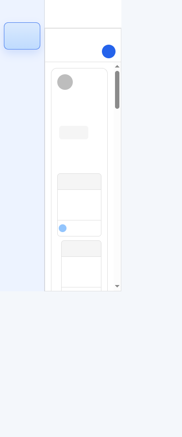
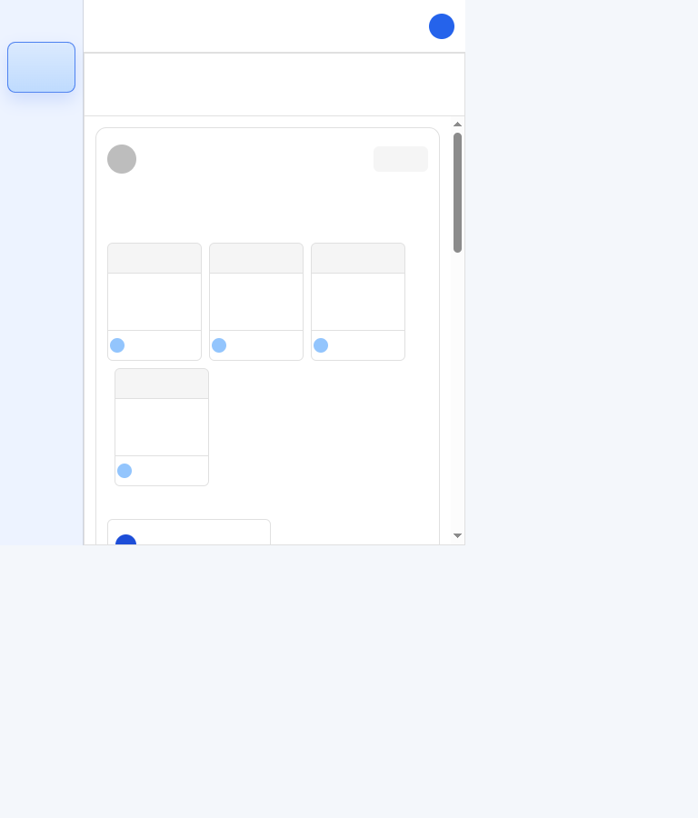
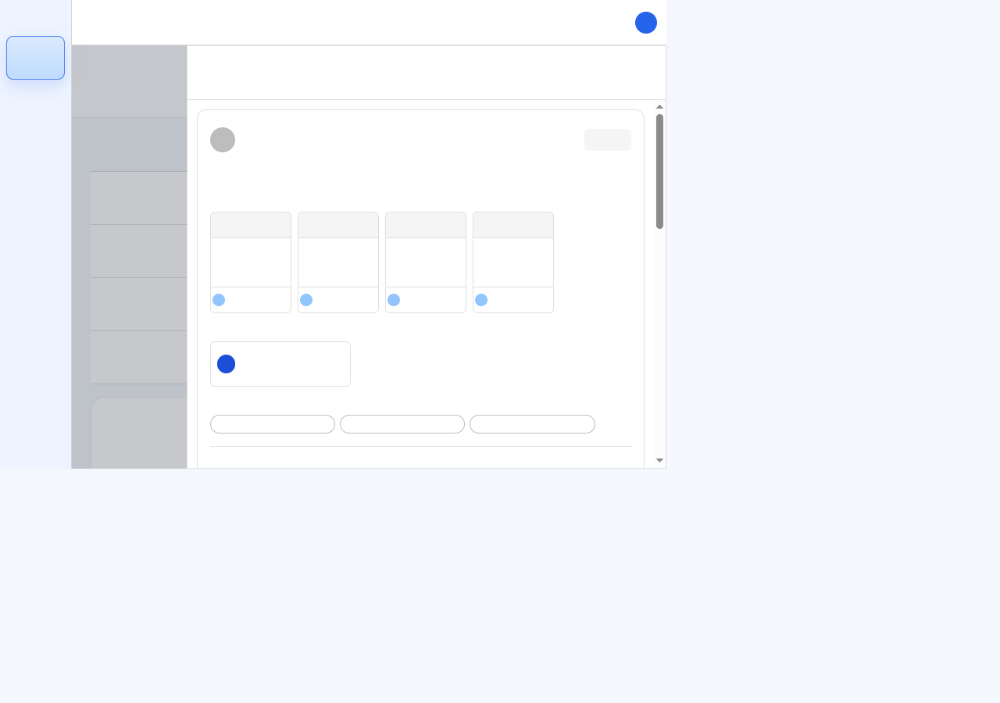

# 공지사항·전자결재 공통 본문 및 상세 UI 결과

## 작업 요약

- 공지사항과 전자결재가 함께 쓰는 표시 전용 `FeedBodyContent`를 추가하고, 두 상세 화면의 본문 접기/펼치기 및 이미지 미리보기 표현을 공통화했다.
- 전자결재의 embedded image는 인증된 Blob URL을 확장 본문 ``에 연결하고, 접힌 상태에서는 제목 없는 미리보기로 표시한다. 이미지 텍스트 placeholder와 별도 `본문 이미지` 제목은 제거했다.
- 읽기 전용 결재 참여자 슬롯을 작성 모달과 같은 `32px 64px 32px` 구조로 맞추고, 결재선 블록 아래 구분선을 추가했다.
- 전자결재 댓글은 초기 3개를 요청하며 이전 커서 페이지는 기존 계약대로 최대 20개를 요청한다.
- API, DB, 결재 권한 및 댓글 mutation 계약은 변경하지 않았다.

## 검증

| 검증 | 결과 |
|---|---|
| `npx vitest run tests/feed-components.test.tsx` | 통과: 22/22 |
| Notice 본문·이미지 선택 테스트 (`tests/notice-page.test.tsx`) | 통과: 4/4 선택, 22개 제외 |
| Approval 결재선·본문 이미지·이전 댓글 테스트 (`tests/document-write-page.test.tsx`) | 통과: 3/3 선택, 59개 제외 |
| `npm run build` | 통과: TypeScript 및 Vite production build |
| 브라우저 상세 레이아웃 | 375px, 768px, 1280px에서 페이지 가로 넘침 없음. 상세 패널의 scrollWidth와 clientWidth 일치 |
| `git diff --check` | 통과 |

기존 전체 기준선 실행에서는 4개 테스트 파일 139개 중 116개 통과, 23개 실패가 기록되어 있었다. 전체 파일 재실행은 하지 않았으며, 이번 변경과 직접 관련된 선택 테스트만 재검증했다. unrelated baseline 실패는 수정하지 않았다.

브라우저 스크린샷은 공유 개발 환경의 문서/댓글 데이터가 저장되지 않도록 화면 텍스트와 이미지를 시각적으로 가린 상태에서 캡처했다. 브라우저에서는 레이아웃과 가로 overflow만 확인했으며, 댓글 이전 페이지 호출은 자동화 테스트로 확인했다.

## 반응형 캡처

| Viewport | Page width / scroll width | Detail panel client / scroll width | Capture |
|---|---:|---:|---|
| 375px | 375 / 375 | 281 / 281 | [approval-feed-375.png](./screenshots/approval-feed-375.png) |
| 768px | 768 / 768 | 551 / 551 | [approval-feed-768.png](./screenshots/approval-feed-768.png) |
| 1280px | 1280 / 1280 | 898 / 898 | [approval-feed-1280.png](./screenshots/approval-feed-1280.png) |

## 변경 파일

- `frontend/src/shared/components/feed/FeedBodyContent.tsx`
- `frontend/src/pages/groupware/community/notice/components/NoticeFeedList.tsx`
- `frontend/src/pages/groupware/documents/write/components/DocumentApprovalDetailFeed.tsx`
- `frontend/tests/feed-components.test.tsx`
- `frontend/tests/document-write-page.test.tsx`
- `docs/directions/20261013/20261013_001_공지사항_전자결재_피드_UI_공통화_작업지시서.md`
- `docs/plan/20261013/20261013_001_공지사항_전자결재_피드_UI_공통화_계획서.md`
- `docs/spec/20261013/20261013_001_공지사항_전자결재_피드_UI_공통화_상세사양서.md`
