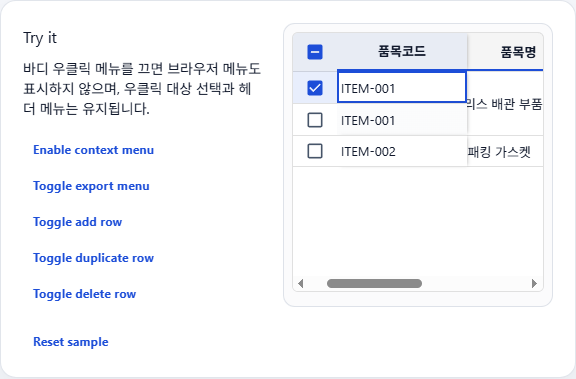

# F1-Grid 컨텍스트 메뉴 전체 비활성화 결과

## 요구사항 및 재현 조건

기존 F1Grid/F1Tree는 바디 영역을 우클릭하면 항상 F1-Grid 컨텍스트 메뉴를 열었다. 행 추가/복사/삭제 등 개별 항목은 제어할 수 있었지만, 화면별로 메뉴 전체를 끌 방법이 없었다.

## 원인과 변경

F1Grid 공통 `openContextMenu`가 우클릭 타겟을 선택한 뒤 항상 메뉴 상태를 설정했고, F1Tree는 해당 F1Grid를 공유했다. 공유 props에 `disableContextMenu?: boolean`(기본값 `false`)을 추가했다. 켜면 기존 이벤트 기본 메뉴 차단과 타겟 선택은 유지하면서 앱 메뉴를 열지 않고, 이미 열린 메뉴/재오픈 타이머도 정리한다. 헤더 메뉴 및 기존 기본 동작은 유지한다.

## 변경 파일

- [grid.types.ts](../../../../frontend/src/shared/components/f1-grid/types/grid.types.ts)
- [F1Grid.tsx](../../../../frontend/src/shared/components/f1-grid/core/F1Grid.tsx)
- [f1-grid-context-menu.test.tsx](../../../../frontend/tests/f1-grid-context-menu.test.tsx)
- [f1-grid-docs.test.tsx](../../../../frontend/tests/f1-grid-docs.test.tsx)
- [f1GridApiReference.ts](../../../../frontend/src/pages/f1-grid-docs/data/f1GridApiReference.ts)
- [f1GridDocs.ts](../../../../frontend/src/pages/f1-grid-docs/data/f1GridDocs.ts)
- [F1GridPlayground.tsx](../../../../frontend/src/pages/f1-grid-docs/components/F1GridPlayground.tsx)
- [F1-GRID.md](../../../../frontend/src/pages/f1-grid-docs/F1-GRID.md)

## 검증

- 회귀 테스트 추가: F1Grid/F1Tree 메뉴 숨김, `contextmenu` 기본 동작 차단, 타겟 선택 유지, 옵션이 동적으로 켜질 때 열린 메뉴 닫힘. Docs Playground에서 메뉴를 끄고 다시 켜는 동작도 검증한다.
- 기준선 테스트(구현 전): 선택한 두 테스트 파일에서 53개 통과, F1Tree 정렬 메뉴(`내림차순 정렬`) 및 필터 메뉴(`필터`)를 찾는 기존 테스트 2개 실패.
- 최종 `npm run test -- tests/f1-grid-context-menu.test.tsx tests/f1-grid-docs.test.tsx`: 57개 통과, 위 기준선과 동일한 기존 F1Tree 테스트 2개 실패. 새 회귀 테스트는 통과했고, 새 실패는 추가되지 않았다.
- `npm run build`: 통과. Vite는 기존 번들 크기 기준(1,000 kB 초과) 경고를 표시했다.
- 변경 파일 대상 `npm run lint -- ...`: 종료 코드 0. F1Grid의 기존 effect/memo 의존성 관련 경고만 출력되었고, 신규 옵션 위치는 경고 대상이 아니었다. `git diff --check`도 통과했다.
- 브라우저 `http://127.0.0.1:4173/f1-grid-docs`: 기존 S-ERP dev server를 재사용했다. 375px, 768px, 1280px 너비에서 Playground 토글이 보이는 것을 확인했다. 비활성 상태에서 우클릭 후 메뉴 수는 0, 타겟 셀의 선택 상태는 `true`였다. 비활성 상태에서도 헤더의 컬럼 메뉴에서 오름차순/내림차순/필터 액션을 확인했다.

## 화면 캡처

비활성화 상태에서 앱 컨텍스트 메뉴 없이 우클릭 대상 셀이 선택된 화면:

## 관련 작업 문서

- [작업지시서](../../../directions/20261016/20261016_003_F1Grid_컨텍스트메뉴_전체비활성화_작업지시서.md)
- [계획서](../../../plan/20261016/20261016_003_F1Grid_컨텍스트메뉴_전체비활성화_계획서.md)
- [상세 사양서](../../../spec/20261016/20261016_003_F1Grid_컨텍스트메뉴_전체비활성화_상세사양서.md)
- [승인된 설계](../../../superpowers/specs/2026-10-16-f1-grid-disable-context-menu-design.md)
- [상세 구현 계획](../../../superpowers/plans/2026-10-16-f1-grid-disable-context-menu.md)
