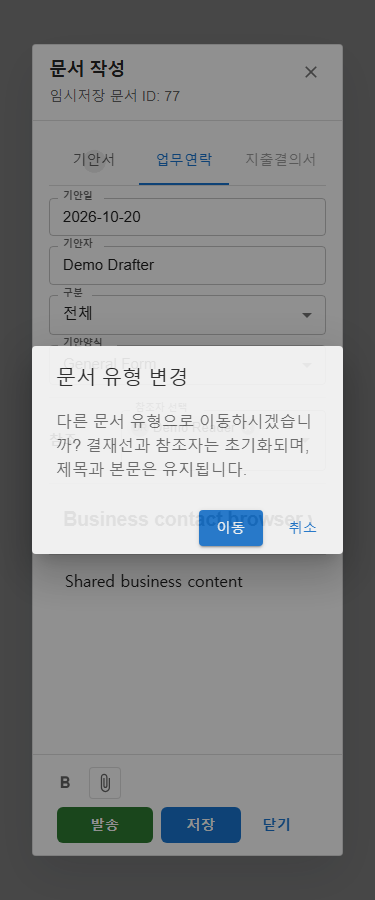
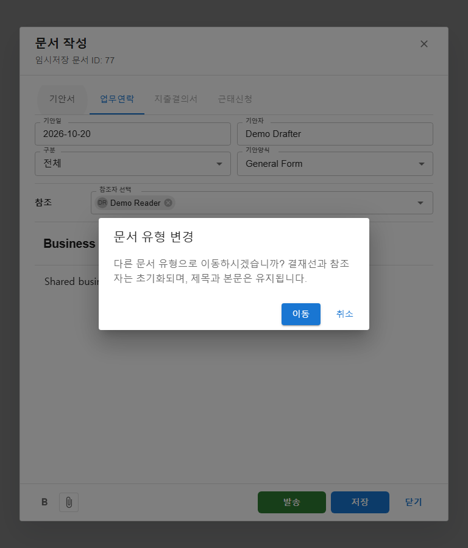
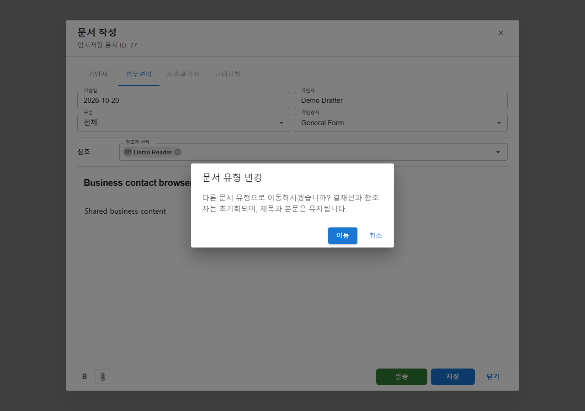
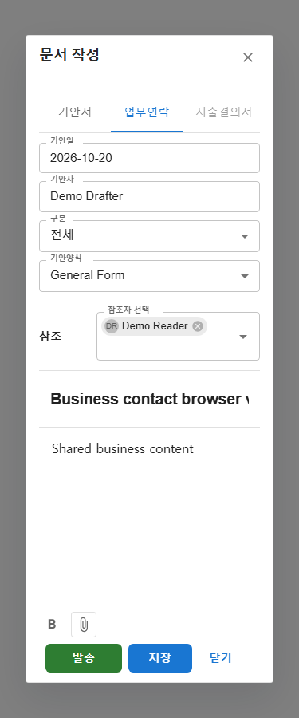
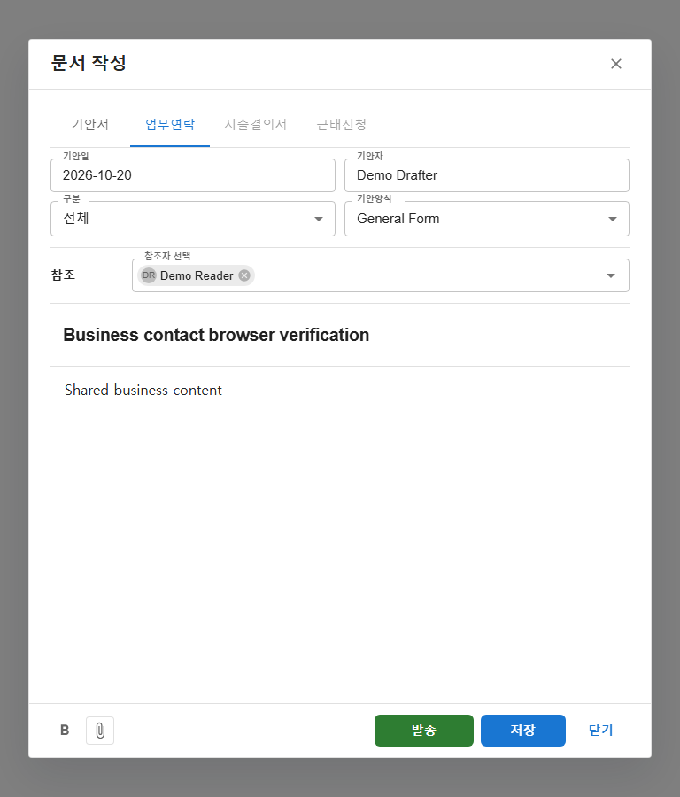
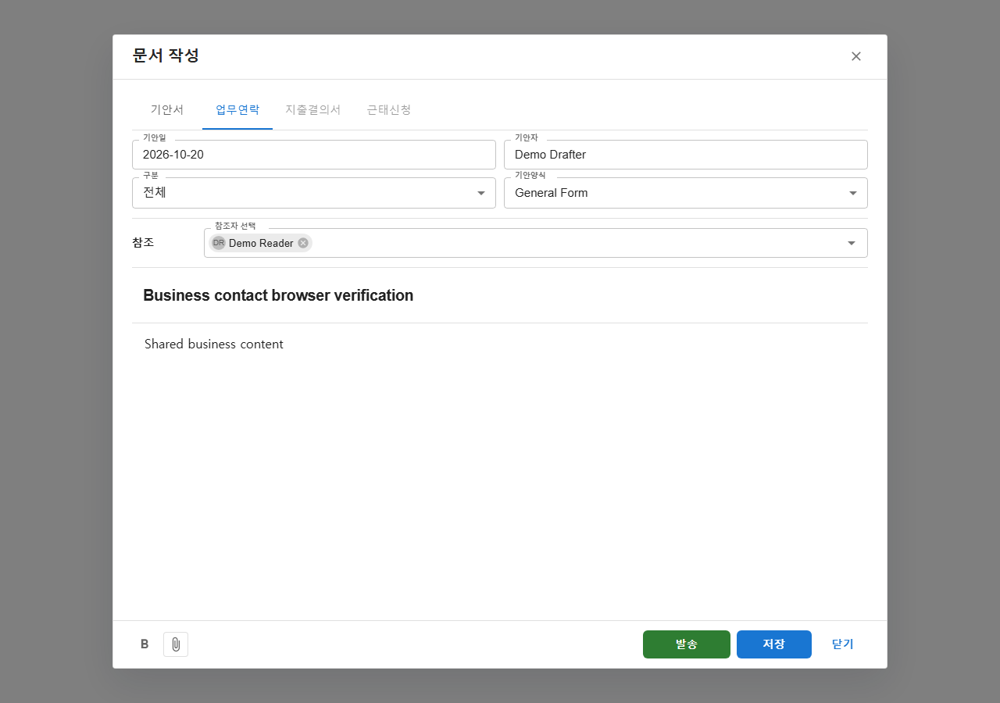

# 업무연락 작성 및 탭 전환 보호 결과

## 요구사항과 구현

- [작업지시서](../../../directions/20261020/20261020_003_business-contact_작업지시서.md)
- [계획서](../../../plan/20261020/20261020_003_business-contact_계획서.md)
- [상세 사양서](../../../spec/20261020/20261020_003_business-contact_상세사양서.md)

상단 기안일/기안자/구분/기안양식을 `DocumentMetadataFields`로 추출했다. 참조 선택은 `DocumentReferenceField`로 추출하여 기안서와 업무연락에서 공유한다.

업무연락에는 결재/합의/결재선 설정 없이 참조자만 표시한다. 참조자 없는 임시저장과 재열기를 지원하며, 발송 시 참조자 1명 이상이 필요하다. 작성자 자신, 중복, 잘못된 순서, 비활성/다른 테넌트 사용자와 결재/합의 행은 서버 검증을 통과할 수 없다.

발송은 기존 submit API에서 BUSINESS_CONTACT 유형을 분기하여 참조 행만 저장하고 즉시 COMPLETED로 전이한다. 참조자의 처리 상태/시각은 null이며 확인/승인을 기다리지 않는다. 기존 COMPLETED 시스템 이벤트에 `업무연락이 발송되었습니다.`를 기록한다. 프론트 서비스 응답 검증도 업무연락의 COMPLETED를 허용하도록 함께 반영했다. 목록/피드/상세/현황에서는 완료 업무연락을 `발송완료`로 표시한다.

## 탭 전환

- 다른 탭 선택 시 수정 여부와 관계없이 항상 이동 확인창을 연다. 신규 작성, 저장 직후, 저장 문서 재열기에 동일하게 적용한다.
- 취소하면 기존 탭과 입력을 보존한다.
- 이동하면 결재/합의/참조자/추가 대기 중인 선택을 초기화한다.
- 기안서로 돌아오면 작성자 기본 단계만 복구한다.
- 제목/본문/양식/첨부/문서 ID는 보존한다. 탭 전환 자체는 양식 본문을 다시 조회하거나 덮어쓰지 않는다.
- 같은 탭 클릭은 무동작이고 초기 로딩/양식 로딩/저장/본문 이미지 업로드 중에는 탭 이동을 차단한다.
- 탭 전환용 snapshot과 저장 기준 추적은 제거했다. 기안양식 본문 교체를 위한 기존 본문 수정 감지는 유지한다.

### 추가 지시 반영: 항상 확인 (2026-10-20)

미수정 상태에서 다른 탭으로 바로 이동하며 결재선/참조선이 초기화되는 현상을 재현했다. 원인은 `requestDocumentKindChange`가 수정 감지 결과에 따라 확인을 생략하고 `applyDocumentKind`를 직접 호출한 것이었다.

이제 유효한 다른 탭 요청은 항상 확인창만 열며, 참여자 초기화는 이동 버튼 승인 후에만 수행한다. 같은 탭 클릭과 로딩/저장/업로드 중 이동 차단은 유지한다.

- 수정 전 저장 업무연락 재열기 테스트: `문서 유형 변경` 확인창을 찾지 못하여 실패함을 확인.
- 수정 후 업무연락 및 인접 기안서 테스트: **14개 통과**, 92개 미선택.
- 변경 훅/테스트 oxlint: 종료 코드 0, 진단 없음.
- `git diff --check`: 통과.
- 이번 전체 빌드는 별도 작업의 `frontend/src/shared/components/view-mode/FileView.tsx` 55/64/99행 MUI prop 타입 오류로 실패했다. 본 수정 파일의 오류는 출력되지 않았으며 무관한 파일은 수정하지 않았다. 아래 최초 구현 당시 빌드 통과 기록과 구분한다.
- 실제 컴포넌트/모의 API 브라우저 검증: 미수정 신규 문서 확인/취소, 저장 직후 확인/취소 후 참조자 유지, 승인 후 초기화, 즉시 역방향 이동도 확인, 제목/본문 유지 및 최종 발송 통과.
- 확인창 clientWidth/scrollWidth: 375px에서 311/311, 768px와 1280px에서 444/444. 페이지 가로 넘침 없음.
- 백엔드/API/DB 변경 없음. 기존 4173 서버를 재사용하고 테스트 브라우저만 종료했다.

## 검증 결과

### 최초 구현 검증 (추가 지시 반영 전)

| 범위 | 결과 |
|---|---|
| 신규 업무연락 및 인접 기안서 작성/양식/저장 테스트 선택 실행 | 13개 통과 |
| 문서 서비스/표시/작성 페이지 훅/참여자 테마 테스트 4개 파일 | 63개 통과 |
| 백엔드 DocumentApprovalServiceImplTest / DocumentApprovalApiControllerTest / DocumentApprovalMapperTest | 90개 통과 |
| 문서현황 페이지 | 9개 통과 |
| 문서현황 서비스 필터 직렬화 재검증 | 1개 통과, 3개 미선택 |
| 최종 `npm run build` | 통과, 기존 대형 청크 경고 유지 |
| 변경 파일 대상 oxlint | 오류 0, 기존 set-state-in-effect 경고 7건 유지 |
| `git diff --check` | 통과 |

주요 회귀 항목은 참조 없이 임시저장, 참조 전용 발송 요청, 기안자 결재 행 없는 문서 재열기, 발송 실패 메시지, 같은 탭 무동작, 이동 취소, 결재/합의/대기 선택/참조 초기화, 제목/본문/양식/첨부 유지, 저장 도중 추가 편집 감지, 기존 기안서 작성자 고정 단계와 결재신청이다.

### 기준 검증의 한계

수정 전 문서작성 전체 테스트에서 20개 실패가 있었다. 버튼 문구/스타일 기대값 불일치와 시간 제한 등이 포함되어 사용자에게 알리고 기존 실패를 보존한 채 진행하도록 승인받았다. 중간 전체 범위 실행에서도 기존 실패와 추가 시간 초과가 있어 전체 프론트 테스트 통과로 보고하지 않는다.

작업 중 공유 폴더의 별도 문서현황 작업도 변경되었다. 한 차례 빌드에서 participantName 필터 타입 불일치가 있었으나 해당 작업 변경이 반영된 뒤 최종 빌드는 통과했다. 본 작업에서 그 필터를 임의로 수정하지 않았다. 기존/동시 작업의 미커밋 변경은 되돌리지 않았다.

## 브라우저 검증

기존 `127.0.0.1:4173` S-ERP Vite 서버를 재사용했다. 실제 작성 모달 컴포넌트를 별도 Playwright 컨텍스트에 마운트하고 API는 전부 모의 응답으로 처리했다. 실제 사용자/테넌트 행이나 운영 문서를 변경하지 않았다.

- 양식 적용 후 탭 전환 취소/승인 및 제목/본문 유지 확인.
- 업무연락에서 결재선 설정이 없고 참조자 미선택 시 발송 비활성 확인.
- 실제 프론트 서비스가 REFERENCE만 발송하고 COMPLETED 응답을 받아 성공 메시지를 표시하는지 확인.
- 모바일 푸터에서 발견한 가로 넘침은 작성 모달 버튼의 모바일 최소 폭을 조정하여 해결했다.

| 뷰포트 | 모달 clientWidth | 모달 scrollWidth | 페이지 scrollWidth |
|---|---:|---:|---:|
| 375px | 309 | 309 | 375 |
| 768px | 702 | 702 | 768 |
| 1280px | 990 | 990 | 1280 |

탭 목록과 긴 제목 입력 내부 스크롤은 의도된 동작이며, 페이지/모달 전체 가로 넘침은 없다.

테스트용 브라우저는 finally에서 종료했다. 기존 개발 서버는 종료하지 않았으며 별도 백엔드 서버 재시작/실DB 발송 테스트는 수행하지 않았다.

## DB MCP 및 스키마

기본 `s-erp-postgresql-readonly` 도구를 직접 사용했다.

1. list_tables
2. describe_table: tb_electronic_approval_main, tb_electronic_approval_line_info, tb_common_comment
3. query_readonly: 위 테이블의 CHECK 제약 메타데이터만 조회, maxRows=30

BUSINESS_CONTACT/REFERENCE/COMPLETED 및 COMPLETED 시스템 이벤트가 현재 DB에서 허용됨을 확인했다. 데이터 행, 자격 증명, 연결 문자열은 조회하거나 기록하지 않았다.

기존 테이블/컬럼/상태/이벤트를 재사용하므로 스키마 변경/마이그레이션/롤백 SQL은 필요하지 않다. 메일/푸시/열람확인/발송취소 및 기존 결재 진행 중 업무연락 데이터의 자동 이관은 범위에 포함하지 않는다.
