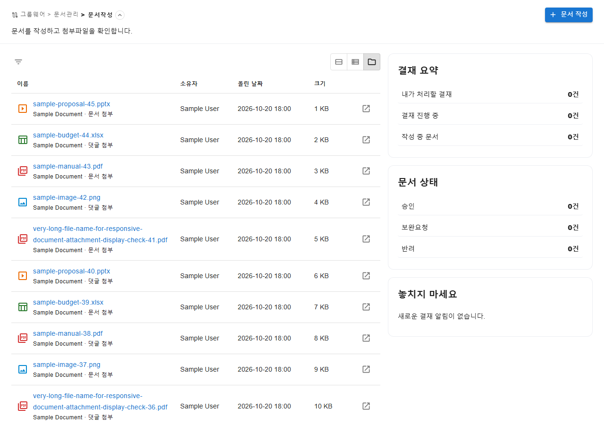
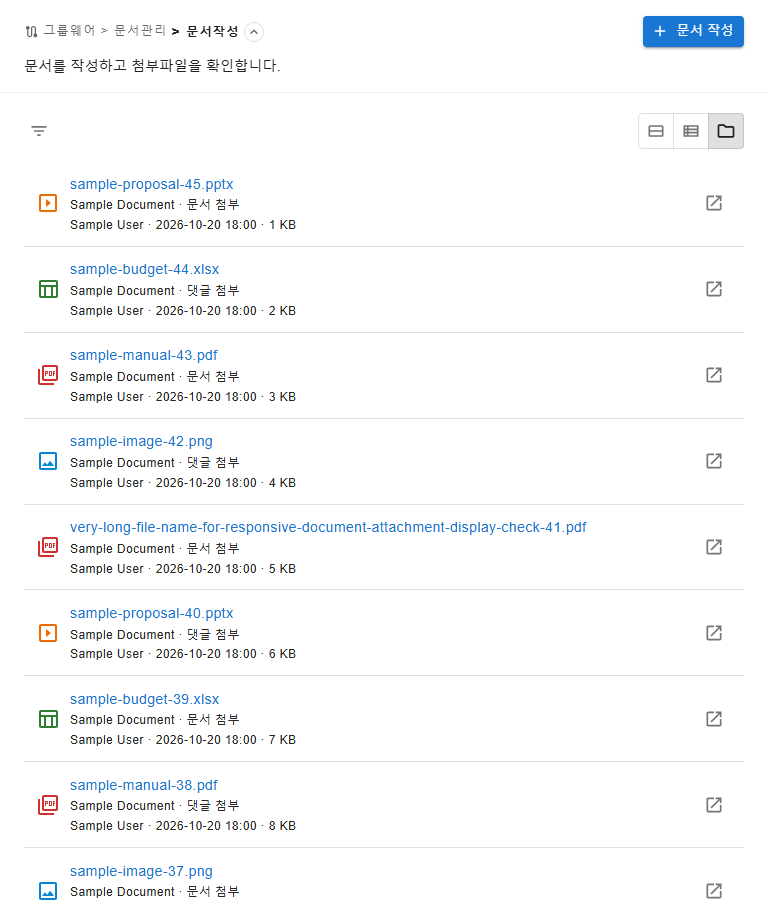
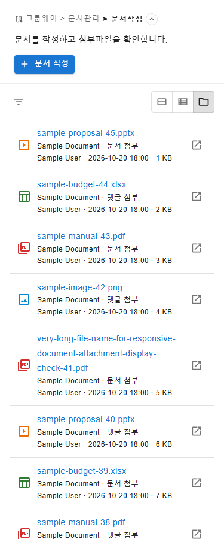
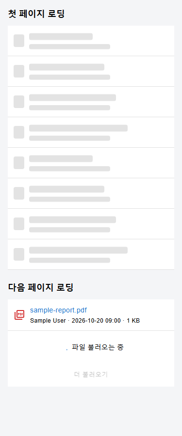
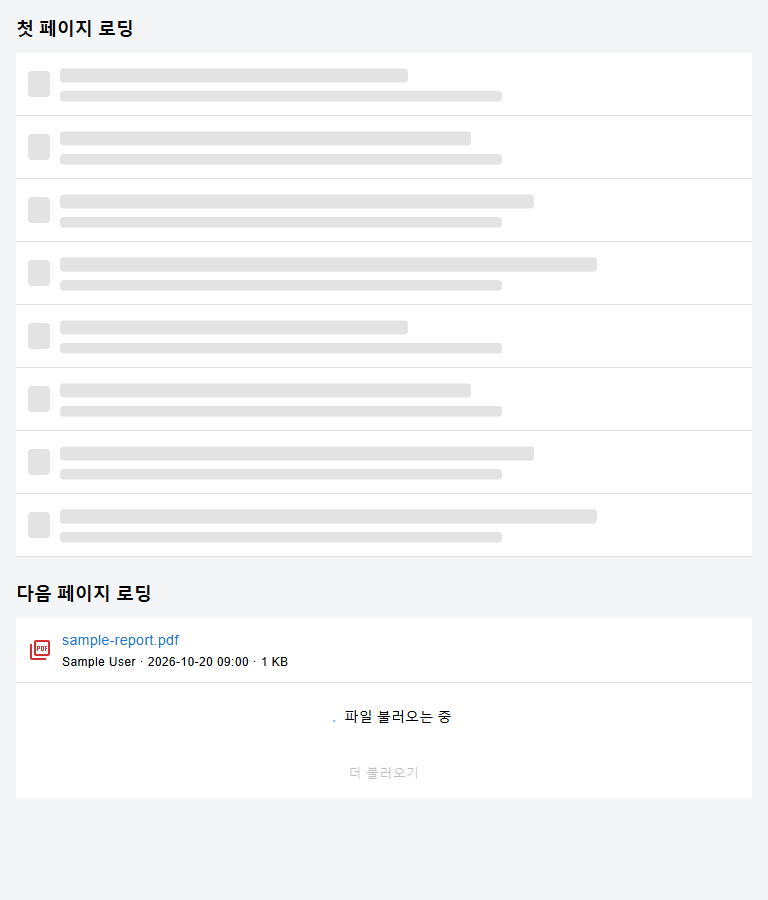
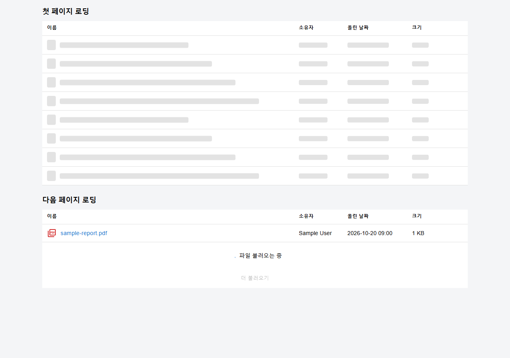
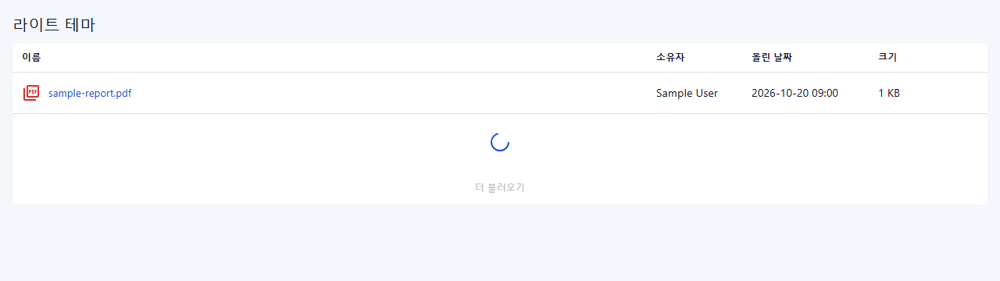
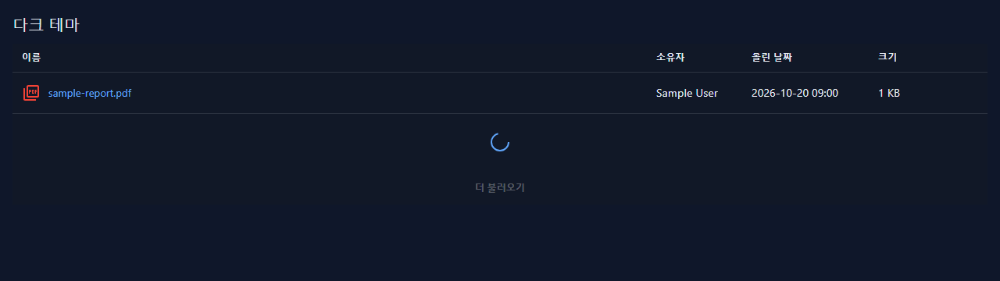

# 문서작성 공통 파일형 보기 작업 결과

## 요구사항과 구현

- [작업지시서](../../../directions/20261020/20261020_005_document-file-view_작업지시서.md)
- [계획서](../../../plan/20261020/20261020_005_document-file-view_계획서.md)
- [상세 사양서](../../../spec/20261020/20261020_005_document-file-view_상세사양서.md)

문서작성에 피드형·리스트형과 나란히 파일형을 추가했다. 다른 페이지에는 명시적으로 활성화하지 않는 한 파일형을 표시하지 않는다.

공통 `FileView`는 파일명·업로더·올린 날짜·크기, 원문 보기, 하단 자동 로딩, 오류 재시도와 목록 새로고침 동작을 제공한다. 모바일에서는 파일 메타정보를 이름 아래로 배치한다.

문서 전용 `DocumentFileList`는 공통 UI의 표시 데이터를 구성하고 기존 문서/댓글 다운로드 함수를 호출한다. `useDocumentFiles`는 페이지와 로딩 상태를 관리하며 요청 중복, 이전 필터 응답 혼입, 마지막 페이지 이후 요청을 방지한다.

서버 `GET /api/v1/groupware/approvals/files`는 문서 및 댓글의 일반 첨부파일을 통합한다. 기존 `relatedDocumentStatusFilters` 및 `documentReadAccess`를 재사용하여 tenant·작성자/참여자 권한·scope·업무구분·선택 문서 조건을 적용한다. 타인의 임시저장, 삭제 문서·댓글·파일 및 본문 이미지는 제외한다.

파일 생성 시각과 ID 내림차순으로 21개를 조회하고 20개만 전달한다. 마지막 노출 파일 ID로 다음 커서를 구성하고 DB 원본 시각을 사용하여 동일 시각 파일과 날짜 정밀도에 따른 페이징 누락을 방지한다.

## DB 확인과 변경 여부

- 기본 읽기 전용 MCP `list_tables` 이후 `describe_table`을 직접 호출했다.
- 확인 테이블: tb_common_file, tb_common_comment, tb_electronic_approval_main, tb_electronic_approval_line_info, tb_user, tb_login_account.
- 테이블·컬럼 메타데이터와 기존 Mapper/업로드 코드를 확인했다. 실사용 데이터 행·인증정보는 조회하거나 기록하지 않았다.
- 테이블·컬럼·인덱스·데이터 마이그레이션 변경은 없다. 신규 날짜별 SQL/롤백은 필요하지 않다.
- 실제 테넌트 데이터로 신규 조회 API를 실행한 검증은 수행하지 않았다.

## 검증

### 백엔드

`backend`에서 다음을 실행했다.

```powershell
mvn '-Dtest=DocumentApprovalMapperTest,DocumentApprovalServiceImplTest,DocumentApprovalApiControllerTest' test -q
```

- Mapper 18개, 서비스 62개, 컨트롤러 15개: 총 95개 통과.
- 신규 쿼리 부재 및 신규 서비스/컨트롤러 메서드 부재로 실패하는 테스트를 먼저 확인한 후 구현했다.
- 문서 읽기 권한 SQL, 첨부 용도/삭제 조건, 생성 시각·ID 커서와 정렬, 21개 조회, 20개 응답/종료, 잘못된 조건·커서 거절, 인증 사용자 전달 및 응답 envelope를 검증했다.

### 프론트엔드

```powershell
npm run test -- tests/document-file-page.test.tsx tests/document-files-hook.test.tsx tests/document-file-service.test.ts tests/file-view.test.tsx tests/common-view-mode.test.tsx tests/document-approval-service.test.ts
npm run build
```

- 파일형 페이지, 서비스, 페이지 상태, 공통 보기 및 기존 문서 서비스 6개 파일의 총 42개 테스트가 통과했다.
- 최초 20개→40개→45개, 중복 요청 방지, 마지막 종료, 필터/새로고침 초기화, 늦은 응답 무시, 추가 조회 오류 시 기존 행 보존 및 같은 커서 재시도를 검증했다.
- 문서/댓글 다운로드 분기, 오류 알림, 원문 상세 연결, 파일형에서 문서 전체 목록 추가 요청 방지, 다른 화면의 토글 기본 동작을 검증했다.
- TypeScript 및 Vite 빌드 통과. 기존 대용량 청크 경고는 유지된다.
- 대상 소스 oxlint 오류는 없으며 기존 상태 관리 패턴의 effect 내 상태 변경 경고가 있다.

### 기존 실패 구분

- 수정 전 기존 문서작성 전체 테스트 실행에서 55개 실패(타임아웃 및 업무연락·상세/댓글 관련 실패 포함)를 확인했다.
- 동일 파일의 다른 문서현황 작업이 진행 중임을 알리고, 사용자가 다른 변경·기존 실패를 보존한 채 파일형만 계속 진행하도록 승인했다.
- 후속 기존 피드·리스트·필터 10개 선별 회귀에서 9개 통과, `clears feed cards when a filter reload fails after a quiet refresh` 1개 실패를 확인했다.
- 해당 실패는 기존 편집 모달의 `취소` 버튼을 찾지 못하는 것으로, 수정 전 전체 테스트에도 같은 종류의 실패가 있었다. 파일형 작업에서 모달 동작이나 테스트를 수정하지 않았다.
- 기존 전체 문서작성 테스트 통과를 주장하지 않는다.

### 브라우저 및 스크린샷

- 기존 S-ERP 4173 개발 서버를 확인하고 재사용했다. 기존 서버는 종료하지 않았다.
- API 모듈을 합성 데이터로 대체한 임시 렌더링 진입점에서 실제 DocumentWritePage와 FileView를 검증했다. 실사용 계정·테넌트 데이터는 사용하지 않았다.
- 통합 브라우저 도구의 탭이 hidden 상태여서 자동 스크롤 검증은 별도 headless Playwright 컨텍스트로 수행했다.
- 1280px에서 자동 스크롤과 오류→재시도로 20→40→45개를 확인했다. 마지막 파일 이후 추가 요청이 없고 파일 ID 45→1이 중복·누락 없이 표시되었다.
- 375px, 768px, 1280px에서 최초 20개를 표시했고 각 화면 document scrollWidth와 clientWidth가 같았다.
- 검증용 임시 HTML/TSX는 삭제했고 별도 headless 브라우저도 종료했다.
- 상세 측정값: [verification.json](verification.json)







## 범위 및 확인 사항

- 기존 미커밋 업무연락/문서현황 변경을 보존했다. 자동 커밋은 하지 않았다.
- 폴더·즐겨찾기·본문 삽입 이미지·일괄 다운로드는 범위에 포함하지 않았다.
- 신규 조회 API의 실데이터 성능과 실행 계획은 이번 합성 데이터 UI/단위 테스트로 측정하지 않았다.

## 후속 수정: 관련 문서·댓글 첨부가 빈 목록으로 조회됨

### 재현 및 원인

- 기존 관련 문서/댓글 API에 일반 첨부가 있으나 파일 전용 ALL 응답은 0개였다.
- `listFiles`가 재사용하는 `actorParams`에는 쓰기 경로용 `documentStatus=DRAFT` 기본값이 있다.
- 파일 쿼리가 재사용한 `relatedDocumentStatusFilters`는 documentStatus가 전달되면 해당 상태만 조회한다.
- 그 결과 ALL도 임시저장 문서로 제한되고, COMPLETED 같은 scope는 DRAFT 조건과 충돌하여 빈 목록이 되었다.
- 최초 합성 UI 검증과 DAO mock 테스트가 실제 actor 파라미터·SQL 결합 문제를 검출하지 못했다.

### 수정 및 회귀

- `listFiles`에서만 documentStatus 기본값을 제거했다. actorParams 자체나 문서 쓰기/기존 조회 경로는 변경하지 않았다.
- 파일 조회 및 다음 페이지 커서 권한 검사에서 documentStatus가 전달되지 않는지 서비스 회귀 테스트에 추가했다.
- 수정 전 파일 서비스 테스트 3개 중 2개 실패를 확인하고 수정 후 관련 백엔드 회귀를 실행했다.
- 최종 백엔드 회귀: 컨트롤러 15개·Mapper 19개·서비스 62개, 총 96개 통과 및 BUILD SUCCESS를 확인했다.
- 사용자가 백엔드를 재시작한 후 현재 로그인 세션의 실제 API를 읽기 전용으로 재확인했다.
- 관련 문서 직접 첨부와 댓글 첨부를 파일 ID로 내부 비교해 누락·추가 없이 일치함을 확인했다. 파일명·본문·작성자·계정/tenant 정보는 기록하지 않았다.
- 직접 첨부 3개, 댓글 첨부 7개, 총 10개가 조회되었다. ALL 10개, DRAFT 0개, COMPLETED 1개, REJECTED 9개이며 생성 시각/ID 최신순을 확인했다.
- 화면에 `내가 처리할 결재` 등 활성 scope 필터가 남아 있으면 해당 조건을 만족하는 파일만 표시되는 기존 필터 정책은 유지한다.
- DB MCP list_tables, describe_table(파일·댓글), 소유 유형/용도별 COUNT 집계를 통해 계약을 재확인했다. DB 데이터·스키마 변경은 없다.
- 이 수정은 백엔드 조회 조건에만 적용된다. 새 실사용 데이터 스크린샷은 저장하지 않았으며 UI 구조 검증은 위 합성 데이터 스크린샷을 따른다.

## 후속 표시 조정

- 파일형 마지막 페이지 하단의 `모든 파일을 불러왔습니다.` 안내 문구를 제거했다.
- 파일형 목록 루트 배경을 `common.white`로 지정해 머리글/행 영역이 흰색으로 표시되도록 조정했다.
- 자동 페이지 종료, hover, 빈 목록/오류/로딩 동작은 유지했다.
- 검증: `npm run test -- tests/file-view.test.tsx tests/document-file-page.test.tsx` (6개 통과)

## 후속 초기 로딩 스켈레톤

- 파일형 첫 페이지 조회 중에는 머리글을 유지하고 파일 행 형태의 스켈레톤 8개를 표시한다.
- 다음 페이지 조회 중에는 이미 표시된 파일 행을 유지하고 기존 하단 진행 표시를 사용한다.
- 오류, 빈 결과, 마지막 페이지, 재시도, 새로고침, 자동 페이지 로딩 및 흰색 배경 동작은 변경하지 않았다.
- 테스트 우선 확인: 초기 로딩 스켈레톤 검증은 수정 전 구현에서 실패했고, 추가 페이지 로딩 중 기존 행 유지 검증은 통과했다.

### 검증

```powershell
npm run test -- tests/file-view.test.tsx tests/document-file-page.test.tsx
npm run build
```

- `file-view.test.tsx` 5개와 `document-file-page.test.tsx` 2개, 총 7개 테스트 통과.
- 첫 병렬 검증에서는 production build와 동시 실행 중 문서 페이지 테스트 1개가 5초 제한으로 타임아웃됐다. 해당 파일을 단독 재실행해 2개 모두 통과했고, 두 파일의 대상 테스트를 다시 실행해 종료 코드 0을 확인했다.
- `npm run build`의 TypeScript 및 Vite production build 통과. 기존 대용량 청크 경고는 표시되었다.
- 실제 FileView를 합성 데이터로 375px·768px·1280px에서 확인했다. 각 너비에서 스켈레톤 8개, 페이지 전체 가로 넘침 없음, 흰색 목록 배경, 추가 조회 중 기존 파일 행과 진행 표시를 확인했다.
- 375px·768px에서는 기존 모바일 레이아웃에 맞춰 파일명/행 형태를 표시했고, 1280px에서는 머리글과 이름·소유자·올린 날짜·크기 열 정렬을 확인했다.
- 검증용 미리보기 파일은 삭제했다. 실제 사용자·테넌트 파일 데이터는 사용하지 않았다.







## 후속 페이징 스피너 및 다크테마 가독성

- 다음 파일 페이지 조회 중에는 이미 표시된 파일 행을 유지하고, `파일 불러오는 중` 안내 텍스트 대신 primary 색상의 로딩 스피너만 표시한다.
- 진행 상태는 `role="status"`와 `파일 페이지 불러오는 중` 접근성 이름을 제공하고 스피너는 progressbar로 노출한다.
- 라이트 테마의 파일 목록 배경은 기존 흰색을 유지하며, 다크 테마는 앱의 `background.paper` 표면색을 사용한다.
- 앱 테마 팔레트의 본문/보조 텍스트와 primary 링크·스피너 색상을 사용해 다크 표면에서 파일 정보와 진행 상태가 보이도록 했다.
- 초기 8행 스켈레톤, 오류/빈 상태, 재시도, 자동 페이징 및 백엔드 계약은 변경하지 않았다.

### 검증

```powershell
npm run test -- tests/file-view.test.tsx tests/document-file-page.test.tsx
npm run build
```

- 추가 전 회귀 테스트 2개가 실패해 기존 문제(페이징 진행 텍스트 및 다크 모드의 고정 흰 배경)를 재현했다.
- `file-view.test.tsx` 7개와 `document-file-page.test.tsx` 2개, 총 9개 테스트가 통과했다.
- `npm run build`에서 TypeScript와 Vite production build가 통과했다. 기존 1000 kB 초과 청크 경고가 표시되었다.
- 합성 FileView 화면을 라이트/다크 각각 375px·768px·1280px에서 확인했다. 모든 조합에서 페이지 가로 넘침이 없고, 파일 행과 스피너가 표시되며 페이징 중 로딩 텍스트는 보이지 않는다.
- 라이트 배경 `rgb(255, 255, 255)`, 라이트 스피너 `rgb(29, 78, 216)`, 다크 표면 `rgb(17, 24, 39)`, 다크 스피너 `rgb(96, 165, 250)`를 확인했다.
- 스크린샷은 합성 파일 정보만 포함한다. 캡처의 원형 진행 표시만 정지 프레임으로 고정했으며 실제 UI 스피너 애니메이션은 변경하지 않았다.
- 검증용 임시 미리보기 파일을 삭제했고 공유 4173 개발 서버는 종료하지 않았다.




