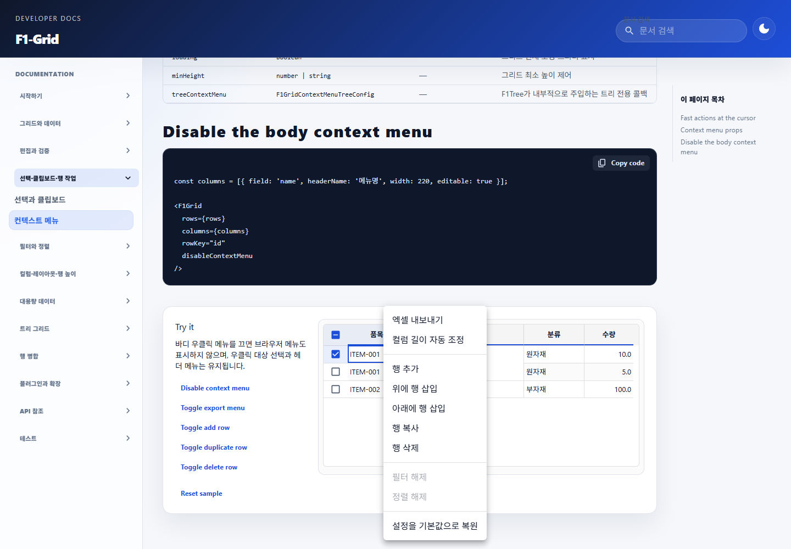

# F1-Grid Excel 타입별 내보내기 결과

## 변경 내용

- Excel 내보내기 시 컬럼 타입에 맞는 셀 값을 기록한다.
  - `number`, `decimal`, `currency`, `rownumber`: 숫자 셀
  - `date`, `datetime`: 날짜 셀
  - `time`: Excel 시간 serial 및 시간 표시 형식
  - `checkbox`: Boolean 셀
  - 그 외 타입: 기존 화면 표시 텍스트
- 숫자 자릿수, KRW 통화, 날짜 형식을 Excel 표시 서식으로 적용하며, 계산 가능한 셀 값 타입은 유지한다.
- 빈 값은 빈 셀로 두고 변환할 수 없는 값은 원문 텍스트로 보존한다.
- date-only 값은 문자열에 기재된 날짜를 유지해 시간대 변환으로 날짜가 달라지지 않게 한다. 날짜 화면 표시와 내보내기는 공통 변환 함수를 사용한다.
- F1-Grid 사용 문서에 타입별 값, 표시 형식 및 fallback 계약을 추가했다.

## 브라우저 확인

- `http://127.0.0.1:4173/f1-grid-docs`의 컨텍스트 메뉴 예제를 열고 샘플 행을 우클릭해 `엑셀 내보내기` 메뉴 항목이 표시되는 것을 확인했다.
- 1440 × 1000 뷰포트에서 캡처했다. 이번 변경은 레이아웃 변경이 아니다.

## 검증

| 항목 | 명령 | 결과 |
| --- | --- | --- |
| 내보내기·날짜·문서 테스트 | `npm run test -- tests/f1-grid-excel-export.test.ts tests/f1-grid-date-format.test.tsx tests/f1-grid-docs.test.tsx` (`frontend`) | PASS: 3개 파일, 62개 테스트 |
| 프론트엔드 빌드 | `npm run build` (`frontend`) | PASS. 번들 크기 경고가 표시됨 |

## 기존 기준 실패 및 빌드 이력

- 작업 전 기준 실행에서 관련 Grid/context-menu 테스트 4개 파일의 239개 테스트 중 48개가 실패했다. `f1-grid.test.tsx`의 46개와 `f1-grid-context-menu.test.tsx`의 2개 실패는 DOM/가상 스크롤 및 기존 기대와 현재 동작의 불일치로 확인했다. `f1-grid-date-format.test.tsx` 23개와 문서 테스트는 통과했다. 사용자의 결정에 따라 이 기존 실패는 이번 범위에서 수정하지 않았다.
- 중간 `npm run build` 실행에서 작업 범위 밖인 `DocumentApprovalDetailFeed.tsx`의 `isPinned` 타입 오류가 보고됐으나, 후속 빌드에서는 재현되지 않았고 최종 빌드는 통과했다. 이 작업에서는 해당 파일을 수정하지 않았다.

## 범위

- 프론트엔드 내보내기, 날짜 유틸리티, 관련 테스트와 문서만 변경했다.
- 백엔드/API/DB 변경은 없다.
