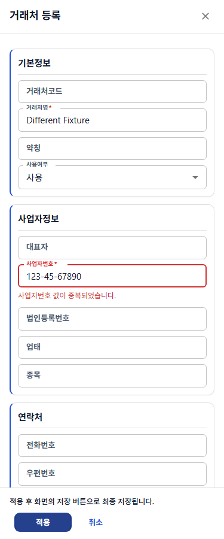
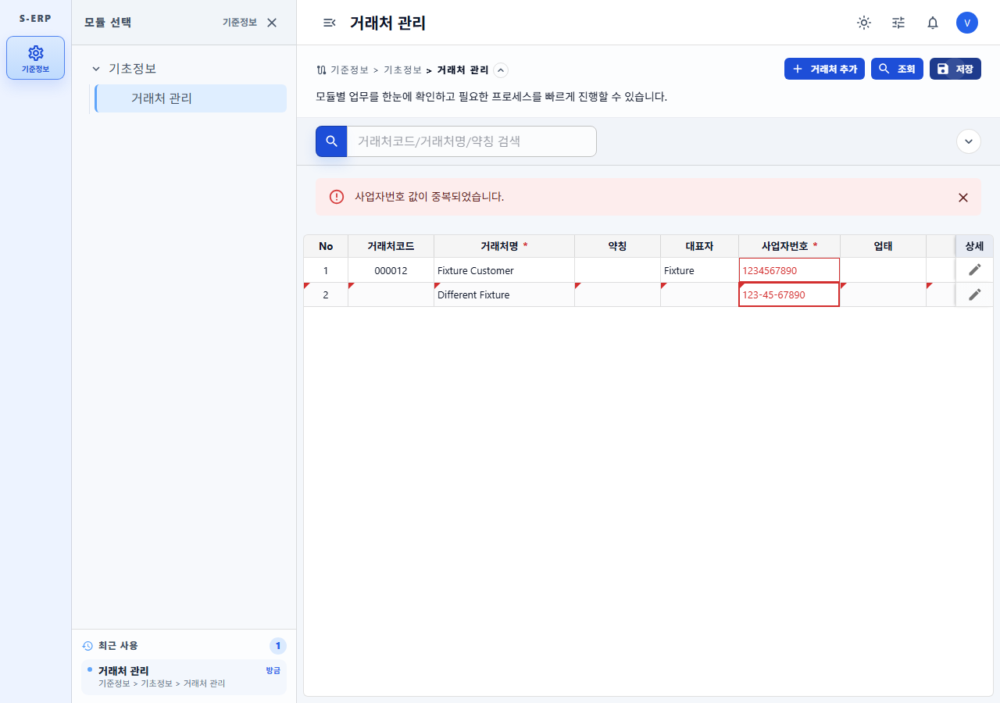

# 사업자번호 공통 중복 검증 결과

## 요구사항 및 구현

- [작업지시서](../../../directions/20261023/20261023_005_사업자번호_중복검증_작업지시서.md) → [계획서](../../../plan/20261023/20261023_005_사업자번호_중복검증_계획서.md) → [상세 사양서](../../../spec/20261023/20261023_005_사업자번호_중복검증_상세사양서.md) 순서로 진행했다.
- 원인: 거래처명만 `validation.unique`를 선언했고, 기존 공통 비교는 문자열 trim만 지원했다. 사업자번호 서버 조회와 번호 고유 인덱스도 없었다.
- F1-Grid `validation.unique?: boolean | 'digits'`를 제공한다. 기존 true/false 동작을 유지하며 digits는 ASCII 숫자만 비교하고 앞자리 0을 보존한다. 인덱스 생성과 draft 조회가 동일한 정규화를 사용한다.
- 거래처 사업자번호에 `validation: { unique: 'digits' }`를 선언했다. 필수·10자리 검증은 유지한다. 폼 적용과 최종 저장 모두 공통 검증으로 차단하며 상단 오류와 빨간 입력란/셀을 표시한다.
- 같은 tenant의 사용/미사용 전체를 비교하고 수정 자기 행은 제외한다. 서버 검색 결과 밖의 데이터는 백엔드가 확인한다. 프론트 비교는 로드된 활성 행 전체를 대상으로 한다.
- 백엔드 등록/수정 시 숫자키 사전 조회를 수행하고, 동시 저장의 신규 인덱스 충돌을 `이미 사용 중인 사업자번호입니다.`로 분류한다. 저장 표기는 기존대로 유지한다.
- 기존 서버의 NULL/빈 번호 선택 입력 계약은 변경하지 않았다. 숫자가 없는 키는 고유성 검사에서 제외한다. 별도의 서버 필수·자리수 정책 변경은 범위 밖이다.
- F1-Grid 가이드/API 참조, OpenAPI 설명, 누적 스키마 문서를 갱신했다.

## DB 확인 및 미적용 상태

- 기본 `s-erp-postgresql-readonly` MCP를 직접 list_tables → describe_table(tb_customer_info) → pg_indexes 제한 조회 순서로 사용했다.
- business_no는 nullable varchar였다. 기본 DB에 거래처명·사업자번호 고유 인덱스는 없고 tenant/code 고유 인덱스는 있었다. 이전 tenant 전용 DB 근거와 동일한 DB 계약으로 간주하지 않았다.
- 업무 데이터 행·자격 증명은 조회하지 않았다. 기존 중복 데이터 유무는 미확인이다.
- [migration/이력/rollback](../../../database/20261023/20261023_002_change_customer_business_no_unique.md)을 [backend 사본](../../../../backend/DATABASE/20261023)과 동일하게 작성했다.
- 인덱스는 `(tenant_id, regexp_replace(business_no, '[^0-9]', '', 'g'))`이며 빈 숫자키와 NULL을 제외한다. 사용여부 조건은 없다.
- 잠금 후 기존 중복이 있으면 값을 출력하지 않는 오류로 전체 중단한다. 자동 데이터 수정·삭제는 하지 않는다.
- **실제 DB에는 적용하지 않았다.** 실제 PostgreSQL DDL 실행과 동시 세션 테스트는 수행하지 않았다. SQL 테스트는 사본 일치와 계약 문자열 검증이다. 배포 시 인덱스를 적용하기 전에는 사전 조회만으로 동시 중복을 완전히 방어하지 못한다.
- 기존 순차 배치 저장 방식은 유지한다. 두 행 사이 번호 교환이나 뒤에서 비워질 번호의 선행 재사용을 별도 허용하는 변경은 하지 않았다.

## 검증 결과

| 검증 | 결과 |
| --- | --- |
| RED: 공통 digits 비교·거래처 metadata | 구현 전 실패 확인 |
| RED: 서버 번호 사전 조회/저장 표기/충돌 분류 | 서비스 구현 전 22개 중 4개 실패 확인 |
| 백엔드 CustomerInfoServiceImplTest / BatchServiceImplTest / ApiControllerTest / SchemaTest | **51개 통과** |
| 프론트 최초 관련 7파일 회귀 | **129개 통과, 기존 모달 크기 테스트 1개 제외** |
| 최종 관련 7파일 회귀 | **129개 통과, 동시 작업에서 추가된 동적 폼 라벨 테스트 1개 실패, 기존 모달 크기 테스트 1개 제외** |
| 최종 거래처 화면·고유값 검증 부분 | 위 최종 실행에서 **24개 모두 통과** |
| 변경 TS/TSX oxlint | 오류 없음, 기존 CustomerGrid Fast Refresh 경고 2개 |
| 전체 npm run build | **차단**: 동시 수정 중인 품목관리 MaterialGrid.tsx:65의 `align` TS2339 |
| 실제 Chromium 375 / 768 / 1280px | 3개 모두 폼 중복 오류·빨간 테두리·다른 번호 적용·인라인 중복 저장 차단·저장 API 호출 0회 확인 |
| 페이지 가로 overflow | 각 viewport의 document scrollWidth가 375 / 768 / 1280px로 일치 |
| git diff --check | 통과 |

### 실행 명령과 한계

백엔드:

```powershell
Set-Location backend
mvn '-Dtest=CustomerInfoServiceImplTest,CustomerInfoBatchServiceImplTest,CustomerInfoApiControllerTest,CustomerInfoSchemaTest' test
```

프론트:

```powershell
Set-Location frontend
& .\node_modules\.bin\vitest.cmd run tests\f1-grid-unique-validation.test.tsx tests\customer-management-page.test.tsx tests\f1-grid-input-format-validation.test.ts tests\customer-number-input.test.ts tests\customer-management-service.test.ts tests\f1-grid-form-modal.test.tsx tests\f1-grid-docs.test.tsx '--testNamePattern=^(?!.*renders fixed modal regions)' --maxWorkers=1 --testTimeout=15000
npm run build
```

- 같은 화면 테스트가 기본 5초 제한으로 간헐적으로 timeout되어 최종 실행만 CLI timeout을 15초로 지정했다. 테스트 소스와 assertion은 완화하지 않았다.
- 최종 실패한 `resolves dynamic form labels from the current row`는 이번 작업 중 다른 변경에서 추가된 테스트다. 기대 문자열 대신 label 함수를 반환한다. 번호 검증과 관계없는 폼 라벨 기능은 수정하지 않았다.
- 기존 `renders fixed modal regions, responsive grid span contracts, and final-save guidance`는 이전 검증에서 확인된 CommonDialog 크기 계약 불일치로 제외했다.
- 전체 빌드의 품목관리 오류도 이번 변경 밖이므로 수정하지 않았다. 따라서 전체 통합 검증이 모두 통과한 상태라고 보고하지 않는다.
- MUI select out-of-range 경고는 기존 테스트에서 지속되었다.

## 브라우저 근거

- 기존 S-ERP 서버 `http://127.0.0.1:4173`의 응답/제목을 확인하고 재사용했다. 기존 서버는 종료하지 않았다.
- 격리된 Playwright context에서 합성 인증과 API fixture만 사용했다. 모든 API를 가로채 실제 업무 데이터 읽기/쓰기는 하지 않았다.
- 미사용 fixture 번호 `1234567890`에 대해 신규 draft `123-45-67890`을 중복 처리했다. 다른 번호 적용 후 인라인으로 같은 숫자키를 넣으면 기존/신규 두 셀에 오류가 생기고 최종 저장 API는 호출되지 않았다.
- 테스트용 browser context/browser는 종료했고 임시 스크립트는 제거했다.

| 화면 크기 | 폼 적용 차단 | 최종 저장 차단 |
| --- | --- | --- |
| 375px | [폼](screenshots/form-duplicate-375.png) | [그리드](screenshots/save-duplicate-375.png) |
| 768px | [폼](screenshots/form-duplicate-768.png) | [그리드](screenshots/save-duplicate-768.png) |
| 1280px | [폼](screenshots/form-duplicate-1280.png) | [그리드](screenshots/save-duplicate-1280.png) |





## 최종 체크

- [x] 작업지시서 → 계획서 → 사양서 → 구현 순서 준수
- [x] F1-Grid 공통 기능 및 거래처·서버 검증 연결
- [x] 필수·자리수·기존 이름/코드 검증 보존
- [x] 번호 정규화·앞자리 0·자기 ID·저장 표기·배치 rollback 검증
- [x] SQL/이력/rollback 두 사본과 누적 스키마 문서 갱신
- [x] MCP 근거·미확인 항목·미적용 상태 명시
- [x] 3개 viewport 실제 브라우저 검증 및 스크린샷
- [x] 무관한 동시 변경 보존
- [ ] 전체 빌드와 동시 수정 중인 폼 라벨 테스트 통과: 다른 작업 범위 오류로 차단
- [ ] 실제 DB migration 적용 및 동시 저장 검증: 사용자 승인 범위에 따라 미실행
