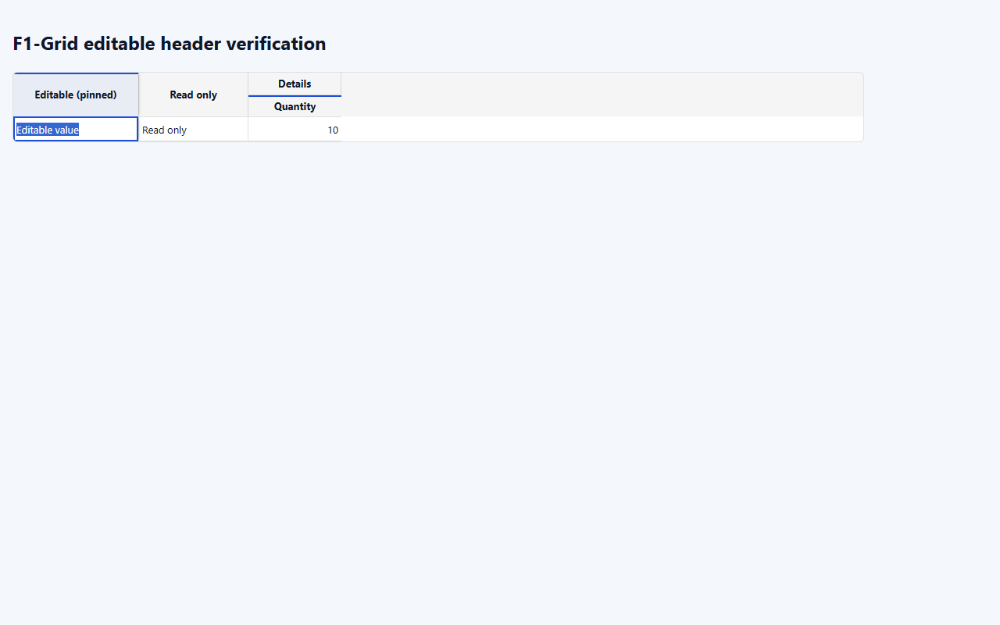

# F1-Grid 편집 가능 헤더 상단 강조 결과

## 요구사항 및 구현

- [작업지시서](../../../directions/20261023/20261023_001_F1Grid_편집헤더_상단강조_작업지시서.md)
- [계획서](../../../plan/20261023/20261023_001_F1Grid_편집헤더_상단강조_계획서.md)
- [상세 사양서](../../../spec/20261023/20261023_001_F1Grid_편집헤더_상단강조_사양서.md)

### 재현 조건과 원인

편집 가능 컬럼 헤더의 하단 2px 강조 border와 첫 행 셀의 편집 테두리가 맞닿아 선이 겹쳐 보였다.

### 해결

- 사용자가 선택한 상단 안쪽 `inset box-shadow`로 강조선을 이동했다.
- 기존 `primary.main` 색상과 2px 두께, 편집 가능 판정을 유지했다.
- 하단 강조 border는 제거했다. 실제 border를 추가하지 않아 추가적인 헤더 레이아웃 공간을 차지하지 않는다.
- 고정 컬럼 그림자와 드롭 대상 그림자를 합성하고 그룹 헤더의 divider를 보존했다.
- 공통 사용 문서, 문서 화면의 안내 데이터, 관련 테스트를 함께 갱신했다.
- 백엔드/API/DB는 변경하지 않았으므로 DB MCP 및 SQL 스크립트는 대상이 아니다.

## 검증

### 자동화

- 변경 전 새 상단 강조선 검증 4건이 모두 예상대로 실패했다. 기존 구현에는 inset 강조선이 없었다.
- 선별 회귀 실행: **9건 통과**, 나머지 227건 제외.
  - `node .\node_modules\vitest\vitest.mjs run tests\f1-grid.test.tsx tests\f1-grid-docs.test.tsx tests\f1-grid-form-modal.test.tsx --testNamePattern='F1-GRID custom cell rendering|documents column render hooks|shadow' --reporter=dot`
  - 라이트/다크 테마, 일반/그룹 헤더, 좌/우 고정 그림자, 읽기 전용 제외, 드롭 대상 그림자와 강조선 합성, 문서 안내를 확인했다.
- `npm run build`: **통과**. 번들 크기 경고가 출력되었다.
- 확대 실행: 문서/폼 모달 테스트 **73건 통과, 2건 실패**.
  - 문서 검색 테스트 `searches F1GridColumn.search and opens its API reference row`: 5초 타임아웃. 단독 재실행은 통과했다.
  - 폼 모달 테스트 `renders fixed modal regions, responsive grid span contracts, and final-save guidance`: 기존 모달의 `maxHeight: 85vh`, `maxWidth: 960px` 기대와 실제 스타일 불일치. 이번 헤더 스타일 변경 범위 밖이므로 수정하지 않았다.
- 구현 변경 전 실행된 전체 기본 그리드 테스트에도 새 테스트 4건 외 46건의 실패가 있었다. 전체 테스트가 통과했다고 판단하지 않는다.

### 실제 브라우저

기존 4173 S-ERP 개발 서버를 재사용했다. 로그인/업무 데이터를 사용하지 않고 실제 공통 F1Grid 컴포넌트를 브라우저 임시 검증 영역에 렌더링했다.

- 375/768/1280px에서 셀을 실제 편집 상태로 전환한 뒤 상단 강조선과 하단 border 0px를 확인했다.
- 좌측 고정 헤더 그림자와 그룹 헤더의 기존 상단 divider 1px를 확인했다.
- 각 뷰포트에서 문서 너비가 각각 375/768/1280px임을 확인했다. 좁은 화면에서는 그리드 내부 가로 스크롤을 사용한다.
- 기존 서버는 종료하지 않았다.
- 작업 중 다른 작업의 수정이 공통 코드 및 문서에 추가된 것을 확인했으며 해당 변경을 되돌리거나 수정하지 않았다.

## 스크린샷

- [모바일 375px 편집 상태](screenshots/editing-375.png)
- [태블릿 768px 편집 상태](screenshots/editing-768.png)
- [데스크톱 1280px 편집 상태](screenshots/editing-1280.png)

