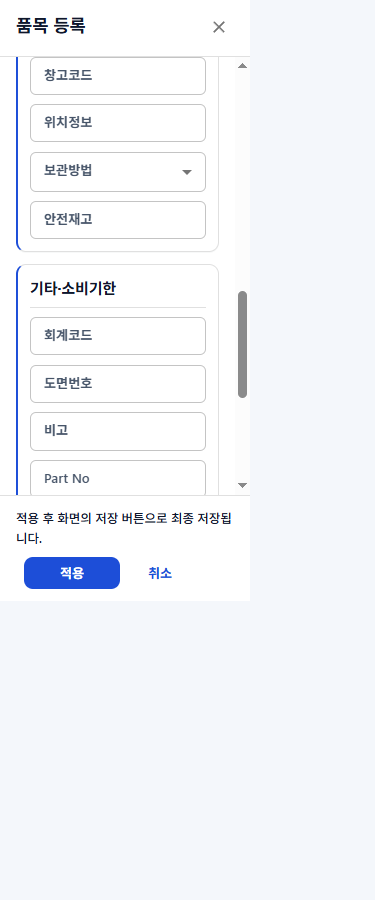
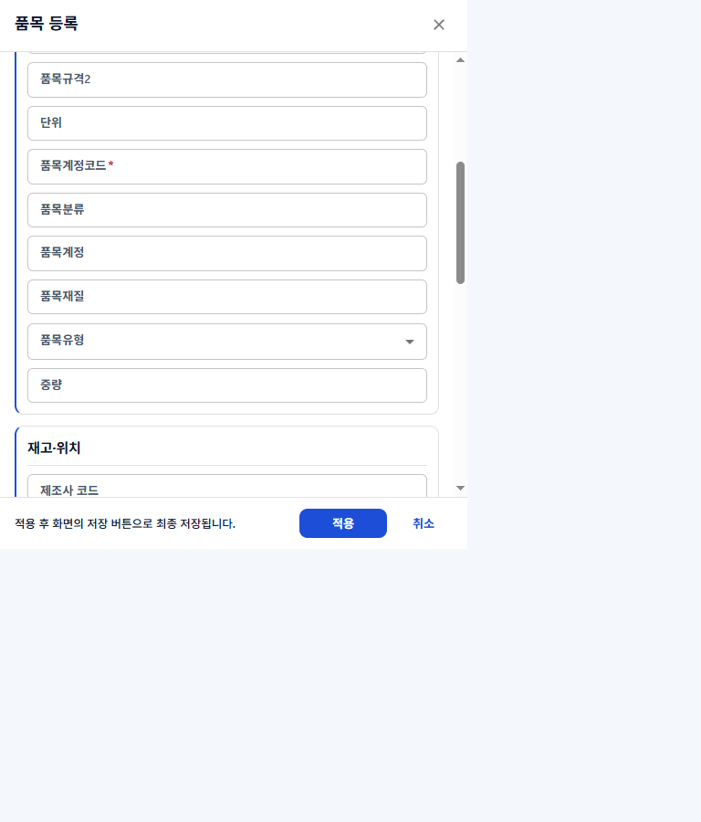
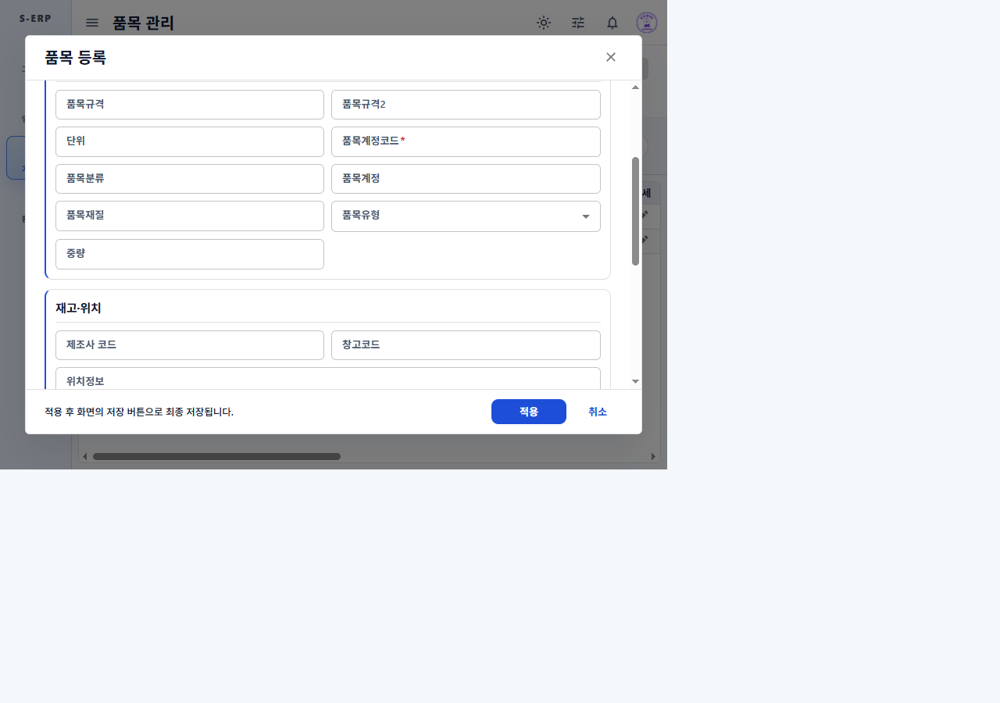

# 품목관리 공통코드·소비기한 입력 결과

## 기준 문서

- [작업지시서](../../../directions/20261023/20261023_004_품목관리_공통코드_소비기한입력_작업지시서.md)
- [계획서](../../../plan/20261023/20261023_004_품목관리_공통코드_소비기한입력_계획서.md)
- [상세 사양서](../../../spec/20261023/20261023_004_품목관리_공통코드_소비기한입력_상세사양서.md)
- [F1-Grid 안내](../../../../frontend/src/pages/f1-grid-docs/F1-GRID.md)

## 구현 결과

### 공통코드 시드

품목관리에서 사용하는 그룹 3개와 상세코드 12개를 tenant 지정 INSERT 스크립트로 작성했다.

| 그룹 코드 | 그룹명 | 상세코드 |
| --- | --- | --- |
| `MATERIAL_TYPE` | 품목 유형 | `TYPE_01`, `TYPE_02`, `TYPE_03` |
| `STORE_METHOD` | 보관 방법 | `ROOM`, `AMBIENT`, `REFRIG`, `FROZEN`, `ROOM_OPEN_REFRIG` |
| `EXPIRY_STATUS` | 소비기한 기준 | `NONE`, `DAY`, `MONTH`, `YEAR` |

- [배포용 시드 SQL](../../../../backend/DATABASE/20261023/20261023_004_seed_material_common_codes.sql)과 [문서용 시드 SQL](../../../../docs/database/20261023/20261023_004_seed_material_common_codes.sql)을 동일하게 유지한다.
- psql 변수 `target_tenant_id`로 적용 대상을 정하고, 자연 키 충돌 시 기존 그룹·상세코드 정의를 덮어쓰지 않도록 했다.
- 적용 예: `psql -v target_tenant_id=1110011111 -f 20261023_004_seed_material_common_codes.sql`
- 이 작업에서는 MCP 및 실제 S-ERP DB에 시드나 스키마 SQL을 실행하지 않았다.

### 소비기한 입력

- 기준과 숫자 입력을 폼에서 인접하게 배치하고, 기준에 따라 숫자 입력 단위를 `일`·`개월`·`년`으로 표시한다.
- `NONE` 선택 시 숫자 값을 비우고 입력을 비활성화한다. `DAY`/`MONTH`/`YEAR`에서는 양의 정수를 입력하도록 프론트엔드·백엔드 검증을 맞췄다.
- 기존 `expiryedStatus`/`expiryedCount` API와 DB 필드를 유지했다.
- PostgreSQL 쌍 제약, 변경 이력과 롤백 SQL을 추가했으며, 변경 스크립트·이력은 [docs/database](../../../../docs/database/20261023)와 [backend/DATABASE](../../../../backend/DATABASE/20261023)에 각각 보관했다.

## 검증

| 검증 | 결과 |
| --- | --- |
| F1-Grid·품목관리 집중 테스트 | 2개 파일, 64개 통과 |
| 프론트엔드 빌드 | `npm run build` 성공 |
| 프론트엔드 린트 | `npm run lint` 종료 코드 0; 기존 경고 출력 |
| 백엔드 품목 서비스 테스트 | 13개 통과 |
| 공통코드·스키마 정적 테스트 | 5개 통과 |
| 실제 브라우저 반응형 확인 | 375px, 768px, 1280px에서 소비기한 입력 배치 및 페이지 가로 넘침 확인 |

브라우저에서는 소비기한 기준을 `일`로 선택하고 숫자 `30`을 입력한 상태로 확인했다. 375px에서는 두 필드가 세로로 쌓였고, 768px·1280px에서는 같은 행에 배치됐다. 각 뷰포트의 문서 `scrollWidth`는 뷰포트 폭과 같았다. 캡처 시 폼 적용이나 최종 저장은 실행하지 않았다. 빌드에는 기존 대형 번들 경고가 있었고, 테스트에는 기존 MUI select 범위 경고가 출력됐다.

## 스크린샷

| 뷰포트 | 캡처 |
| --- | --- |
| 375px |  |
| 768px |  |
| 1280px |  |

## 최종 확인

- [x] 지정한 공통코드 그룹 3개와 상세코드 12개를 tenant 지정 스크립트에 반영했다.
- [x] 소비기한 기준별 라벨·입력 활성상태와 숫자 검증을 구현했다.
- [x] DB 제약 및 롤백을 두 스키마 이력 경로에 기록했고, 실제 DB에는 적용하지 않았다.
- [x] 집중 테스트, 빌드, 린트, 백엔드 테스트, SQL 정적 테스트를 실행했다.
- [x] 수정된 필드 순서로 375px·768px·1280px 화면을 다시 확인하고 캡처했다.
- [x] 결과 문서와 스크린샷을 저장했다.
