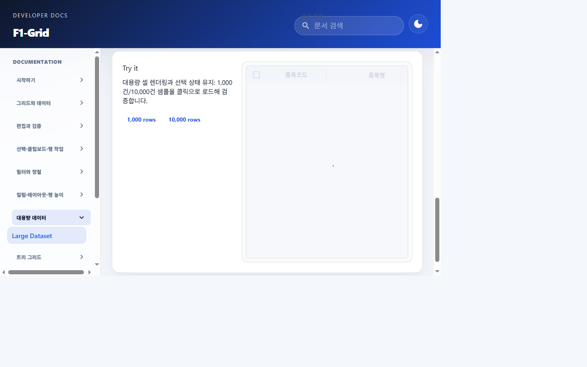

# F1-Grid 조회 데이터 표시 시점 정합 결과

## 요청 및 원인

품목관리·거래처 관리의 최초 조회에서 로딩 스피너가 사라진 다음 빈 그리드가 잠깐 보이고 데이터가 뒤늦게 나타나는 현상을 개선했다.

페이지 조회 훅은 API 응답으로 `rows`와 `loading=false`를 함께 반영한다. 공통 F1-Grid는 외부 `rows`를 내부 편집 모델에 passive `useEffect`로 동기화해, 업데이트가 완료되기 전 빈 그리드가 페인트될 수 있었다.

## 변경 내용

- [F1Grid.tsx](../../../../frontend/src/shared/components/f1-grid/core/F1Grid.tsx)의 외부 `rows` 동기화 effect를 `useLayoutEffect`로 변경했다. 비교, dirty row 처리, 저장 행 확정, 데이터 소스 재기준화, 선택·포커스 처리 및 dependency 배열은 유지했다.
- [f1-grid.test.tsx](../../../../frontend/tests/f1-grid.test.tsx)에 로딩 중 빈 행에서 조회 행과 `loading=false`를 함께 반영하는 경우, 그리고 기존 행에서 빈 결과와 로딩 종료를 함께 반영하는 경우를 확인하는 동기식 회귀 테스트를 추가했다. 테스트는 passive effect가 실행되기 전, 로딩 완료 업데이트가 반환될 때 행과 overlay 상태가 함께 반영됐는지 확인한다.
- [F1-GRID.md](../../../../frontend/src/pages/f1-grid-docs/F1-GRID.md)에 조회 결과 행이 브라우저 페인트 전에 내부 모델에 반영된다는 계약을 추가했다.
- 페이지별 API·로딩 계약, 저장 정책, 백엔드 및 DB는 변경하지 않았다.

## 검증

### TDD

- RED: `npx vitest run tests/f1-grid.test.tsx -t 'commits fetched rows before the loading-complete update returns'`
  - 구현 전 `expected undefined to be 'FETCHED'`로 실패했다. 로딩 완료 업데이트 반환 시점에 gridcell이 아직 없는 것을 확인했다.
- GREEN: `npx vitest run tests/f1-grid.test.tsx -t "commits fetched and empty rows before loading-complete updates return"` 실행에서 확장된 회귀 테스트 통과(1 passed).

### 자동화 테스트

- `npx vitest run tests/f1-grid.test.tsx -t 'commits fetched rows before|uses the thinner shared spinner|does not recurse when a parent recreates equivalent row arrays'`
  - 통과: 3 tests.
- `npm run test -- tests/f1-grid-render-performance.test.tsx tests/f1-grid-row-merge-regression.test.tsx`
  - 통과: 22 tests.
- `npm run test -- tests/material-management.test.tsx tests/customer-management-page.test.tsx`
  - 통과: 42 tests.
- 수정 전 기준선으로 전체 `tests/f1-grid.test.tsx`를 실행했을 때 161개 중 46개가 실패하고 115개가 통과했다. 가상 행 스크롤, 높이 스타일, 숫자 편집기 및 기타 기존 동작 실패가 포함되어 있어 전체 파일을 수정하거나 범위를 넓히지 않았다. 수정 후에는 위와 같이 이번 동기화 및 관련 회귀 범위를 집중 검증했다.
- 변경 후 전체 파일을 다시 실행했을 때 162개 중 46개 실패, 116개 통과였으며 새 조회 행/빈 결과 회귀 테스트는 통과했다. 실패 수는 변경 전 기준선과 같아 전체 파일을 통과한 것으로 간주하지 않았다.

### 빌드 및 lint

- `npm run build`: TypeScript 빌드 및 Vite 프로덕션 빌드 통과. 기존 번들 1,000 kB 초과 안내가 출력됐다.
- `npx oxlint src/shared/components/f1-grid/core/F1Grid.tsx tests/f1-grid.test.tsx`: exit code 0. F1Grid의 effect state update 및 hook dependency 관련 비차단 경고 10건이 출력됐다. 이번 변경에서는 경고 suppressions를 추가하지 않았다.
- `git diff --check`: 공백 오류 없음.

### 브라우저

- 공유된 품목관리 화면을 새로고침해 결과 목록이 표시되는 상태를 확인했다. 브라우저 뷰포트 375px, 768px, 1280px에서 페이지 전체 가로 overflow가 없고 그리드가 표시되며 로딩 overlay가 없는 것을 확인했다.
- 실제 품목관리 화면은 업무 데이터를 포함하므로 데이터가 보이는 스크린샷은 저장하지 않았다. 화면 새로고침 후 계측 샘플링이 첫 로딩 프레임을 놓쳐, 업무 화면에서 스피너 제거와 데이터 표시가 같은 첫 프레임인지 직접 포착하지는 못했다.
- 별도 F1-Grid 문서의 로컬 합성 대용량 예제에서 1280px 로딩 overlay와 스피너를 확인하고 캡처했다. 샘플 로딩 중 overlay가 보이고 합성 행 반영 후 사라지는 것을 확인했다. 이 캡처는 업무 데이터가 없는 합성 화면이며 실제 품목/거래처 응답을 재현한 것은 아니다.

## 결과 및 제한

공통 그리드의 새 외부 행 동기화가 내부 데이터 반영 전 브라우저가 페인트하지 않도록 바뀌었다. 변경된 테스트에서 로딩 종료와 새 행의 동기화 시점을 검증했고, 품목·거래처 페이지 테스트와 그리드 성능·병합 회귀 및 프로덕션 빌드가 통과했다.

전체 F1-Grid 테스트 파일에는 변경 전부터 46개 실패가 관찰됐다. 실제 업무 화면의 로딩 종료 프레임은 브라우저에서 직접 캡처하지 못했으며, 업무 데이터 보호를 위해 해당 화면 스크린샷을 결과물에 저장하지 않았다.

## 관련 문서

- [작업지시서](../../../directions/20261026/20261026_004_f1-grid_data_loading_sync_작업지시서.md)
- [계획서](../../../plan/20261026/20261026_004_f1-grid_data_loading_sync_계획서.md)
- [상세 설계](../../../superpowers/specs/2026-10-26-f1-grid-data-loading-sync-design.md)
- [구현 계획](../../../superpowers/plans/2026-10-26-f1-grid-data-loading-sync.md)
