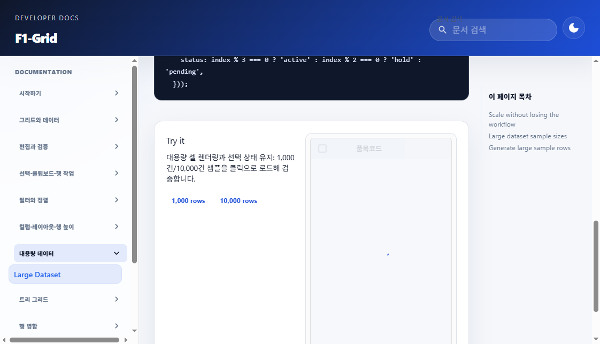

# 공통 로딩 스피너 MUI 애니메이션 복구 결과

## 원인 및 수정

- `frontend/src` 전체 검색에서 다른 전역 CSS의 `CircularProgress`/SVG stroke override는 발견되지 않았다.
- 원인은 `AppLoadingSpinner`에 직접 추가되어 있던 `styled(CircularProgress)` 규칙이었다. Circle에 `animation: none`과 사용자 정의 `strokeDasharray`를 넣어 MUI indeterminate의 dash keyframe을 비활성화했고, 그 결과 spinner가 고정된 부분 호처럼 보였다.
- Custom styled wrapper를 제거하고 MUI `CircularProgress`를 `variant="indeterminate"`로 명시했다. 이제 MUI 기본 circle dash 애니메이션과 root 회전을 사용한다.
- 기본 34px·2.4px, Dashboard 첫 접속 34px·3.6px, F1Grid/F1Tree 34px·2.4px 및 기존 props/로딩 흐름은 변경하지 않았다.
- F1-Grid 사용자 문서와 날짜별 작업지시서·계획서·상세사양서를 수정된 동작에 맞췄다.

## 브라우저 검증

F1-Grid 대용량 예제에서 1,000 rows 로딩을 트리거하고 progressbar 스타일을 확인했다.

| 항목 | 관찰 결과 |
|---|---|
| 크기 | 34px |
| 두께 | `stroke-width="2.4"` |
| circle 애니메이션 | MUI keyframe `animation-1o38n3e` |
| root 회전 | MUI keyframe `animation-61bdi0` |
| custom `animation: none` override | 없음 |
| MUI dash keyframe | 존재 (`stroke-dasharray`의 1px→100px→1px 변화) |

짧은 간격의 관찰에서 dash 길이는 `1.10718px, 200px` → `1.43321px, 200px` → `1.98461px, 200px`로 변했다. 이는 MUI 기본 indeterminate 애니메이션의 정상적인 원호 변화이며, 고정된 별도 스피너가 적용된 것이 아니다. 캡처는 애니메이션의 초기 단계라 호가 매우 짧게 보인다.

공유 브라우저에서 실제 업무 조회 버튼을 반복 실행하는 추가 검증은 수행하지 않았다. 확인 가능한 활성 로딩 화면은 F1-Grid 문서 대용량 예제였다.

## 자동 검증

| 검증 | 결과 |
|---|---|
| `npm run test -- tests/app-loading-spinner.test.tsx` | 통과: 3 tests |
| `npx vitest run tests/f1-grid.test.tsx tests/f1-tree.test.tsx -t "matches the shared app spinner\|same loading spinner as F1Grid"` | 통과: 2 focused tests |
| `npx vitest run tests/f1-grid-docs.test.tsx --testTimeout 15000` | 통과: 30 tests |
| `npm run build` | 통과: TypeScript 및 Vite production build |
| `git diff --check` | 통과 |

빌드에는 기존 대형 청크 경고가 있었으며 빌드 오류는 발생하지 않았다.
