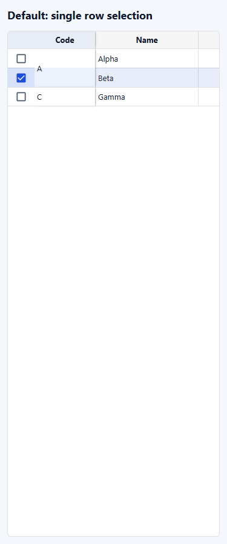
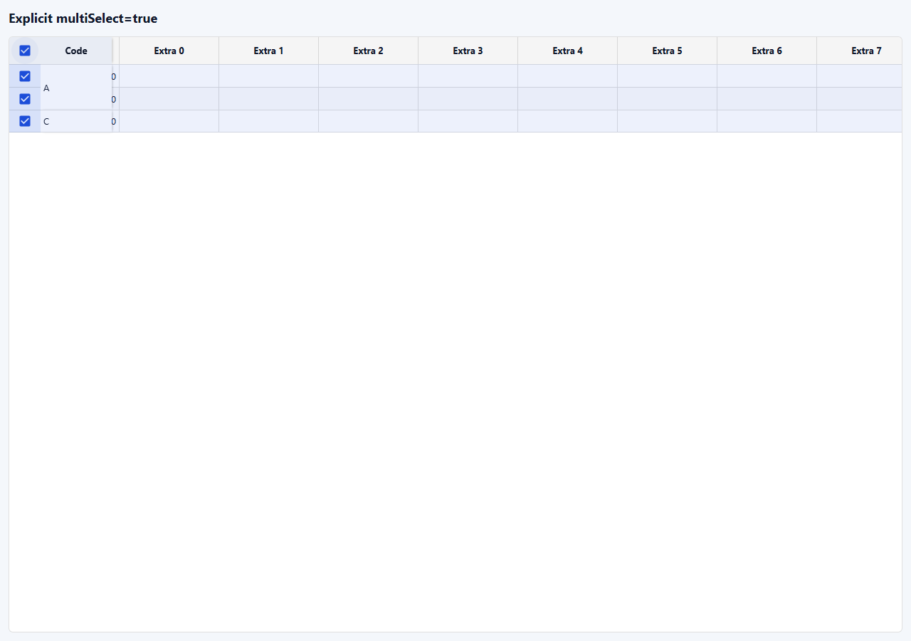

# F1-Grid 다중 행 선택 옵션 결과

## 요구사항과 반영

근거: [작업지시서](../../../directions/20261027/20261027_011_f1grid-multi-select_작업지시서.md), [계획서](../../../plan/20261027/20261027_011_f1grid-multi-select_계획서.md), [상세 사양서](../../../spec/20261027/20261027_011_f1grid-multi-select_상세사양서.md).

공통 `multiSelect?: boolean`을 추가했고 기본값은 **false**다. 수주현황·문서현황을 포함해 옵션을 생략한 화면은 최대 한 행만 선택한다. 다중 작업이 필요한 화면은 명시적으로 활성화한다.

```tsx
<F1Grid
  rows={rows}
  columns={columns}
  rowKey="id"
  selectionMode="row"
  multiSelect
/>
```

| 구분 | 기본값 / false | true |
|---|---|---|
| 일반·Ctrl·Command·Shift 클릭 | 클릭 대상 한 행으로 교체 | 기존 일반/토글/연속 범위 |
| row 모드 Shift 위/아래 | 이동한 한 행 선택 | 연속 행 범위 |
| 행 checkbox | 이전 선택 대체, 재클릭 해제 | 추가/해제 |
| 헤더 행 전체 선택 | 컨트롤 숨김, 컬럼 폭 유지 | 기존 전체 선택/해제 |
| 초기/ref 복수 IDs | 표시 순서 첫 유효 행만 선택 | 유효 행 모두 |
| true→false→true | 첫 선택 행만 남기고 나머지 복구 안 함 | 새 다중 선택 가능 |

옵션 전환 시 자식/선택 콜백에 다중 상태가 노출되기 전에 정규화한다. 전체 선택의 제외 행도 고려해 첫 유효 선택 행을 유지한다. ref 조회·행 강조·행 복사/삭제는 같은 선택 상태를 사용한다.

`selectionMode`는 표시/복사 단위, `multiSelect`는 선택 행 수로 독립적이다. 기존 셀 직사각형 범위 선택·복사/편집, 데이터 checkbox의 `headerCheckbox` 일괄 편집, F1Tree 내부 `treeCheckbox` 부모·자식 값 전파는 유지했다.

## 변경 범위

- 공통 Grid 타입, F1Grid 선택 입력/초기·ref·옵션 전환, GridHeader 행 전체 선택 표시.
- `f1-grid-row-selection.test.tsx`의 명시적 다중 opt-in 및 기본값/전환/데이터 checkbox 회귀.
- 공통 [F1-GRID](../../../../frontend/src/pages/f1-grid-docs/F1-GRID.md) 문서, 포털 API/선택 예제와 공개 API 목록 회귀.
- 개별 업무 화면에 임의로 다중 선택을 켜지 않았다. 병행 거래처/품목 분류·수주 상세 변경을 보존했다.

## 검증

| 실행 | 결과 |
|---|---|
| 구현 전 전용 테스트 | 5 실패 / 11 통과. Ctrl/Shift·checkbox 헤더·초기 복수 ID·옵션 전환에서 요구한 실패 확인 |
| 선택/엔진/렌더 성능/고정 범위/병합/트리/문서 포털/문서현황 8개 파일 | 123 통과 |
| 최종 전용 테스트(전체 선택 제외 행 및 데이터 headerCheckbox 회귀 추가) | 18 통과 |
| 수주현황 페이지 전체 파일 최종 단독 실행 | 11 통과 |
| `npm run build` | 성공, exit 0 |
| 변경 TS/TSX 7개 파일 oxlint | exit 0, 오류 0. 기존 effect/deps/refs 경고 12개 유지 |
| 변경 추적 파일 `git diff --check` | 통과 |
| 실제 Chromium 375/768/1280px | 각 폭 기본 단일/명시 다중·checkbox·ref·Ctrl/Command/Shift·키보드·복사·옵션 전환 통과 |

확장 실행에서 병행 수주 상세 편집 테스트의 저장 후 상세 영역 확인이 한 번 실패했다(전용 테스트와 함께 실행: 28 통과/1 실패). 해당 테스트 단독 재실행 1 통과, 이후 수주현황 전체 파일 재실행 11 통과를 확인했으며 관련 업무 코드는 수정하지 않았다. 전용 옵션 테스트는 실패하지 않았다.

브라우저는 기존 `127.0.0.1:4173` S-ERP 서버를 재사용했다. 앱 시작 모듈과 업무 API를 차단하고 합성 데이터로 실제 공통 F1Grid를 마운트했다. 페이지 수평 넘침·브라우저 오류는 모든 폭에서 없었다. 브라우저/context는 종료했고 기존 서버는 유지했다.

## 스크린샷

| 폭 | 기본 단일 / Shift 이동 | 기본 checkbox·ref 축약 | 명시적 다중 / 내부 가로 스크롤 |
|---|---|---|---|
| 375 | [이미지](screenshots/375-default-single.png) | [이미지](screenshots/375-default-checkbox-ref.png) | [이미지](screenshots/375-explicit-multi-scrolled.png) |
| 768 | [이미지](screenshots/768-default-single.png) | [이미지](screenshots/768-default-checkbox-ref.png) | [이미지](screenshots/768-explicit-multi-scrolled.png) |
| 1280 | [이미지](screenshots/1280-default-single.png) | [이미지](screenshots/1280-default-checkbox-ref.png) | [이미지](screenshots/1280-explicit-multi-scrolled.png) |





## 완료 점검

- [x] 작업지시서 → 계획서 → 상세 사양서 → 구현 순서.
- [x] 공통 Grid 문서/API와 결과/스크린샷 9개 동시 반영.
- [x] 회귀/빌드/린트 및 실제 브라우저 세 폭 확인.
- [x] 최소 범위 유지, 병행 변경 보존, 커밋/푸시 없음.
- [x] 백엔드/DB/SQL/API 데이터 계약 변경 없음. DB MCP/SQL/스키마 이력 대상 아님.
