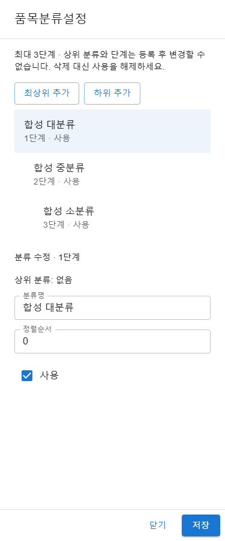
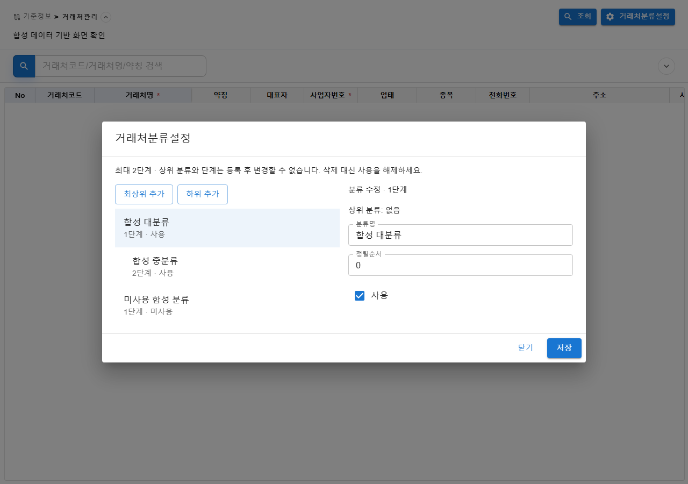

# 20261027_003 품목·거래처 분류관리 API/UI 결과

## 구현 범위

- [작업지시서](../../../directions/20261027/20261027_003_품목_거래처_분류관리_API_UI_작업지시서.md) → [계획서](../../../plan/20261027/20261027_003_품목_거래처_분류관리_API_UI_계획서.md) → [상세사양서](../../../spec/20261027/20261027_003_품목_거래처_분류관리_API_UI_상세사양서.md)를 기준으로 구현했다.
- 품목관리 우측 헤더의 **품목분류설정**, 거래처관리의 **거래처분류설정**에서 공통 설정 다이얼로그를 연다.
- 품목 3단계, 거래처 2단계의 목록 조회, 최상위/하위 추가, 이름·정렬순서·사용여부 수정을 지원한다. 부모와 레벨은 등록 후 변경하지 않으며 물리 삭제는 제공하지 않는다.
- 해당 메뉴의 CREATE 또는 UPDATE 권한으로 버튼을 표시한다. CREATE는 추가, UPDATE는 기존 분류 편집에만 적용하고 별도 tenant-admin 역할을 요구하지 않는다.
- **기존 품목·거래처 마스터 자체의 등록/수정에 있던 `isTenantAdmin` 조건은 변경하지 않았다.** 이번 역할 조건 제거는 새 분류 설정 기능에 한정된다.
- 마스터 입력 폼의 분류 선택/저장 연결, 분류 검색, 데이터 backfill, DDL 적용은 이번 범위가 아니다.

## API 및 데이터 보호

| API | 권한 | 응답 |
|---|---|---|
| `GET /api/v1/co/master/classifications/items` | 품목 메뉴 READ/CREATE/UPDATE 중 하나 | `result.resultList` |
| `POST /api/v1/co/master/classifications/items` | 품목 메뉴 CREATE | HTTP 201, `result.item` |
| `PUT /api/v1/co/master/classifications/items/{id}` | 품목 메뉴 UPDATE | `result.item` |
| `GET /api/v1/co/master/classifications/partners` | 거래처 메뉴 READ/CREATE/UPDATE 중 하나 | `result.resultList` |
| `POST /api/v1/co/master/classifications/partners` | 거래처 메뉴 CREATE | HTTP 201, `result.item` |
| `PUT /api/v1/co/master/classifications/partners/{id}` | 거래처 메뉴 UPDATE | `result.item` |

- 서버는 `SystemMenuService.getMyMenuTree`에서 `co` 모듈과 `materials`/`customers` 페이지의 유효 메뉴 권한을 확인한다. 다른 업무/모듈의 권한은 대체할 수 없다.
- tenant는 인증 `LoginVO.tenantId`, 감사 사용자는 `LoginVO.uniqId`에서 결정한다. 요청에 tenant·레벨·감사 필드를 받지 않으며 응답에도 tenant·감사 필드를 노출하지 않는다.
- 등록자/등록일시는 INSERT에서, 수정자/수정일시는 UPDATE에서 기록한다. 시각은 DB `CURRENT_TIMESTAMP`를 사용한다.
- 이름은 trim 후 1~50자, 정렬순서는 0 이상의 정수, 사용여부는 Y/N으로 검증한다.
- 같은 tenant의 활성 부모만 하위 등록을 허용한다. 활성 자식이 있으면 부모 비활성화를 거부하고 재활성화 시 부모 활성 상태를 확인한다.
- 모든 조회/수정에 tenant 조건을 적용하고 부모/대상 행 잠금을 트랜잭션 안에서 사용한다. 동적 SQL 식별자는 요청 문자열 대신 서버 내부 enum에 고정한다.
- 입력 및 비정수 ID는 표준 HTTP 400/INPUT_CHECK_ERROR, 권한 부족은 403, 인증 tenant 부재는 401, 없는/다른 tenant의 대상은 404다. 예상 밖 오류를 성공으로 변환하지 않는다.

## UI 및 검토 보완

- 열 때 로딩을 표시하고 실패 시 원인 메시지와 재조회 버튼을 제공한다. 부모 우선 목록, 단계별 들여쓰기, 최대 깊이/미사용 부모의 하위 추가 제한을 적용했다.
- 저장 오류는 입력을 유지한다. 저장 성공 뒤 목록 재조회만 실패하면 저장을 차단하고 재조회로 복구해 중복 등록을 방지한다.
- 검토에서 발견한 **다른 분류 선택/추가 시 미저장 편집값 유실**을 보완했다. 선택 변경·추가·닫기 시 기존 공통 확인창에서 폐기를 확인하고 취소하면 값을 보존한다.
- 초기 비동기 조회는 다이얼로그 해제 뒤 결과를 반영하지 않는다. 600px 미만은 전체 화면·세로 배치, 그 이상은 최대 900px의 두 영역 배치다.

## 검증 결과

| 확인 | 결과 및 한계 |
|---|---|
| 백엔드 분류 집중 테스트 | Controller 28 + Service 26 + Mapper 6 = **60건 통과**, 실패/오류 0 |
| 프론트엔드 관련 4개 파일 | 서비스 4 + 다이얼로그 8 + 품목 26 + 거래처 22 = **60건 통과** |
| 변경 프론트엔드 lint | `npm run lint --`로 변경 소스/테스트 지정, 오류·경고 없음 |
| 프론트엔드 build | `npm run build` 성공 |
| 전체 Maven | 562건 중 assertion 실패 0, 기존 설정 파일 누락 오류 2건. 전체 통과 아님 |
| 전체 Vitest | 1542건 중 1329 통과/213 실패, 27개 실패 파일, unhandled error 10건. 전체 통과 아님 |
| 브라우저 | 품목/거래처 각각 375/768/1280px, 총 6개 조합의 레이아웃·조작 확인 |

전체 Maven의 기존 `MinioStorageConfigTest`, `SecurityConfigTest`는 worktree의 `application-dev.properties` 부재로 실패했다. 민감 설정을 복사하거나 테스트와 무관한 설정을 수정하지 않았다. 분류 60건은 같은 전체 실행에서도 통과했다.

전체 Vitest는 변경 전 baseline도 1524건 중 225건 실패, 28개 파일 실패 및 unhandled error 10건이었다. 최종 실패 파일 27개 중 26개는 baseline에도 존재했다. 나머지 `sales-order-create-page.test.tsx`의 합계 계산 1건은 전체 실행에서 5초 시간초과였으며, 파일 단독 재실행은 **3건 모두 통과**했다. 이번 분류 관련 4개 파일은 전체 실행에서도 모두 통과했다. 기존 공통코드 트리 mock의 `setSelectedRowIds` 누락 등 무관한 실패는 수정하지 않았다. npm exec의 worker 옵션은 npm 경고로 전달되지 않아 전체 실행을 제한 병렬 검증으로 간주하지 않는다.

서비스/다이얼로그/페이지의 실패 테스트를 먼저 실행하고 구현했다. 검토 보완의 미저장 변경 확인도 기존 동작에서 회귀 테스트 실패를 확인한 뒤 수정했다. 백엔드 단계별 상세 근거는 [서비스 결과](task-1-backend-service.md), [컨트롤러 결과](task-2-backend-controller.md)를 참고한다.

### 실제 브라우저 확인

기존 `http://127.0.0.1:4173` S-ERP 서버를 재사용했다. 다른 작업을 방해하지 않도록 worktree의 실제 페이지·다이얼로그를 임시 Vite bundle로 빌드하고 Playwright의 격리 페이지에 공급했다. 마스터 목록과 분류 API는 **합성 데이터로 전부 가로채기**했으며, 실제 인증/업무 데이터나 DB를 사용하지 않았다. 이는 실제 Chromium 렌더링 및 서비스 요청/응답 흐름 확인이지, 운영 라우팅·DB 통합 검증이 아니다.

- 각 폭에서 비관리자의 메뉴 권한 기반 설정 열기, 최대 레벨/비활성 부모의 하위 추가 차단, 미저장 편집 취소 시 값 보존, 수정, 등록, 저장 후 재조회 실패, 재시도 및 중복 등록 방지, 닫기를 확인했다.
- 문서/본문의 가로 overflow 없음, 375px 전체 화면 및 768/1280px 일반 다이얼로그를 확인했다. 각 조합의 page error는 0건이다. 오류 복구 시나리오의 HTTP 503은 의도한 합성 응답이다.
- 측정값: 375px에서는 다이얼로그 375px, 768px에서는 704px, 1280px에서는 900px. 본문 `scrollWidth`와 `clientWidth`가 각 조합에서 일치한다.
- 임시 harness는 저장소에서 제거했고 브라우저는 종료했다. 기존 4173 서버 및 사용자가 실행한 8080 서버는 종료하지 않았다.

| 폭 | 품목 | 거래처 |
|---|---|---|
| 375px | [품목 화면](screenshots/item-375.png) | [거래처 화면](screenshots/partner-375.png) |
| 768px | [품목 화면](screenshots/item-768.png) | [거래처 화면](screenshots/partner-768.png) |
| 1280px | [품목 화면](screenshots/item-1280.png) | [거래처 화면](screenshots/partner-1280.png) |

전체 측정값은 [browser-check.json](screenshots/browser-check.json)에 보관한다.

## 브랜치 및 인계 상태

- 구현은 `feature/item-partner-classification-api-ui` 브랜치에 보관한다. worktree는 `C:\Users\socra\.config\superpowers\worktrees\S-ERP\classification-api-ui`다.
- 최초 완료 시 전체 테스트의 기존 실패 때문에 통합을 보류했다. 이후 사용자의 계속 진행 요청에 따라 `socra710` 기본 작업 폴더에 분류 변경 36개 파일을 반영했다. 원격 push는 하지 않았다.
- 기본 작업 폴더에서 진행 중인 수주등록 변경은 수정·스테이징하지 않았다. 테스트가 추가한 worktree의 `backend/backend` 로그 변경만 되돌렸고 임시 harness는 제거했다.
- 사양 검토 후 코드 품질 검토를 수행했다. 비정수 ID 오류 안내와 미저장 변경 확인 보완을 재검토해 승인받았다.

### 기본 작업 폴더 통합 확인

- 기존 수주/F1-Grid 변경이 이미 스테이징되어 있어 일반 `git merge`가 보호 차원에서 거부됐다. 이를 우회해 다른 변경을 커밋하거나 stash하지 않고, 공통 조상부터 분류 브랜치까지의 binary patch를 `git apply --check` 후 해당 파일에만 적용했다. 이는 merge commit이 아닌 **분류 변경만 반영한 통합**이다.
- 기존 변경과 분류 파일이 겹치지 않는지 확인하고 기존 파일 내용과 index 항목을 별도로 확인해 보존했다. 분류 브랜치/worktree는 삭제하지 않는다.
- `D:\f1soft\dev\react\S-ERP`에서 분류 Controller/Service/Mapper **60건**, 프론트엔드 서비스/다이얼로그/품목·거래처 페이지 **60건**을 다시 실행해 모두 통과했다. 기본 작업 폴더의 `npm run build`도 성공했다.
- 기존 전체 테스트 실패의 범위는 위 기록과 같고 이번 통합에서 무관한 전체 suite를 반복하거나 수정하지 않았다.
- 화면 버튼은 기본 작업 폴더에 반영됐다. 새 백엔드 클래스를 실행 중인 서버에 반영하려면 사용자가 서버를 재시작해야 한다. 서버/포트는 임의 종료하지 않았다.
- **DDL은 여전히 미적용**이다. 따라서 버튼에서 실제 DB 조회·저장까지 사용하려면 별도 migration 승인/적용이 필요하다.

## DB MCP 및 배포 제한

- 구현 전에 기본 읽기 전용 `s-erp-postgresql-readonly`의 `list_tables` → `describe_table(tb_tenant)`/`describe_table(tb_menu)`로 tenant key 및 메뉴 경로 메타데이터를 확인했다. 업무 데이터 행이나 자격 증명을 기록하지 않았다.
- 해당 시점에 분류 테이블은 없었다. 분류 컬럼 계약은 현행 DB 조회 결과로 가장하지 않고 **미적용 `20261027_002` 스키마 사양**을 근거로 사용했다.
- **이번 작업은 DDL·migration·DB 쓰기를 실행하지 않았다.** Mapper 검증은 SQL 파싱/렌더링이며 실제 PostgreSQL 트랜잭션·동시성·FK 적용을 검증하지 않았다.
- `docs/database/db-schema.md`의 분류 정의는 이미 미적용으로 표시되어 있어 변경하지 않았다. 기존 날짜별 SQL/rollback 및 `backend/DATABASE` 사본은 유지한다.
- 실사용 전 별도로 승인된 migration 적용과 실제 DB API 검증이 필요하다. 마스터의 분류 선택/저장 연결은 후속 범위다.
