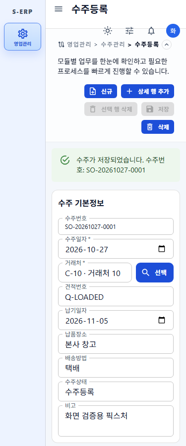
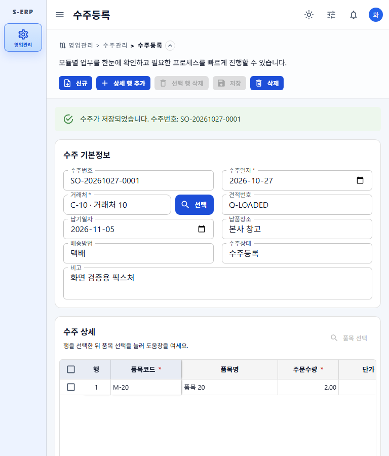
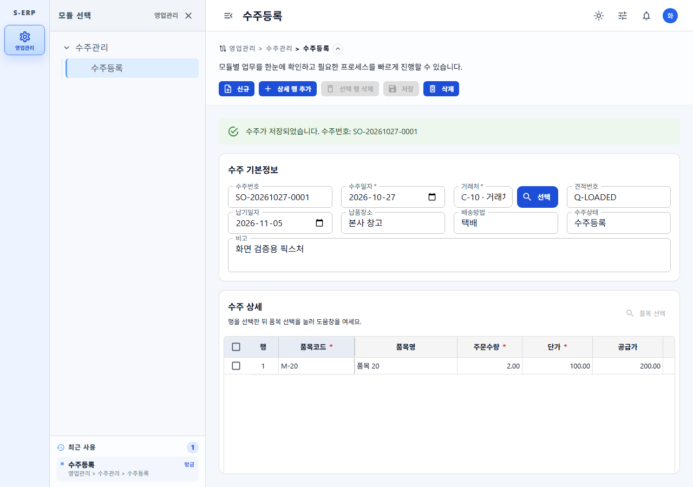
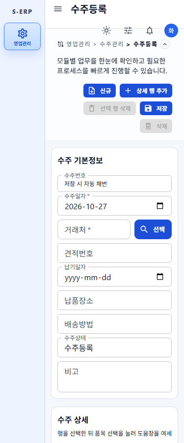
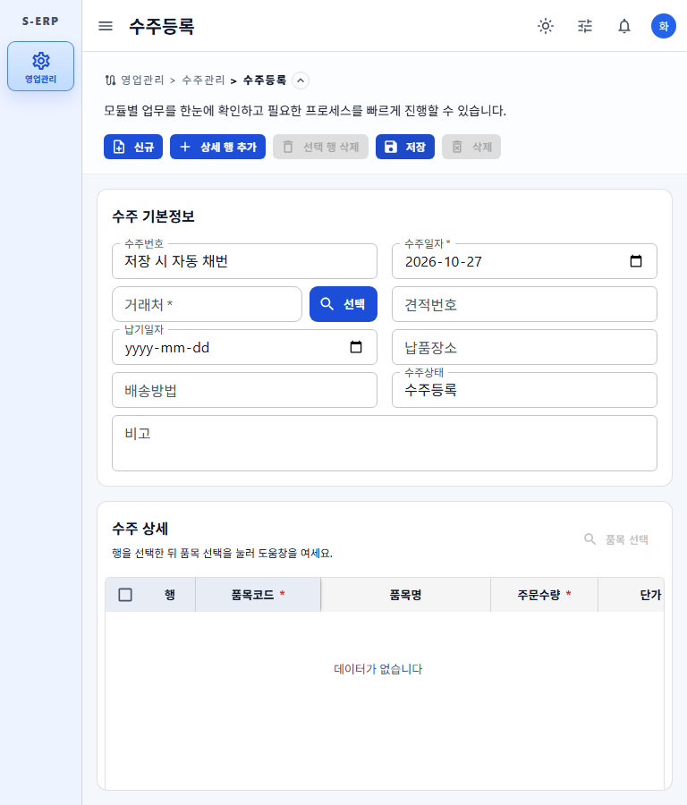
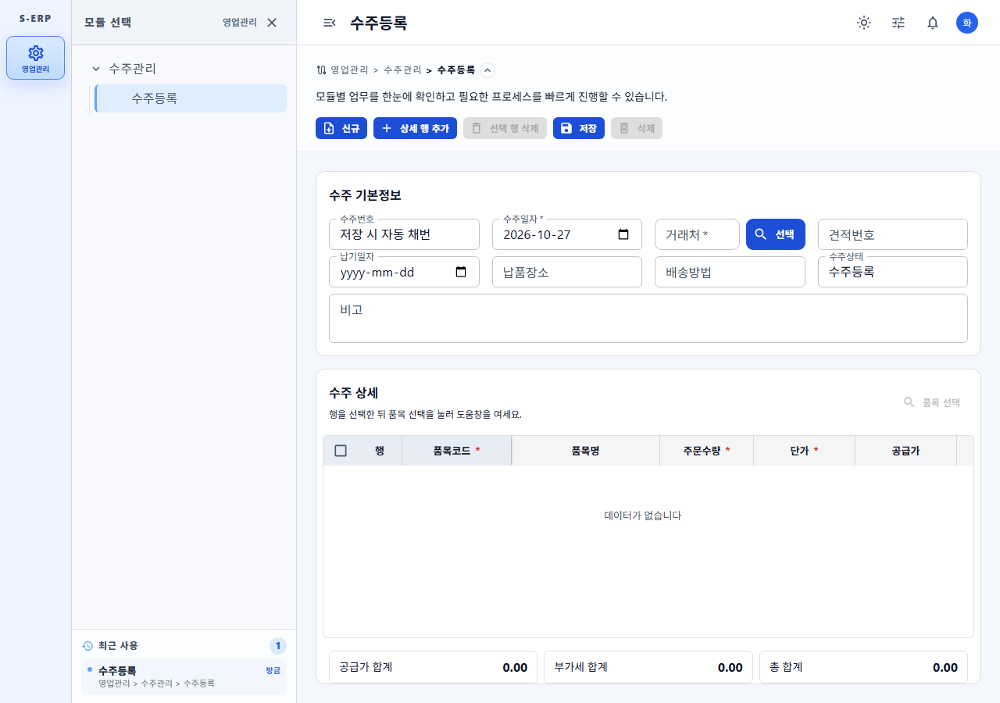
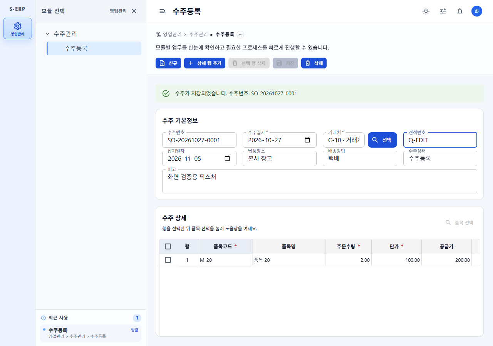

# 20261027_005 수주등록 저장 후 재조회·수정·삭제 및 신규 버튼 결과

- 작업지시서: [20261027_005 작업지시서](../../../directions/20261027/20261027_005_수주등록_저장후_재조회_수정삭제_작업지시서.md)
- 계획서: [20261027_005 계획서](../../../plan/20261027/20261027_005_수주등록_저장후_재조회_수정삭제_계획서.md)
- 상세사양서: [20261027_005 상세사양서](../../../spec/20261027/20261027_005_수주등록_저장후_재조회_수정삭제_상세사양서.md)

## 구현 내용

### 백엔드 (`egovframework.let.sales.order.create`)

- `GET /api/v1/sales/orders/{salesOrderId}` 수주 조회: 헤더(거래처 코드/명 포함)와
  상세(품목 코드/명 포함, `line_no` 순)를 tenant 범위·`use_at='Y'` 조건으로 반환한다.
- `PUT /api/v1/sales/orders/{salesOrderId}` 수주 수정: 저장과 같은 검증·서버 금액 계산 후
  헤더를 갱신하고(`updated_by`, `updated_at`), 상세를 삭제 후 1..n 행으로 재등록한다.
  수주번호는 변경하지 않는다.
- `DELETE /api/v1/sales/orders/{salesOrderId}` 수주 삭제: 헤더 `use_at='N'` 소프트 삭제.
- 수정·삭제는 상태가 `수주등록`이고 출하수량이 있는 행이 없을 때만 허용한다(그 외 409).
  없는 수주/타 테넌트 수주는 404.
- 컨트롤러는 `@Operation`/`@ApiResponses`/`@SecurityRequirement`, VO는 `@Schema`,
  Controller/Service/DAO 모두 JavaDoc을 갖춘 기존 시스템 패턴을 따른다.

### 프론트엔드 (`frontend/src/pages/sales/order/create`)

- 신규 저장 성공 시 `POST` 응답의 ID로 즉시 `GET` 재조회하여 상단(수주번호·거래처·헤더 필드)과
  하단 그리드(상세 행)를 서버 값으로 다시 세팅한다. 이후 화면은 수정 모드가 된다.
- 수정 모드: 변경이 있을 때만 `저장`이 활성화되며 `PUT`으로 수정 후 응답으로 다시 세팅한다.
- `삭제` 버튼(삭제 권한 필요): 수주번호 포함 확인창 후 `DELETE`, 성공 시 신규 상태로 초기화한다.
- 우측 상단 `신규` 버튼(저장 권한=create 또는 update 필요): 상단·하단을 초기화한다.
  미저장 변경이 있으면 확인창을 띄우고, 취소하면 입력을 유지한다.
- 권한: `신규`/`상세 행 추가`/`선택 행 삭제`/`저장`은 쓰기 권한, `삭제`는 삭제 권한이 있을 때만 표시된다.
  `DashboardContent`가 메뉴 권한(`selectedMenuPermissions`)을 페이지에 전달한다.
- 재조회 실패 시 화면을 잠그고 `수주는 저장되었지만 다시 불러오지 못했습니다. 수주번호: X`를 표시해
  중복 저장을 막는다(`신규`로 해제).
- 그리드는 `rows` prop + `key` 재마운트로 로드/초기화하며, 금액 합계는
  `resolveActiveSalesOrderRows`(로드 행 + 변경분)로 계산한다.

## DB 확인 (읽기 전용 MCP `s-erp-postgresql-readonly`)

- `tb_sales_order_hd`: `use_at`(char, 기본 'Y'), `updated_by`(varchar), `updated_at`, `status`(기본 '수주등록') 존재.
- `tb_sales_order_dt`: `use_at`/감사 컬럼 없음, UNIQUE(`sales_order_id`, `line_no`),
  FK(`sales_order_id`, `tenant_id`) → 헤더. 따라서 상세는 삭제 후 재등록, 헤더는 소프트 삭제로 처리했다.
- 마스터 조인: `tb_customer_info.customer_code/customer_name`, `tb_material_info.material_code/material_name`.
- 신규 테이블/컬럼 변경 없음 → DDL·롤백 스크립트 불필요(테이블은 사용자 관리).

## 검증

- Backend: `mvn -q test "-Dtest=SalesOrder*"` — Controller 5, Mapper 6, Service 10 통과.
- Frontend: `npx vitest run tests/sales-order-create-api.test.ts tests/sales-order-grid.test.ts tests/sales-order-create-page.test.tsx`
  — 28개 통과(재조회·PUT 수정, 삭제 확인/초기화, 신규 확인/초기화, 권한별 버튼 표시 포함),
  `tests/master-picker*` 6개 통과.
- `npm run build` 통과, 변경 파일 `npx oxlint` 경고 0.
- Playwright(`frontend/scripts/capture-sales-order-reload.js`, API mock 사용):
  `POST → GET /300` 순서 확인, 375/768/1280px 모두 페이지 가로 overflow 없음, 런타임 오류 0.

## 스크린샷

| 상태 | 375px | 768px | 1280px |
| --- | --- | --- | --- |
| 저장 후 재조회(수정 모드) |  |  |  |
| 신규 초기화 |  |  |  |

- 수정 입력 중(저장 활성): 

## 참고/제약

- 메뉴 권한은 UI에서 적용한다. 백엔드는 기존 저장 API와 동일하게 인증 + 테넌트 범위로 보호한다.
- 삭제는 소프트 삭제이며, 삭제된 수주는 조회되지 않는다.

## 버그 수정: 수주 조회 시 `orderdt` 컬럼 읽기 실패

- 재현: 저장 후 재조회(`GET /api/v1/sales/orders/{id}`) 시
  `InvalidDataAccessApiUsageException: Error attempting to get column 'orderdt' ... SQLFeatureNotSupportedException ... type=class java.time.LocalDate`.
- 원인: MyBatis 기본 `LocalDateTypeHandler`는 `ResultSet#getObject(col, LocalDate.class)`를 호출하는데,
  런타임 데이터소스의 log4jdbc `ResultSetSpy`가 이를 지원하지 않는다(매퍼 테스트는 log4jdbc를 거치지 않아 통과).
- 해결: 기존 `LocalDateTimeTimestampTypeHandler` 패턴대로 `egovframework.com.cmm.LocalDateDateTypeHandler`
  (`getDate`/`setDate` 기반)를 추가하고 `mapper-config.xml`의 `typeHandlers`에 `java.time.LocalDate`용으로 등록했다.
- 회귀 검증: `LocalDateDateTypeHandlerTest` 4개(저장/조회/null/설정 등록 확인) 및 `SalesOrder*` 21개 통과.
