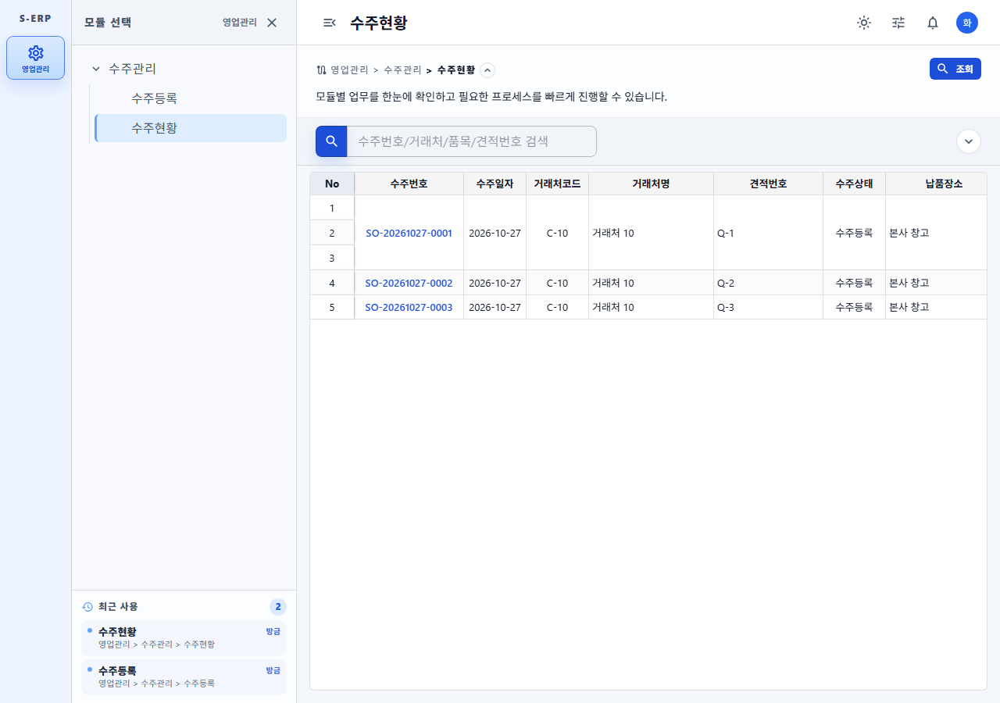
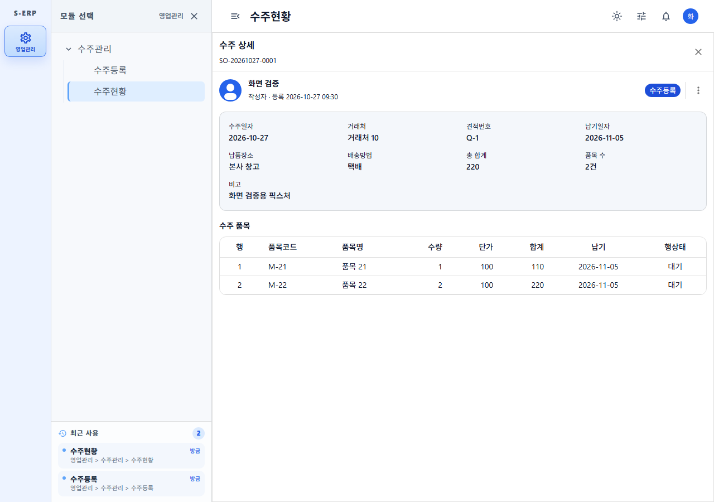
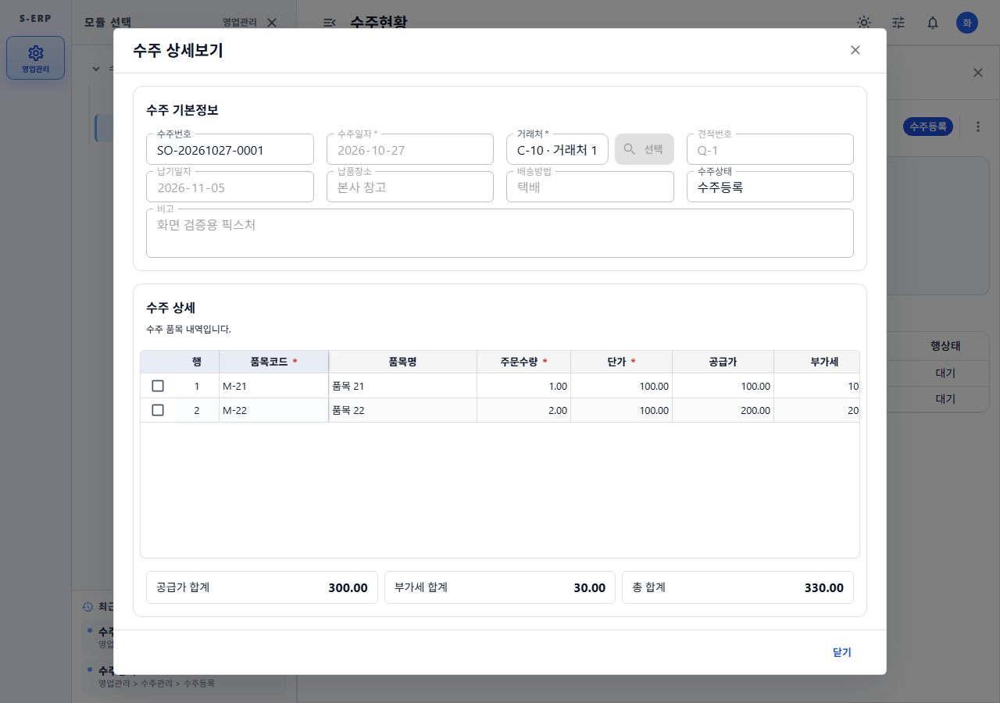
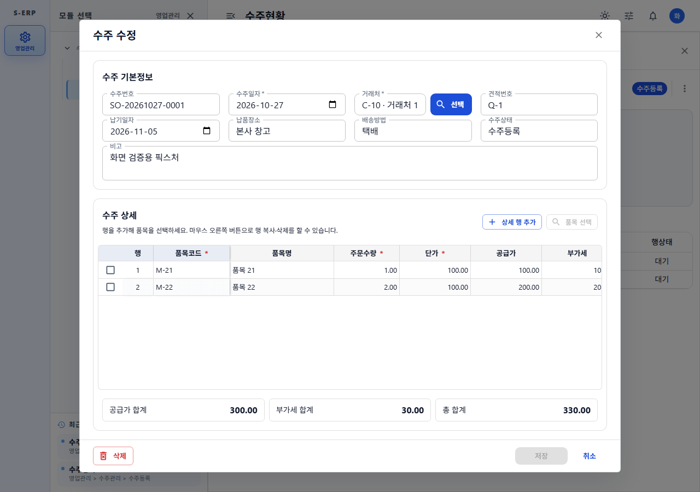

# 수주현황 상세 패널 및 상태 저장 결과

- 작업일: 2026-10-27
- 근거 문서
  - [작업지시서](../../../directions/20261027/20261027_010_수주현황_상세패널_및_상태저장_작업지시서.md)
  - [계획서](../../../plan/20261027/20261027_010_수주현황_상세패널_및_상태저장_계획서.md)
  - [상세사양서](../../../spec/20261027/20261027_010_수주현황_상세패널_및_상태저장_상세사양서.md)

## 구현 내용

| 요구사항 | 구현 |
| --- | --- |
| 조회조건 유지 | `usePageSessionState`(key `s-erp:page:sales-order-status`, v1)에 빠른 검색어와 상세검색 값을 저장한다. 다른 화면에 갔다가 돌아오면 같은 조건으로 다시 조회한다. |
| 수주번호 클릭 → 우측 상세 패널 | 그리드의 수주번호를 링크 버튼(`{수주번호} 상세 보기`)으로 바꿨다. 패널은 문서작성 상세 패널과 같은 `PageAreaOverlay` + `PostDetailPanel` 구조다. |
| 메인/디테일 간단 표시 | 패널 내용은 다음과 같다.  • 작성자 아바타, 작성자명, 등록일시  • 상태 칩과 더보기 메뉴  • 헤더 요약: 수주일자, 거래처, 견적번호, 납기일자, 납품장소, 배송방법, 총 합계, 품목 수, 비고  • 품목 표 |
| 더보기 > 자세히보기 | `SalesOrderEditorDialog`가 수주등록 화면(`SalesOrderCreatePage`)을 `mode="view"`, `embedded`로 띄운다. 모든 입력이 비활성이고 저장/삭제/신규 버튼이 없다. |
| 더보기 > 수정 (본인 작성 건) | 같은 화면을 `mode="edit"`로 띄우고 PUT으로 저장한다. 저장하면 상세 패널과 목록을 다시 조회하고, 삭제하면 다이얼로그와 패널을 닫고 목록을 다시 조회한다. |
| 수정 노출 조건 | 아래 조건을 모두 만족할 때만 `수정` 메뉴가 보인다.  • `writer === true`  • 수주등록 메뉴 수정 권한 보유  • 상태가 `수주등록`  • 출하수량이 있는 행이 없음 |
| 미저장 변경 보호 | 수정 다이얼로그에 변경사항이 있는 상태로 닫으면 확인창을 띄운다. 다이얼로그가 열려 있는 동안 Escape는 패널을 닫지 않는다. |

### 백엔드 (eGovFrame 패턴 유지, 패키지 `egovframework.let.sales.order.create`)

- `SalesOrderVO`에 `createdBy`, `createdByName`, `createdAt`, `writer` 필드를 추가하고 각각 `@Schema`를 달았다.
- `SalesOrderService.getOrder(tenantId, userId, salesOrderId)`는 로그인 사용자와 작성자를 비교해 `writer` 값을 채운다.
- Mapper `selectOrder`는 `tb_login_account` → `tb_user`를 LEFT JOIN해 작성자명을 가져오고, `to_char`로 등록일시를 포맷한다.

## DB 확인 (s-erp-postgresql-readonly MCP)

건수만 기록하고 개인정보는 기록하지 않았다.

- 활성 수주 5건 모두 작성자명 조인이 성공했다.
- 5건 모두 `created_at` 값이 있다.
- DB 스키마 변경은 없다. 따라서 SQL과 롤백 스크립트도 없다.

## 검증

| 구분 | 명령 | 결과 |
| --- | --- | --- |
| 프론트 테스트 | `npx vitest run tests/sales-order-status-page.test.tsx tests/sales-order-create-page.test.tsx` | 30/30 통과 (신규 5건 포함, 구현 전 RED 확인) |
| 타입 | `npx tsc -b` | 오류 없음 |
| 빌드 | `npm run build` | 성공 |
| 린트 | `npx oxlint src/pages/sales/order` | 기존 허용 패턴인 `set-state-in-effect` 경고만 있음 |
| 백엔드 | `mvn test -Dtest=SalesOrder*` | create: 5/6/11 통과, status: 3/2/3 통과 (구현 전 RED 확인) |
| 화면 | `CAPTURE_BASE_URL=http://127.0.0.1:4176 node scripts/capture-sales-order-status-detail.js` | 375/768/1280 모두 가로 넘침 없음, 런타임 오류 0건 (픽스처 데이터) |

## 스크린샷

| 화면 | 파일 |
| --- | --- |
| 목록 |  |
| 상세 패널 |  |
| 더보기 메뉴 |  |
| 자세히보기 (읽기전용) |  |
| 수정 |  |

375/768 화면은 `screenshots/*-375.png`, `*-768.png`에 있다.

## 미결 사항

- 작성자만 수정할 수 있다는 제한은 현재 UI(더보기 메뉴 노출)에서만 적용된다. PUT/DELETE API는 아직 작성자를 서버에서 검증하지 않으므로, 서버 측 검증은 별도 작업으로 추가해야 한다.
- 사용자가 헤더 메뉴로 `수주번호` 컬럼을 고정(pin)하면 셀마다 별도 쌓임 맥락(stacking context)이 생긴다. 이 경우 병합 영역 링크 클릭이 다시 가려질 수 있다. 기본 설정에서는 이 컬럼이 고정되지 않는다.

## 후속 수정 (2026-10-27 오후)

### 1. 병합된 행의 수주번호 클릭 불가

- 재현: 상세가 2행 이상인 수주는 수주번호 셀이 병합된다. 가운데 표시된 링크를 클릭해도 패널이 열리지 않았다.
- 원인
  - F1-Grid는 병합된 후속 행 셀을 `opacity: 0`, `pointer-events: auto` 상태로 같은 위치에 그린다.
  - 이 설정은 병합 영역의 드래그 범위 선택과 물리 행 선택을 위한 의도된 동작이다(`tests/f1-grid.test.tsx`, `tests/f1-grid-row-selection.test.tsx`).
  - 이 투명 셀이 시작 셀 위에 겹쳐 링크 클릭을 가로챘다.
- 수정
  - `salesOrderStatusColumns.tsx`의 수주번호 링크에 `position: relative; z-index: 1`을 줘서 투명 셀 위로 올렸다.
  - F1-Grid 공통 동작은 변경하지 않았다.
  - 수주번호가 좁은 컬럼에서 두 줄로 잘리던 문제도 함께 고쳤다. 컬럼 너비를 110 → 140으로 늘리고 링크를 한 줄(`nowrap` + 말줄임)로 표시한다.
- 회귀 검증: `scripts/capture-sales-order-status-detail.js`에서 같은 수주를 3행으로 병합한 픽스처로 확인했다.
  - 링크 중심 좌표의 `elementFromPoint`가 링크 자신인지 검증한다.
  - 수정 전에는 `AssertionError`로 실패했고, 수정 후에는 통과했다.

### 2. 작성자 정보 미표시("-")

- 확인 결과 (MCP, 건수만 기록): 활성 수주 5건 모두 다음이 존재했다.
  - `tb_login_account` 조인 성공
  - `tb_user.user_nm`
  - `profile_image`
  - `created_at`
- 해석: SO-20261027-0002도 데이터는 정상이다. 따라서 화면의 "-"는 작성자 필드가 추가되기 전 백엔드가 실행 중이었기 때문으로 판단한다. **백엔드를 재시작해야 반영된다.**
- 함께 반영한 개선: 문서 상세 패널처럼 작성자 프로필 이미지를 표시한다.
  - `SalesOrderVO.createdByProfileImage`(`@Schema`) 필드를 추가했다.
  - Mapper에 `la.profile_image AS createdByProfileImage`를 추가했다.
  - 상세 패널의 `ProfileAvatar`에 `imageUrl`을 전달한다.
- DB 스키마 변경: 없음

### 검증

| 구분 | 결과 |
| --- | --- |
| 프론트 테스트 RED | 프로필 이미지 `img` 요소가 없어 실패 |
| 백엔드 테스트 RED | `setCreatedByProfileImage` 심볼이 없어 컴파일 실패 |
| 프론트 테스트 | `sales-order-status-page`, `sales-order-create-page`, `f1-grid-row-selection` 40/40 통과 |
| 타입 | `npx tsc -b` 통과 |
| 백엔드 | `SalesOrder*` 통과 (create 5/6/11, status 3/2/3) |
| 브라우저 | 병합 링크 hit-test 통과, 375/768/1280 가로 넘침 없음, 런타임 오류 0건 |

## 후속 수정 2 — 수주 수정 모달 공통화

- 요청: 수주 수정 모달을 공통 모달로, 저장·취소는 하단 우측에 배치, 수주 기본정보·수주 상세가 모달 화면을 꽉 채우도록
- 구현:
  - `SalesOrderCreatePage`:
    - embedded일 때 상단 액션바를 렌더링하지 않는다.
    - 본문 패딩을 0으로 해 이중 여백을 없앴다.
    - `onEmbeddedActionsChange`로 저장/삭제 상태와 핸들러를 상위에 전달한다.
  - `SalesOrderEditorDialog`:
    - 공통 `CommonDialog`의 `actions`(우측)에 `취소`·`저장`을 둔다.
    - `footerStart`(좌측)에 `삭제`를 둔다.
    - 상세보기 모드는 `닫기`만 표시한다.
    - 본문을 flex 컨테이너로 감싸 상세 그리드가 남은 높이를 채운다.
  - `SalesOrderStatusPage`: 저장이 성공하면 모달을 닫고 상세 패널과 목록을 새로고침한다.
- 검증:
  - RED: 3건 실패(`common-dialog-actions` 없음).
  - GREEN: `sales-order-status-page` 11/11, `sales-order-create-page` 20/20 통과.
  - `npx tsc -b`, `npm run build`, oxlint 모두 통과(기존 경고만 남음).
  - Playwright 캡처:
    - 하단 버튼 순서가 `['저장','취소']`이다(후속 수정 3에서 공통 순서로 변경).
    - 본문 영역에 저장 버튼이 없다.
    - 입력 영역과 모달 본문의 차이는 모달 기본 패딩(가로 48px, 세로 32px)뿐이다.
    - 375/768/1280에서 가로 넘침이 없다.
- 스크린샷:
  - `screenshots/sales-order-status-edit-dialog-{375,768,1280}.png`
  - `screenshots/sales-order-status-view-dialog-{375,768,1280}.png`

## 후속 수정 3 — 공통 버튼 스타일 및 조용한 재조회

- 요청: 저장·취소 버튼을 공통 모달과 같은 스타일로, 수정 후 메인 그리드는 조용한 로딩으로
- 구현:
  - `SalesOrderEditorDialog` 하단 버튼을 공통 스타일(`CommonCodeItemHelpDialog`, `F1GridFormModal`과 동일)로 맞췄다.
    - `저장`: contained, `borderRadius 1.5 / fontWeight 700 / minWidth 96 / px 2.5`, 저장 중 `AppLoadingSpinner`
    - `취소`: text 버튼
    - 순서: `저장` → `취소`
  - 상세보기의 `닫기`도 text 버튼으로 맞췄다.
  - `useSalesOrderStatusList`에 `refreshQuietly`를 추가했다(`useDocumentWritePage.refresh({ quiet })` 패턴).
    - 수정 저장과 삭제 후 목록을 조용히 재조회한다.
    - 재조회 버전이 바뀐 요청에만 quiet를 적용하므로, 이후 조건 변경 조회는 정상적으로 로딩을 표시한다.
- 검증:
  - RED:
    - 버튼 순서 `['취소','저장']`가 기대값 `['저장','취소']`와 달라 실패했다.
    - 재조회 중 `조회` 버튼이 비활성되어 실패했다.
  - GREEN: status 11/11, create 20/20, `npx tsc -b`, oxlint(오류 0건) 모두 통과.
  - Playwright 캡처: 하단 버튼 순서가 `['저장','취소']`이고 런타임 오류는 0건이다.

## 후속 수정 4 — 삭제 확인을 공통 모달로

- 요청: 삭제 클릭 시 브라우저 `window.confirm` 대신 공통 모달로 확인
- 구현:
  - `SalesOrderCreatePage`의 `handleDelete`는 확인 모달만 연다.
  - 실제 삭제는 `confirmDelete`가 수행한다.
  - 확인 모달은 공통 `UnsavedChangesConfirmDialog`를 사용한다.
    - 제목 `수주 삭제`, 본문에 수주번호와 되돌릴 수 없다는 안내
    - 버튼: `삭제`(error contained) → `취소`(text)
  - 수주등록 화면과 수주현황 수정 모달(embedded) 모두 같은 확인 모달을 쓴다.
- 검증:
  - RED: `수주 삭제` 다이얼로그가 없어 실패했다.
  - GREEN: create 20/20, status 11/11, `npx tsc -b`, oxlint(오류 0건) 통과.
  - `window.confirm`이 호출되지 않음을 확인했다.
- 스크린샷: `screenshots/sales-order-status-delete-confirm-1280.png`
