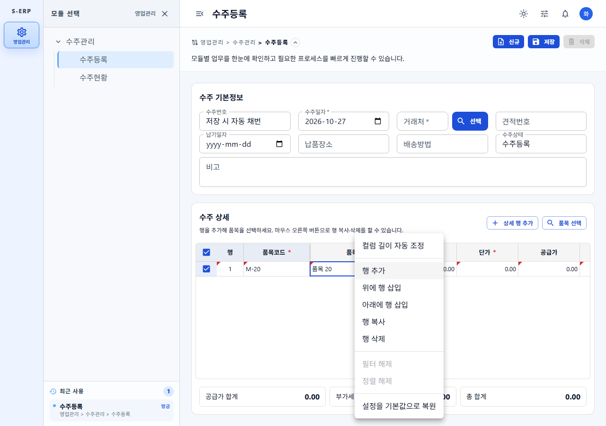
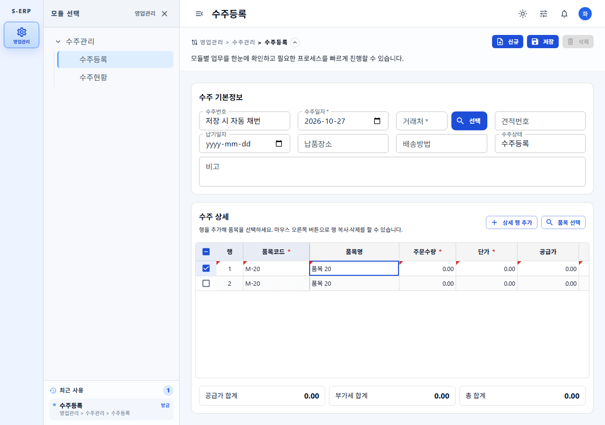
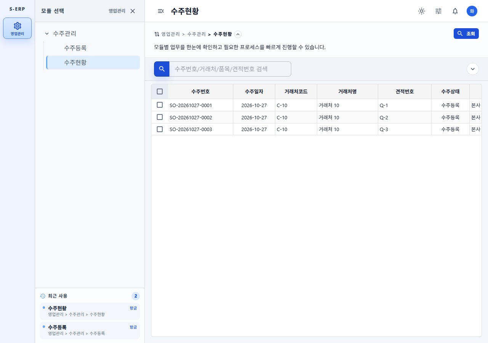
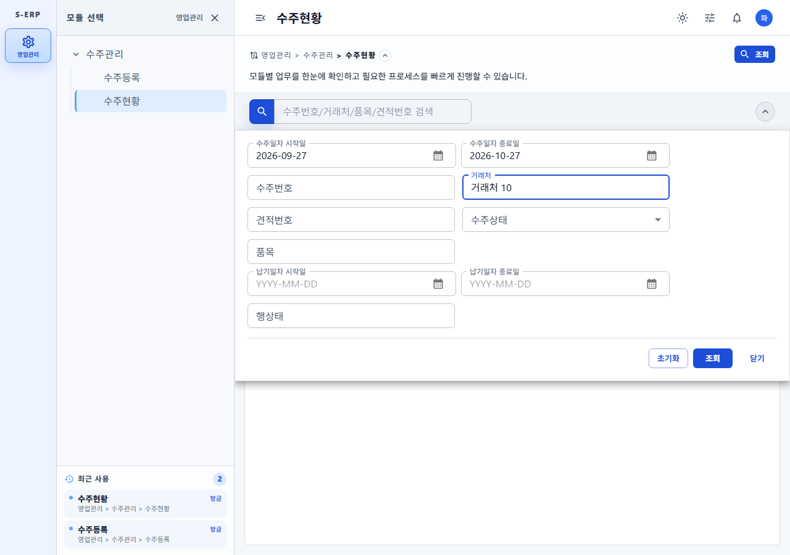

# 20261027_007 수주등록 버튼 정리 및 수주현황 결과서

- 작업지시서: [20261027_007](../../../directions/20261027/20261027_007_수주등록_버튼정리_및_수주현황_작업지시서.md)
- 계획서: [20261027_007](../../../plan/20261027/20261027_007_수주등록_버튼정리_및_수주현황_계획서.md)
- 상세사양서: [20261027_007](../../../spec/20261027/20261027_007_수주등록_버튼정리_및_수주현황_상세사양서.md)

## 1. 변경 내용

### 수주등록 (`/sales/order/create`)

- 우측 상단 `상세 행 추가` 버튼을 수주 상세 그리드 헤더의 `품목 선택` 버튼 왼쪽으로 이동했습니다. 쓰기 권한이 있을 때만 보이고, 편집 불가 상태에서는 비활성화됩니다.
- `선택 행 삭제` 버튼을 제거했습니다. 행 삭제는 우클릭 메뉴 `행 삭제`로 합니다.
- 우클릭 메뉴 `행 복사`를 활성화했습니다.
  - 복사 행은 새 rowId를 받고, `출하수량 0`, `행상태 대기`로 초기화됩니다.
  - 저장 시 신규 상세 행으로 처리됩니다.
  - 관련 코드: `duplicateSalesOrderDetailRow`
- 안내 문구: "행을 추가해 품목을 선택하세요. 마우스 오른쪽 버튼으로 행 복사·삭제를 할 수 있습니다."

### 수주현황 (`/sales/order/status`, 신규)

- 프론트 `frontend/src/pages/sales/order/status/`
  - `SalesOrderStatusPage`: 헤더 `조회` 버튼(read 권한), 빠른 검색, 상세 검색, F1-Grid 목록.
  - 상세 검색 필드는 컬럼 `search` 옵션에서 생성합니다.
    - 대상: 수주일자, 수주번호, 거래처, 견적번호, 수주상태, 품목, 납기일자, 행상태.
    - 수주일자 기본값은 시스템일자 기준 1개월 전 ~ 오늘입니다.
  - 그리드는 헤더와 상세 정보를 결합한 21개 컬럼으로, 상세 1행이 그리드 1행입니다(`rowKey=salesOrderDetailId`).
    - 읽기 전용이며, 행 추가/복사/삭제 메뉴는 비활성입니다.
    - 엑셀 내보내기는 excel 권한이 있을 때만 가능합니다.
  - `DashboardContent`의 `sales` 모듈 `status` 키에 연결했습니다.
- 백엔드 `egovframework.let.sales.order.status` (controller / domain.model / domain.repository / service / service.impl)
  - `GET /api/v1/sales/order-status` (`SalesOrderStatusApiController`)
    - `@Operation`/`@ApiResponses`/`@SecurityRequirement`/`@Schema`와 Javadoc을 적용했습니다.
  - 테넌트는 인증 사용자 기준으로만 적용하고, `use_at='Y'`인 행만 조회합니다.
  - 날짜 형식 오류이거나 시작일 > 종료일이면 400을 반환합니다.
  - Mapper: `egovframework/mapper/let/sales/order/status/EgovSalesOrderStatus_SQL_postgresql.xml`

## 2. F1-Grid 사용 변경 메모

- F1-Grid 코어 변경은 없습니다. 수주 상세 그리드에서 기존 옵션 `createDuplicate`와 `allowDuplicateRowInContextMenu={!disabled}`를 사용하도록 바꿨습니다.
- 수주현황 그리드는 기존 읽기 전용 목록 패턴을 따릅니다(문서현황과 동일한 컨텍스트 메뉴 플래그).

## 3. DB 확인 (s-erp-postgresql-readonly MCP)

- `describe_table`로 `tb_sales_order_hd`, `tb_sales_order_dt`의 컬럼과 타입을 확인했습니다(`order_dt`/`delivery_dt`는 date, 금액/수량은 numeric).
- `tb_customer_info`의 거래처 코드/명, `tb_material_info`의 품목 코드/명/`unit` 컬럼을 확인했습니다.
- 최종 목록 SQL을 `query_readonly`(count만 조회)로 실행해 문법과 조인이 유효함을 확인했습니다. 데이터 행은 기록하지 않았습니다.
- 수주상태 허용값은 `db-schema.md`의 CHECK 제약을 따릅니다: 수주등록, 생산대기, 생산중, 출하완료, 취소.
- DB 스키마 변경은 없으므로 SQL/롤백 스크립트를 추가하지 않았습니다.

## 4. 검증

| 항목 | 명령 | 결과 |
|---|---|---|
| 프론트 테스트 | `npx vitest run tests/sales-order-status-api.test.ts tests/sales-order-status-page.test.tsx tests/sales-order-create-api.test.ts tests/sales-order-grid.test.ts tests/sales-order-create-page.test.tsx` | 5 files, 37 passed |
| 프론트 빌드 | `npm run build` | 성공 |
| 린트 | `npx oxlint src/pages/sales ...` | 오류 0 (set-state-in-effect 경고는 기존 목록 페이지와 동일 패턴) |
| 백엔드 테스트 | `mvn -q test "-Dtest=SalesOrder*"` | create 5+6+10, status 3+2+3 통과 |
| 화면 캡처 | `node scripts/capture-sales-order-status.js` (API 픽스처) | 375/768/1280 가로 넘침 없음, 런타임 오류 0 |

TDD 순서: 수주등록 버튼/복사, 수주현황 서비스·페이지, 백엔드 컨트롤러·서비스·매퍼 모두 테스트를 먼저 작성해 실패(RED)를 확인한 뒤 구현했습니다.

## 5. 스크린샷

- 수주등록 우클릭 메뉴(행 복사): 
- 수주등록 행 복사 후: 
- 수주현황 목록: 
- 수주현황 상세검색: 
- 375/768 폭 캡처: `screenshots/*-375.png`, `screenshots/*-768.png`

## 6. 추가 수정: 상세 검증 메시지 중복 제거

- 재현: 상세 행 여러 개가 같은 오류(예: 주문수량 0)일 때, 저장 시 상단 오류 Alert에 같은 메시지가 행 수만큼 반복되었습니다.
- 원인: 화면이 행별 메시지(`detailRows`)를 그대로 펼쳐 표시했습니다.
- 해결:
  - `validateSalesOrderInput`이 `detailMessages`(메시지 단위로 중복 제거, 최초 발생 순서 유지)를 함께 반환합니다.
  - 화면 Alert는 `detailMessages`를 표시합니다.
  - 행별 위치는 기존처럼 F1-Grid 셀 오류 표시로 확인할 수 있습니다.
- 회귀 테스트:
  - `sales-order-create-api.test.ts` "collects detail validation messages once regardless of row count"
  - `sales-order-create-page.test.tsx` "shows each detail validation message once even when several rows fail"
  - 5 files, 39 passed

## 7. 후속 조치

- 메뉴관리에서 `영업관리 > 수주관리 > 수주현황` 메뉴(경로 `/sales/order/status`)를 등록하고 역할 권한(read/excel)을 부여해야 화면에 노출됩니다.
