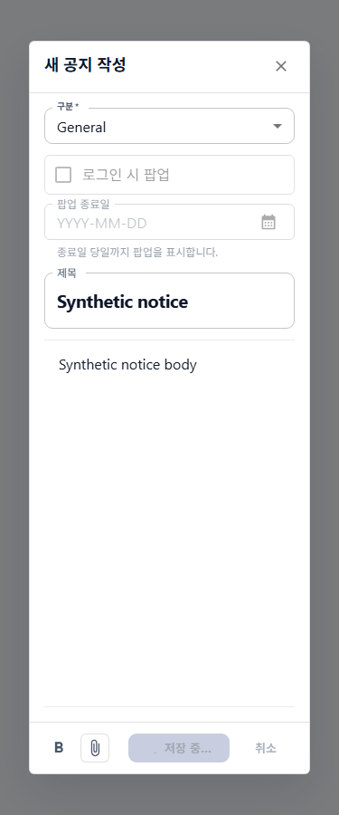
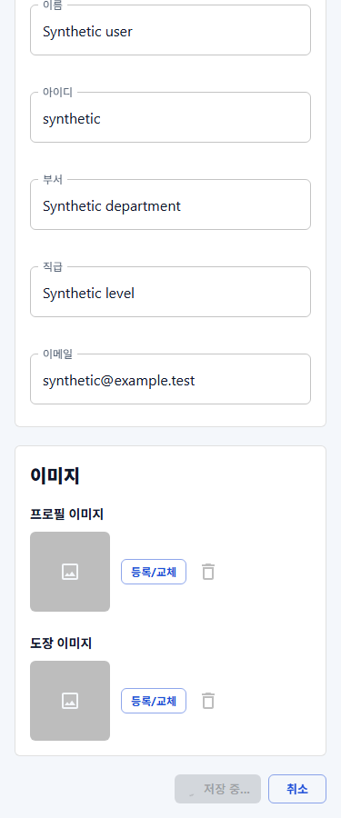

# 페이지·모달 저장 스피너 공통화 결과

근거: [작업지시서](../../../directions/20261027/20261027_012_shared-save-spinner_작업지시서.md), [계획서](../../../plan/20261027/20261027_012_shared-save-spinner_계획서.md), [상세 사양서](../../../spec/20261027/20261027_012_shared-save-spinner_상세사양서.md).

## 구현과 사용법

공통 [AppSaveButton](../../../../frontend/src/shared/components/AppSaveButton.tsx)을 추가했다. 저장 상태일 때 기존 아이콘을 16px `AppLoadingSpinner`로 교체하고 disabled/aria-busy를 적용한다. 완료/실패 후 저장 상태가 해제되면 기존 아이콘·문구·비활성 조건으로 복귀한다. 중복 spinner는 없다.

```tsx
<AppSaveButton
  variant="contained"
  saving={saving}
  savingLabel="저장 중..."
  progressLabel="문서 저장 중"
  disabled={!hasChanges}
  onClick={save}
>
  저장
</AppSaveButton>
```

`children` 기본값은 `저장`이다. `savingLabel`을 생략하면 기존 문구를 유지하고 작은 spinner만 추가한다. 기존 `저장 중...`/`저장 중…`/`처리 중...`/`변경 중...` 문구는 그대로 연결했다. `progressLabel`은 spinner 접근성 이름이며 기본 `저장 중`이다. 기존 버튼 aria-label을 우선하고 문자열 문구의 접근성 이름에 spinner 이름이 중복되지 않도록 했다.

페이지 상단은 [PermissionGroup](../../../../frontend/src/shared/components/PermissionGroup.tsx)의 액션 정의에 명시적으로 상태를 전달한다. disabled나 문구로 저장 여부를 추론하지 않는다.

```tsx
{
  label: '저장',
  icon: SaveIcon,
  saving,
  savingAriaLabel: '문서 저장 중',
  disabled: !hasChanges || saving,
  onClick: save,
}
```

## 적용 목록

| 구분 | 화면 |
|---|---|
| 페이지 액션 | 공통코드, 거래처, 품목, 기안양식, 메뉴, 권한, 모듈, 창고, 수주등록 |
| 프로필/보안 | 내 정보 저장, 비밀번호 변경 |
| 기준정보 모달 | 분류관리, 공통코드 도움말, 기안양식 본문 편집 |
| 그룹웨어 모달 | 공지 작성, 로그인 공지 팝업 확인 저장, 문서 작성 저장·결재신청/발송, 결재선 템플릿 저장·이름 저장, 자료실 파일 정보 편집 |
| 수주 모달 | 수주 수정의 하단 저장 버튼 |

기존 업무별 spinner 이름(품목/거래처/기안양식/분류/공지 저장 중)을 보존했다. 기존 로컬 spinner 함수와 중복된 저장 버튼 spinner JSX는 제거했으나 본문 조회 spinner는 유지했다.

저장/후속 조용한 재조회 수명, API 호출, 권한, 검증, dirty, 편집/검색/닫기 잠금, 실패 알림은 변경하지 않았다. 문서 작성의 두 액션은 기존처럼 공유 isSaving을 사용한다. 동기적인 F1-Grid 행 폼의 로컬 적용, 조회/삭제 버튼, 업로드 전용 진행 UI는 이번 공통 저장 표시 대상이 아니다. 백엔드/DB/API 데이터 계약 변경은 없다.

## 검증

| 범위 | 결과 |
|---|---|
| 구현 전 공통 버튼/헤더 | 공통 컴포넌트 부재 및 페이지 saving spinner 부재로 실패 확인 |
| 공통 버튼·헤더·프로필·보안·모듈·코드 도움말·공지 작성·분류관리 8개 파일 | 70 통과 |
| 나머지 저장 관련 선택 실행 12개 파일 | 73 통과 / 7 실패 / 193 선택 제외. 아래 실패 분리 참고 |
| 문서 저장/재저장/결재신청/저장 오류/저장 중 편집 경로 | 4 통과 / 120 선택 제외 |
| 메뉴 저장·후속 재조회 잠금 경로 | 3 통과 / 52 선택 제외 |
| 최종 공통 버튼·헤더·프로필 및 자료실 파일 저장 지연 회귀 | 12 통과 / 19 선택 제외 |
| 최종 `npm run build` | 성공, exit 0 |
| 변경 TS/TSX 27개 파일 oxlint(전체 범위 및 마지막 추가분) | 오류 0, exit 0. 기존 effect/deps/fast-refresh 경고 유지, 새 AppSaveButton 경고 없음 |
| 추적 변경 `git diff --check` | 통과 |
| Chromium 375/768/1280px | 공통 페이지 액션, 실제 프로필 페이지, 실제 공지 작성 모달 저장 지연·완료·실패 복구 통과 |

모듈 테스트는 저장 요청과 후속 재조회 대기 양쪽에서 16px spinner 유지, 중복 요청 차단, 완료 후 spinner 제거를 확인했다. 프로필은 success/failure 각각, 자료실은 지연 중 spinner·중복 요청 차단과 완료 후 제거를 확인했다.

### 확장 실행 실패 분리

확장 테스트를 모두 성공한 것으로 간주하지 않는다.

| 실패 | 스피너 없는 대조 실행 |
|---|---|
| 공통코드 동일 그룹 저장 후 서버 재조회: 그룹 트리 없음 | 동일 실패 |
| 결재선 이름 부분 실패 후 재시도: 기대 gridcell 없음 | 동일 실패 |
| 기안양식 변경 조회 취소/양식 저장/조용한 진행: 기존 `구분명` textbox 없음(3건) | 동일 실패 |
| 기안양식 행 삭제 저장: `행 삭제` 메뉴 없음 | 동일 실패 |
| 수주 저장 단일 테스트 10초 timeout | 단독 재실행 1 통과 / 19 선택 제외 |

대조 실행은 저장 스피너/aria-busy/이름 처리를 없는 단순 MUI Button으로 치환하고 공통 액션바를 git HEAD 원본으로 메모리 주입했다. 같은 6개 실패가 재현됐다. 이는 스피너 없는 비교 경로이지 전체 워크트리를 이전 시점으로 복원한 검증은 아니다. 저장 진행 공통화와 독립적인 화면/fixture 불일치까지 수정하지 않았으며 병행 변경을 보존했다. 대조용 설정 파일은 삭제했다.

기존 보안/수주/권한 테스트 일부의 React act 경고도 기록됐으며 새 테스트는 해당 경고를 유발하지 않았다.

## 브라우저와 스크린샷

기존 `http://127.0.0.1:4173` 서버를 재사용했다. 앱 시작 모듈 및 업무 API를 차단하고 합성 데이터만 사용했다. 프로필 서비스는 브라우저 모듈 단계에서 합성 Promise로 대체하고 공지 작성은 실제 컴포넌트의 onSubmit에 합성 Promise를 전달했다. 저장 실패 시 spinner 제거/다시 저장 가능, 성공 시 기존 성공 UI/모달 닫힘, 진행 중 중복 클릭 차단을 확인했다. 모든 폭에서 spinner 16×16px, 페이지 넘침 없음, pageerror 0이다. 브라우저/context만 종료하고 기존 서버는 유지했다.

| 폭 | 공통 페이지 저장 액션 | 실제 프로필 저장 | 실제 공지 작성 모달 |
|---|---|---|---|
| 375 | [이미지](screenshots/375-page-header-saving.png) | [이미지](screenshots/375-profile-saving.png) | [이미지](screenshots/375-notice-modal-saving.png) |
| 768 | [이미지](screenshots/768-page-header-saving.png) | [이미지](screenshots/768-profile-saving.png) | [이미지](screenshots/768-notice-modal-saving.png) |
| 1280 | [이미지](screenshots/1280-page-header-saving.png) | [이미지](screenshots/1280-profile-saving.png) | [이미지](screenshots/1280-notice-modal-saving.png) |





## 완료 체크

- [x] 작업지시서 → 계획서 → 상세 사양서 → 구현.
- [x] 페이지/모달 공통 버튼과 모든 확인된 비동기 저장 버튼 연결.
- [x] 기존 문구·권한·저장/재조회·잠금·오류 동작 보존.
- [x] 집중 회귀/빌드/린트 및 실패 분리 근거 기록.
- [x] 375/768/1280 실제 브라우저와 스크린샷 9개.
- [x] 결과/사용법 기록, 병행 변경 보존, 커밋/푸시 없음.
- [x] 백엔드/DB/SQL 변경 없음. DB MCP/스키마 관리 대상 아님.
