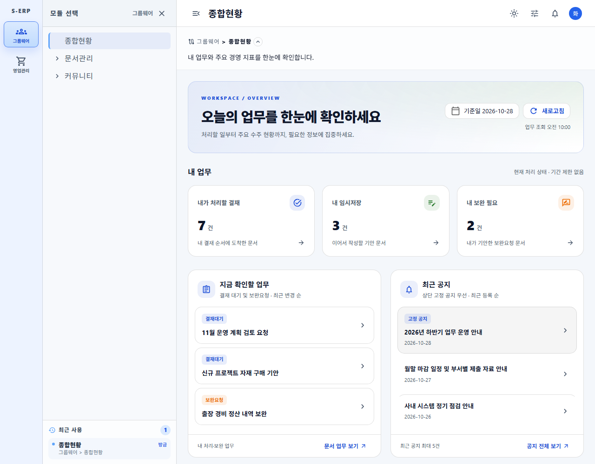
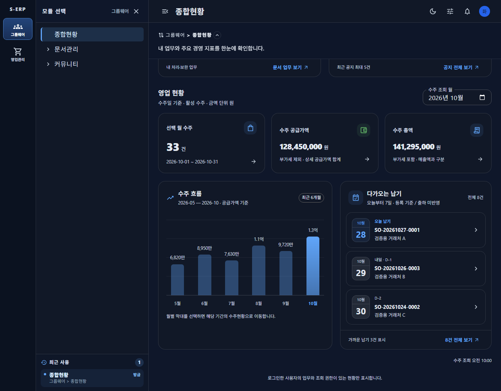

# 대시보드 포커스 패널 결과

근거: [작업지시서](../../../directions/20261028/20261028_004_dashboard-focus-panels_작업지시서.md) · [계획서](../../../plan/20261028/20261028_004_dashboard-focus-panels_계획서.md) · [상세사양](../../../spec/20261028/20261028_004_dashboard-focus-panels_상세사양서.md)

## 적용

승인된 A 포커스 카드형을 실제 대시보드에 반영했다.

- 지금 확인할 업무: 행별 카드 경계, 결재대기/보완요청 채움 배지, 하단 문서 업무 보기.
- 최근 공지: 고정 공지 배지와 배경, 일반 공지 구분선, 하단 공지 전체 보기.
- 다가오는 납기: 월/일 달력 타일, 서버 기준일 기준 오늘/내일/D-n, 전체 건수와 하단 전체 보기.
- 공유 focus 패널/목록 행으로 hover·키보드 focus·여백·테마를 통일했다. 기존 차트 패널 디자인과 전체 패널 위치는 유지했다.
- 스켈레톤에도 동일한 헤더 아이콘 배경·행 경계·배지·날짜 공간·하단 링크 공간을 반영했다.
- 로그인/API/권한/검색·상세 이동 유지. 백엔드/DB 변경이 없어 DB MCP 및 스키마 스크립트 대상 아님.

## 검증

- 신규 회귀 테스트 2건이 구현 전 실패, 구현 후 통과했다. 고정 공지/하단 이동, 월 경계에서 서버 기준일 기반 D-day와 납기 상세 조건을 검증한다.
- 집중 Vitest 2파일 16건 통과. 변경 영역 lint 및 TypeScript/Vite 빌드 통과.
- 실제 브라우저에서 밝은/다크 ×375/768/1280px 가로 넘침 없음, 런타임 오류 0건.
- 월별 수주 기간 이동, 공지 ID 상세, 부분 오류 재시도, 권한 없는 영업 숨김 통과.
- 별도 응답 보류로 개인/영업 스켈레톤을 검증했다. 로딩 카드의 폭/높이와 그리드 상대 위치가 완료 fixture와 허용 오차 내 일치하며, 로딩 클릭/탭 비활성화 유지.
- 화면 검증은 합성 API 응답이다. 실제 운영 데이터 대조나 결재 쓰기를 수행한 것은 아니다. 실제 목록 길이/금액 자릿수에 따라 완료 후 높이는 달라질 수 있다.
- 기존 개발 서버 재사용, 캡처 브라우저 종료. 자동 커밋 없음.

```powershell
Set-Location frontend
npm run test -- tests\overview-page.test.tsx tests\dashboard-overview-service.test.ts
npm run build
npm run lint -- src\pages\dashboard\overview src\pages\groupware\OverviewPage.tsx tests\overview-page.test.tsx scripts\capture-erp-dashboard.js
node scripts\capture-erp-dashboard.js --focus
node scripts\capture-erp-dashboard.js --focus --skeleton
```

## 화면

일반 화면 12장과 로딩/완료 비교 30장을 `screenshots`에 저장했다. 모두 합성 데이터다.

| 테마/폭 | 업무·공지 | 수주·납기 | 스켈레톤 |
|---|---|---|---|
| 밝은 375 | [상단](screenshots/light-375-overview.png) | [납기](screenshots/light-375-sales.png) | [로딩](screenshots/light-375-chart-loading.png) |
| 밝은 768 | [상단](screenshots/light-768-overview.png) | [납기](screenshots/light-768-sales.png) | [로딩](screenshots/light-768-chart-loading.png) |
| 밝은 1280 | [상단](screenshots/light-1280-overview.png) | [납기](screenshots/light-1280-sales.png) | [로딩](screenshots/light-1280-chart-loading.png) |
| 다크 375 | [상단](screenshots/dark-375-overview.png) | [납기](screenshots/dark-375-sales.png) | [로딩](screenshots/dark-375-chart-loading.png) |
| 다크 768 | [상단](screenshots/dark-768-overview.png) | [납기](screenshots/dark-768-sales.png) | [로딩](screenshots/dark-768-chart-loading.png) |
| 다크 1280 | [상단](screenshots/dark-1280-overview.png) | [납기](screenshots/dark-1280-sales.png) | [로딩](screenshots/dark-1280-chart-loading.png) |




