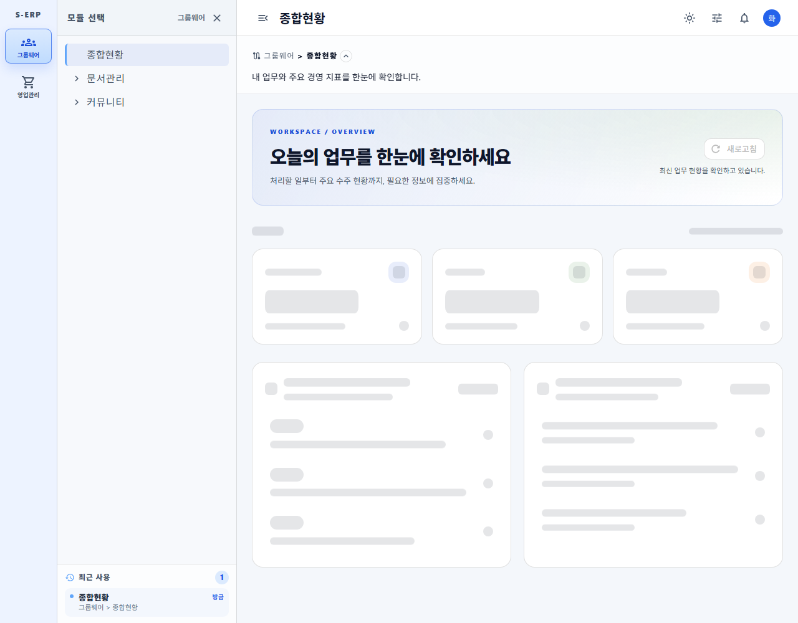
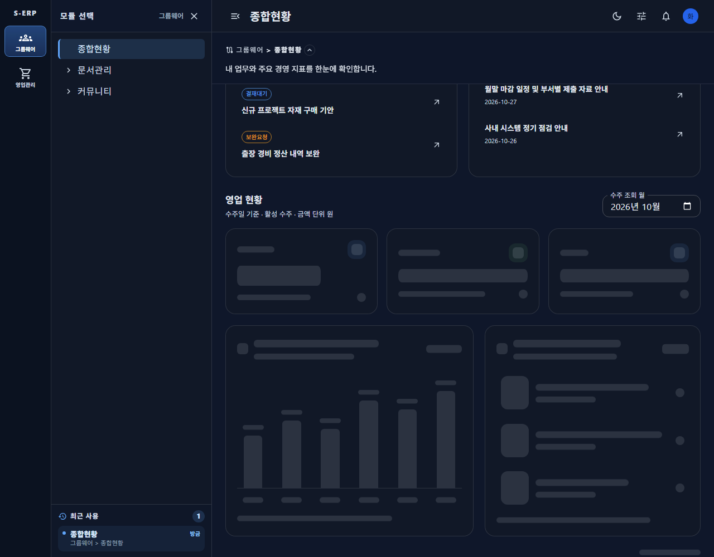

# 종합현황 스켈레톤 구조 정합화 결과

근거: [작업지시서](../../../directions/20261028/20261028_003_dashboard-skeleton_작업지시서.md) · [계획서](../../../plan/20261028/20261028_003_dashboard-skeleton_계획서.md) · [상세사양](../../../spec/20261028/20261028_003_dashboard-skeleton_상세사양서.md)

## 변경

기존 공통 로딩은 카드 모양 3개와 큰 사각형 1개뿐이어서 업무/공지 및 영업의 실제 화면 구성이 일치하지 않았다.

- 개인 로딩: 내 업무 제목/보조문구, 카드 3개, 업무 목록/공지 목록의 개별 패널.
- 영업 로딩: 카드 3개, 6개 막대/월 라벨, 날짜 타일/수주번호/거래처 형태의 납기 목록.
- 실제 `MetricCard`, `OverviewPanel`의 로딩 변형을 사용하므로 테두리·배경·패딩·타이포그래피를 공유한다. 실제 화면과 동일한 반응형 그리드 및 패널 비율을 사용한다.
- 개인/영업 로딩 상태 이름을 구분하고 장식은 접근성 트리에서 제외했다. 로딩 카드는 비활성화하고 탭 순서에서 제외한다.
- 측정용 문자열은 화면에 표시하지 않는다. 금액은 자릿수에 따른 줄바꿈을 고려한 숨겨진 측정값으로 공간을 확보한다.
- 영업 로딩 중에도 이미 표시된 개인 업무/공지는 유지한다. API·권한·집계·서버·DB 변경 없음.

## 검증

```powershell
Set-Location frontend
npm run test -- tests\overview-page.test.tsx tests\dashboard-overview-service.test.ts
npm run build
npm run lint -- src\pages\dashboard\overview scripts\capture-erp-dashboard.js tests\overview-page.test.tsx
node scripts\capture-erp-dashboard.js --skeleton
```

- 신규 회귀 테스트 2건을 먼저 실행하여 기존 구현에서 실패함을 확인했다. 최종 집중 테스트 14건 통과.
- TypeScript/Vite 빌드 및 변경 영역 lint 통과.
- Playwright로 API 응답을 보류하여 초기 개인 로딩 → 개인 완료/영업 로딩 → 영업 완료 상태를 확인했다.
- 밝은/다크 × 375/768/1280px에서 카드 3개의 폭/높이와 그리드 내 상대 위치를 완료 화면과 비교했다. 폭 오차 1px 미만, 높이/상대 세로 위치 오차 2px 미만 조건 통과.
- 로딩 화면 가로 넘침 없음, 런타임 오류 0건. 측정 문자열의 숨김 및 로딩 카드의 클릭/탭 비활성화 확인.
- 모든 화면은 합성 데이터다. 실제 목록 수·제목 길이·금액 자릿수가 다른 경우 완료 후 높이는 달라질 수 있으며, 임의 데이터에 대해 레이아웃 변화가 전혀 없음을 보장하지는 않는다.
- 백엔드/DB 변경이 없어 백엔드 테스트, DB MCP, 마이그레이션은 이번 수정 대상이 아니다. 기존 개발 서버는 재사용했고 종료하지 않았다.

## 화면 자료

각 조합에서 개인 상단/목록, 영업 카드/차트 로딩 및 완료 차트 총 30장을 저장했다.

| 테마/폭 | 개인 로딩 | 업무·공지 로딩 | 차트·납기 로딩 | 완료 비교 |
|---|---|---|---|---|
| 밝은 375 | [상단](screenshots/light-375-personal-loading.png) | [목록](screenshots/light-375-lists-loading.png) | [영업](screenshots/light-375-chart-loading.png) | [완료](screenshots/light-375-chart-loaded.png) |
| 밝은 768 | [상단](screenshots/light-768-personal-loading.png) | [목록](screenshots/light-768-lists-loading.png) | [영업](screenshots/light-768-chart-loading.png) | [완료](screenshots/light-768-chart-loaded.png) |
| 밝은 1280 | [상단](screenshots/light-1280-personal-loading.png) | [목록](screenshots/light-1280-lists-loading.png) | [영업](screenshots/light-1280-chart-loading.png) | [완료](screenshots/light-1280-chart-loaded.png) |
| 다크 375 | [상단](screenshots/dark-375-personal-loading.png) | [목록](screenshots/dark-375-lists-loading.png) | [영업](screenshots/dark-375-chart-loading.png) | [완료](screenshots/dark-375-chart-loaded.png) |
| 다크 768 | [상단](screenshots/dark-768-personal-loading.png) | [목록](screenshots/dark-768-lists-loading.png) | [영업](screenshots/dark-768-chart-loading.png) | [완료](screenshots/dark-768-chart-loaded.png) |
| 다크 1280 | [상단](screenshots/dark-1280-personal-loading.png) | [목록](screenshots/dark-1280-lists-loading.png) | [영업](screenshots/dark-1280-chart-loading.png) | [완료](screenshots/dark-1280-chart-loaded.png) |




