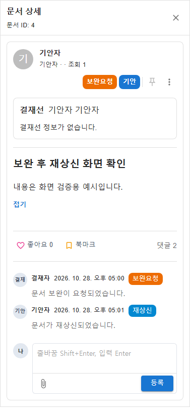
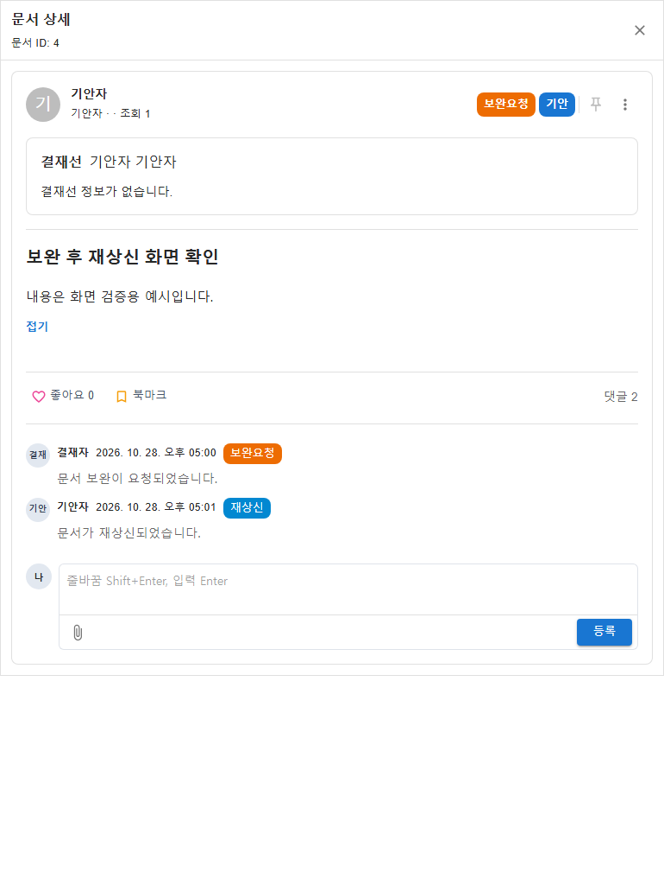
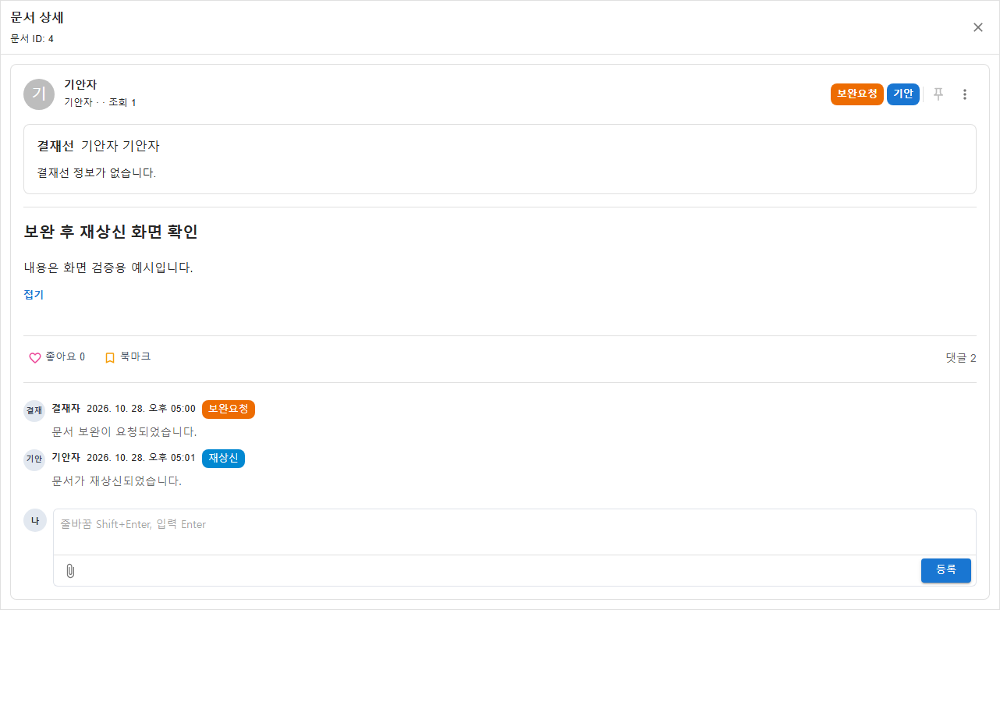

# 20261028_014 문서작성 재상신 후 상세 댓글 갱신 결과

## 결과

보완요청 문서를 수정 후 재상신한 뒤 우측 상세 패널에서 재상신 시스템 이력이 보이지 않던 문제를 수정했다.

상세 갱신 토큰은 문서 상세 정보만 다시 조회하고 댓글·시스템 이력 조회는 문서 ID와 패널 열림 상태에만 연결되어 있었다. 같은 문서의 재상신 후에는 댓글 조회가 다시 실행되지 않아 이전 이력이 화면에 남았다. 이제 상세 갱신 토큰 변경 시 기존 문서 상세 조회와 함께 댓글·시스템 이력도 다시 가져온다.

## 변경 파일

- `frontend/src/pages/groupware/documents/write/components/DocumentApprovalDetailFeed.tsx`
- `frontend/tests/document-write-page.test.tsx`

## 검증

- 회귀 테스트는 재상신 후 댓글 API가 다시 호출되어야 한다는 기대에 따라 작성했다. 수정 전에는 기대 호출 2회 중 실제 1회로 실패했고, 수정 후에는 통과했다.
- `npx vitest run tests/document-write-page.test.tsx --testNamePattern='opens a revision-requested draft in the composer with its persisted content and approvers'` 통과.
- `npm run build` 통과.
- 변경 파일 `oxlint` 통과. 컴포넌트의 `react(set-state-in-effect)` 경고가 출력되었으며 lint 종료 코드는 0이었다.
- `git diff --check` 통과.
- 실제 브라우저에서 mock 데이터로 375px, 768px, 1280px 크기를 확인했다. 각 화면에서 댓글 API가 재호출되고 보완요청 및 재상신 시스템 이력이 표시되었다. 개인정보나 실제 업무 데이터는 사용하지 않았다.

### 브라우저 캡처

| 화면 폭 | 캡처 |
|---:|---|
| 375px |  |
| 768px |  |
| 1280px |  |

`npx vitest run tests/document-write-page.test.tsx` 전체 파일 실행에서는 125개 중 45개가 실패했다. 실패는 여러 기존 페이지/목록/상세 테스트에도 발생했으며, 변경 경로의 회귀 테스트는 단독 실행으로 통과했다. 전체 테스트 파일의 기준선은 별도로 확인하지 않았다.

## 범위

백엔드, API, 데이터베이스, 댓글 정책은 변경하지 않았다.
