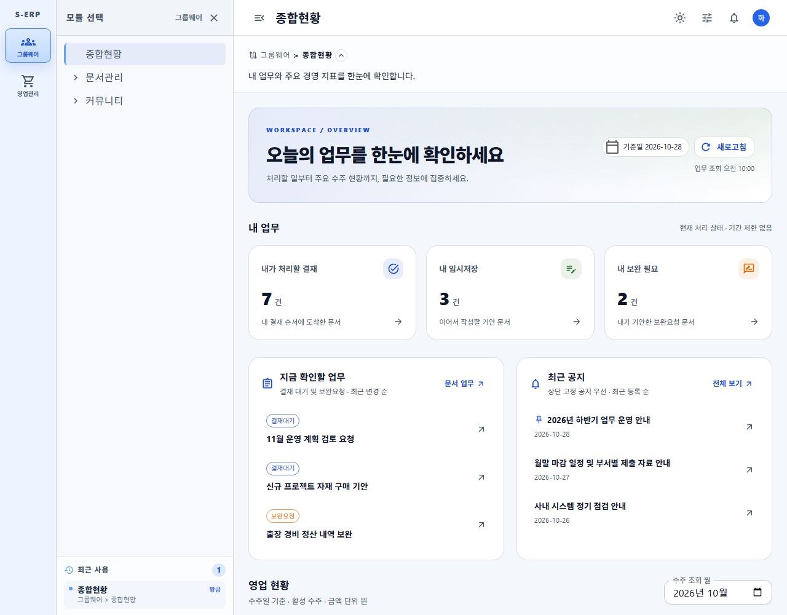
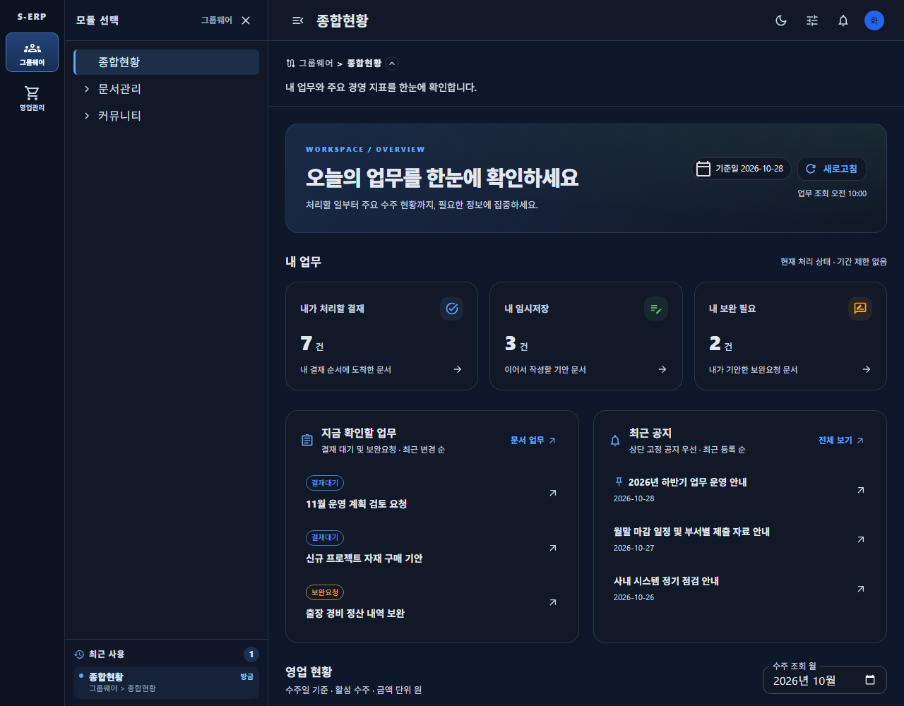

# 20261028_002 ERP 실데이터 대시보드 결과서

근거: [작업지시서](../../../directions/20261028/20261028_002_erp-dashboard_작업지시서.md) · [계획서](../../../plan/20261028/20261028_002_erp-dashboard_계획서.md) · [상세사양서](../../../spec/20261028/20261028_002_erp-dashboard_상세사양서.md)

## 1. 구현 결과

로그인 후 기존 그룹웨어 종합현황의 고정 샘플을 서버 조회 기반 화면으로 교체했다. 기존 로그인·모듈·메뉴 선택과 공통 앱 셸은 유지했다.

| 영역 | 구현 |
|---|---|
| 내 업무 | 내가 처리할 결재, 내 임시저장, 내가 기안한 보완요청 건수 |
| 처리할 업무 | 기존 결재 요약의 최근 업무, 기존 상세·결재·기안 편집 컴포넌트 재사용 및 처리 후 갱신 |
| 최근 공지 | 고정 우선 최신 5건, ID로 기존 공지 상세 열기. 첫 목록에 없는 공지도 상세 조회 |
| 영업 현황 | 월별 활성 수주 헤더 건수, 공급가액, 부가세 포함 총액, 최근 6개월 추이 |
| 다가오는 납기 | 오늘부터 7일, 등록 기준 전체 건수 및 가까운 최대 5건. 출하 미반영 표시 |
| 상세 조회 | 선택 월 또는 납기 범위를 수주현황에 전달. 기존 저장 검색조건보다 명시적 링크 우선 |
| 상태 처리 | 로딩·정상 빈 결과·부분 오류·재시도·새로고침, 오래된 월 응답 무시 |
| 디자인 | MUI palette 기반 밝은/다크 테마, 인디고·청록 포인트, 일관된 카드·간격·아이콘, 반응형 내부 스크롤 |

신규 API는 `GET /api/v1/dashboard/overview`, `GET /api/v1/dashboard/sales?month=YYYY-MM`이다. 클라이언트가 테넌트나 사용자 식별자를 지정하지 않으며, 인증 정보와 매 요청의 서버 메뉴 read 권한을 적용한다. 권한 없는 영역은 조회하지 않고 화면에서도 숨긴다.

수주 건수는 상세 행 수가 아니라 헤더 수이며, 상세 금액을 테넌트·수주별로 먼저 집계한다. 수주금액을 매출액이나 미출하 금액으로 표시하지 않았다. 구매·재고·생산·회계의 미구현 업무 지표도 임의 생성하지 않았다.

## 2. DB MCP 확인과 변경 범위

- 기본 `s-erp-postgresql-readonly`의 `list_tables`, `describe_table`을 직접 호출했다.
- 확인 테이블: `tb_sales_order_hd`, `tb_sales_order_dt`, `tb_electronic_approval_main`, `tb_electronic_approval_line_info`, `tb_board_post`, `tb_material_info`.
- 현재 컬럼 계약을 기존 Mapper/도메인 코드와 대조했다. 수주 합계 및 납기 조회는 `tenant_id = NULL`로 어떤 테넌트도 매칭하지 않는 읽기 전용 SQL로 구문·컬럼 호환성을 확인했다. 0건/0원 결과는 이 검증 조건에 의한 것이며 실제 업무 집계 결과를 의미하지 않는다.
- 실제 테넌트 데이터 행·개인정보·계정·인증 정보는 조회하거나 결과물에 기록하지 않았다.
- 신규 테이블/컬럼, 제약조건, 기본값, 데이터 마이그레이션 변경 없음. 따라서 날짜별 DDL·롤백 및 누적 스키마 갱신 대상 없음.
- 날짜는 문자열로 투영하여 기존 log4jdbc의 java.time 변환 제약을 회피했다.

## 3. 검증 결과

### 자동 검증

| 검증 | 결과 |
|---|---|
| 백엔드 집중 테스트 | 5개 클래스, 16건 통과 |
| 프론트엔드 집중 테스트 | 5개 파일, 36건 통과 |
| 대시보드 구현·신규 테스트·캡처 스크립트 lint | 오류/경고 없이 통과 |
| 프론트엔드 프로덕션 빌드 | TypeScript + Vite 통과 |
| 기능 코드 리뷰 | 중요한 결함 보고 없음 |
| 변경 diff 공백 검사 | 통과 |

백엔드 실행 명령:

```powershell
Set-Location backend
mvn -q "-Dtest=DashboardServiceTest,DashboardMapperTest,DashboardApiControllerTest,SalesOrderStatusServiceImplTest,SalesOrderStatusMapperTest" test
```

프론트엔드 실행 명령:

```powershell
Set-Location frontend
npm run test -- tests\overview-page.test.tsx tests\dashboard-overview-service.test.ts tests\sales-order-status-page.test.tsx tests\use-notice-interactions.test.tsx tests\use-notice-list.test.tsx
npm run lint -- src\pages\dashboard\overview src\pages\groupware\OverviewPage.tsx scripts\capture-erp-dashboard.js tests\overview-page.test.tsx tests\dashboard-overview-service.test.ts
npm run build
node scripts\capture-erp-dashboard.js
```

주요 회귀 항목은 인증 누락, read 없이 create/update/delete만 부여된 메뉴의 조회 차단, 테넌트 전달, 월 범위, 빈 월 보충, 결재/공지 독립 실패, 명시적 기간의 저장 검색조건 덮어쓰기, 이전 월 지연 응답 무시, 오류를 0으로 대체하지 않는 처리다.

1900-01 선택 시 최근 6개월에 1899년 구간이 포함되는 경계값 오류도 수정했다. 조회 월 검증을 추이 데이터에 그대로 적용하던 원인을 분리했으며, 지원 범위 밖 막대는 표시만 하고 상세 이동과 탭 대상에서 제외한다. 관련 API/UI 테스트 2건이 수정 전 실패, 수정 후 통과함을 확인했다.

### 기존 문제와 검증 한계

- 기존 `notice-page.test.tsx`의 초기 스켈레톤 기대 테스트 1건은 인증 fixture 부족에 따른 오류 상태로 실패한다. 수정 전 HEAD의 공지 화면/훅을 임시 Vitest 로더로 로드했을 때도 같은 실패를 재현했다. 이 작업의 집중 테스트와 구분하며 관련 없는 기존 테스트는 수정하지 않았다. 임시 로더 파일은 제거했다.
- 기존 공지 화면의 hook 의존성 경고 및 수주 검색 훅의 effect 내 상태 변경 경고는 별도 범위다. 신규 대시보드 파일 대상 lint 결과를 저장소 전체 무경고로 확대 해석하지 않는다.
- 백엔드 집중 테스트는 서비스·컨트롤러·Mapper 계약 검증이며, 실제 테넌트 데이터와 합계/목록을 대조하는 통합 검증은 아니다.
- 화면 검증은 API 경계에서 합성 응답을 주입했다. 운영 계정 로그인, 실제 테넌트 자료에 대한 집계 대조, 실제 결재 처리 쓰기 작업은 수행하지 않았다. 운영 적용 전 해당 권한 계정으로 이 항목들을 추가 확인해야 한다.

## 4. 브라우저 검증과 화면

기존 S-ERP 개발 서버를 재사용했고 종료하지 않았다. 캡처용 브라우저는 스크립트 종료 시 닫았다. 아래 화면의 문서·공지·수주·금액은 모두 합성 데이터다.

- 밝은/다크 × 375/768/1280px, 높이 1000px에서 상단/영업 영역 총 12장 저장.
- 모든 화면에서 문서 및 대시보드 내부 가로 넘침 없음, 세로 스크롤 가능, 테마 `colorScheme` 일치.
- 런타임 오류 0건. 월 변경 후 정확한 수주 기간 이동, 목록 밖 공지 ID 상세, 수주 503 부분 오류 후 재시도, 수주 조회권한 해제 시 영역 숨김을 양 테마에서 확인.

| 테마 | 폭 | 종합현황 | 영업 영역 |
|---|---|---|---|
| 밝은 | 375 | [상단](screenshots/light-375-overview.png) | [수주·납기](screenshots/light-375-sales.png) |
| 밝은 | 768 | [상단](screenshots/light-768-overview.png) | [수주·납기](screenshots/light-768-sales.png) |
| 밝은 | 1280 | [상단](screenshots/light-1280-overview.png) | [수주·납기](screenshots/light-1280-sales.png) |
| 다크 | 375 | [상단](screenshots/dark-375-overview.png) | [수주·납기](screenshots/dark-375-sales.png) |
| 다크 | 768 | [상단](screenshots/dark-768-overview.png) | [수주·납기](screenshots/dark-768-sales.png) |
| 다크 | 1280 | [상단](screenshots/dark-1280-overview.png) | [수주·납기](screenshots/dark-1280-sales.png) |





## 5. 최종 점검

- 작업지시서 → 계획서 → 상세사양서 → 구현 → 결과서/스크린샷 순서 이행.
- 기존 로그인/라우팅/테마 및 앱 셸 유지, 신규 의존성 없음.
- 프론트엔드·백엔드 영향 범위 및 직접 연결된 공지/수주 이동 회귀 확인.
- DB MCP 근거 및 실데이터 미검증 항목 명시, 스키마 변경 없음.
- 기존 다른 작업의 스테이징 파일은 보존했으며 자동 커밋하지 않음.
