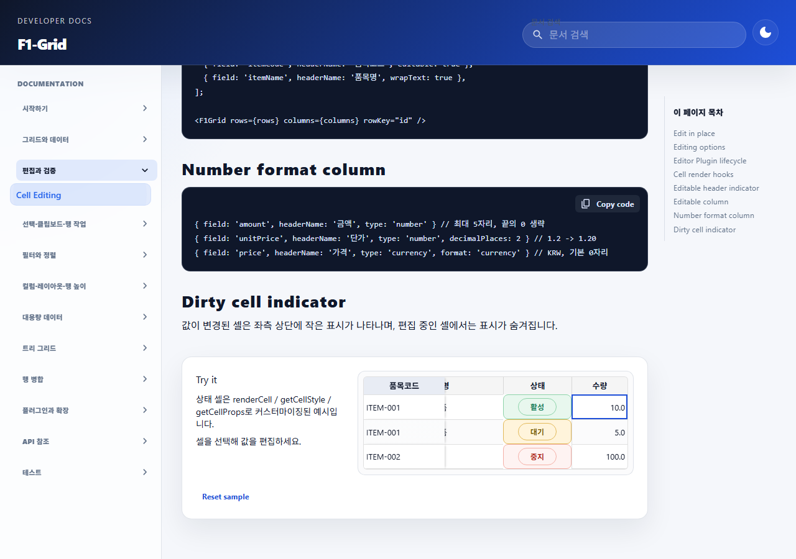

# F1-Grid 빈 숫자 편집 dirty 오표시 수정 결과

## 참조 문서

- [작업지시서](../../../directions/20261029/20261029_001_f1grid_blank_numeric_dirty_작업지시서.md)
- [계획서](../../../plan/20261029/20261029_001_f1grid_blank_numeric_dirty_계획서.md)
- [상세 사양서](../../../spec/20261029/20261029_001_f1grid_blank_numeric_dirty_상세사양서.md)

## 수정 내용

- 숫자·소수·통화 셀의 빈 draft를 확정할 때 `Number('')`로 0이 되던 commit 변환을 `null` 유지로 수정했다.
- 품목관리의 `NONE` 소비기한 숫자가 빈 상태에서 편집을 마쳐도 값과 dirty 상태가 바뀌지 않는다.
- 명시적으로 입력한 0은 숫자 0으로 저장되며 실제 변경으로 추적된다.
- [F1-GRID.md](../../../../frontend/src/pages/f1-grid-docs/F1-GRID.md)에 빈 숫자 및 0의 계약을 기록했다.

## 회귀 검증

| 검증 | 결과 |
| --- | --- |
| 빈 nullable 숫자 commit 후 값·dirty·변경 집합 | 통과 |
| 명시적 0과 숫자 변경 및 원복 dirty 동작 | 통과 |
| 품목관리 회귀 `tests/material-management.test.tsx` | 27개 통과 |
| F1-Grid 관련 선택 테스트 | 통과 |
| F1-Grid 문서 테스트(시간 초과 단일 테스트 재실행 포함) | 통과 |
| 프론트엔드 `npm run build` | 통과 |
| 실제 브라우저에서 숫자 값 그대로 commit 후 dirty 상태 | `data-dirty-cell=false` 확인 |

전체 F1-Grid 테스트 파일에는 이번 수정과 무관한 기존 테스트 실패가 있어, dirty/숫자 편집 관련 테스트를 선택 실행해 확인했다. 문서 테스트의 첫 전체 실행은 검색 테스트가 기본 5초 제한에 걸렸으나, 해당 테스트를 10초 제한으로 재실행해 통과했다.

## 브라우저 캡처

F1-Grid 문서의 숫자 에디터 playground에서 현재 숫자를 변경하지 않고 확정한 1280×900 브라우저 화면이다. `null` 소비기한 입력의 회귀는 Vitest로 직접 검증했다.

