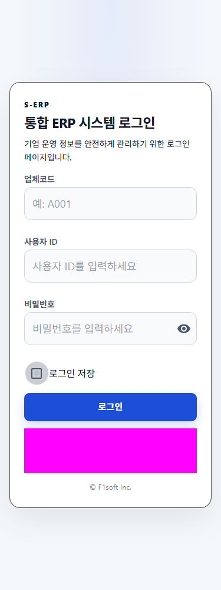
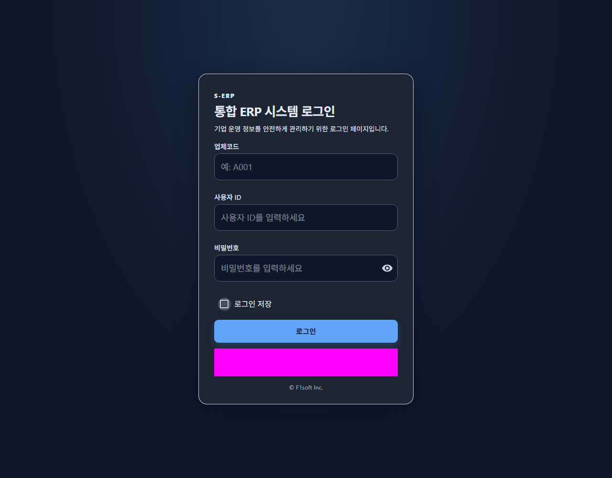

# 로그인 저장 결과보고서

## 구현 결과

- 비밀번호 아래에 `로그인 저장` 체크박스를 추가했다. 기본 해제 상태이며 제출 중에는 비활성화된다.
- 선택 후 로그인 성공 시 현재 브라우저의 `s-erp-remembered-login`에 업체코드와 사용자 ID만 저장한다.
- 재방문/새로고침 시 두 필드와 체크 상태를 복원한다. 비밀번호는 항상 빈 값으로 시작하며 새 저장 항목에 포함하지 않는다.
- 선택 해제 시 해당 저장 항목만 즉시 삭제하고 현재 입력값은 유지한다.
- 필수 입력 오류/인증 실패는 기억한 값을 갱신하지 않는다. 손상된 저장값은 무시하고 저장소 예외는 기존 로그인 흐름을 막지 않는다.
- 로그아웃/인증 세션 처리와 API는 변경하지 않았다.

## 변경 범위

- `frontend/src/pages/auth/hooks/useLoginForm.ts`: 복원, 선택, 삭제, 성공 후 저장.
- `frontend/src/pages/auth/components/LoginForm.tsx`: 접근 가능한 MUI 체크박스.
- `frontend/src/pages/auth/LoginPage.tsx`: 상태/이벤트 연결.
- `frontend/tests/login-remember.test.tsx`: 신규 저장 동작 16개 사례.
- `frontend/tests/login.test.tsx`: 체크박스 기본 상태 및 기존 인증 회귀 검증.
- 작업지시서, 계획서, 상세사양서와 이 결과 문서 및 스크린샷.

## 검증

| 검증 | 결과 |
|---|---|
| 구현 전 신규 테스트 | 16개 중 기능 부재에 따른 14개 실패 확인 |
| 로그인/입력 컴포넌트/저장 집중 테스트 | 3개 파일, 27개 테스트 통과 |
| 변경한 소스/테스트 5개 파일 oxlint | 오류/경고 없이 통과 |
| `npm run build` | TypeScript 및 Vite 빌드 통과 |
| 실제 Chromium, 라이트/다크 × 375/768/1280px | 가로 넘침 없음, 키보드 Space 선택/해제 확인 |
| 실제 브라우저 저장/재방문/새로고침 | 두 필드 복원, 비밀번호 빈 값, 해제 후 재진입 시 빈 값 확인 |
| 브라우저 런타임 오류 | 없음 |
| 변경 diff 점검 | 로그인 범위만 검토, 기존 타 작업 변경 유지 |

기존 로그인 테스트는 지연 로딩 전 동기 조회, 자식 메뉴가 없는 메뉴 fixture, 토큰이 빠진 갱신 fixture, 중복된 제목 선택자로 실패했다. 로그인 회귀 검증을 위해 이 파일 안에서 화면 대기와 메뉴/갱신 fixture를 정합화하고 제목을 level 1로 지정했다. 별도 테스트가 있는 로그인 공지 팝업은 이 인증 테스트에서만 격리했다. 실제 제품의 메뉴/갱신/공지 코드는 변경하지 않았다.

브라우저 검증은 기존 `http://127.0.0.1:4173` S-ERP 서버를 재사용했고 종료하지 않았다. 합성 입력과 모의 인증 응답을 사용했으며 인증 이후 대시보드 모듈은 빈 컴포넌트로 대체해 로그인 저장 흐름만 검증했다. 실제 계정이나 인증 정보를 결과물에 기록하지 않았다. 스크린샷의 자홍색 영역은 기존 개발 계정 안내를 가린 마스킹이다.

브라우저 정책으로 저장소 접근이 차단되면 저장/삭제가 보장되지 않으며 현재 로그인만 기존대로 수행한다.

## 스크린샷

| 테마 | 모바일 | 태블릿 | 데스크톱 |
|---|---|---|---|
| 라이트 | [375px](screenshots/login-light-375.png) | [768px](screenshots/login-light-768.png) | [1280px](screenshots/login-light-1280.png) |
| 다크 | [375px](screenshots/login-dark-375.png) | [768px](screenshots/login-dark-768.png) | [1280px](screenshots/login-dark-1280.png) |

## 최종 체크리스트

- [x] 작업지시서 확인 및 이번 사용자 요청 반영
- [x] 계획서 → 상세 사양서 → 실제 구현 순서 준수
- [x] 실패 테스트 후 구현 및 집중 회귀 검증
- [x] 실제 브라우저 및 반응형/키보드 확인
- [x] 결과 문서와 비식별 스크린샷 작성
- [x] 프론트엔드 범위 유지 및 문서/구현 일치 확인
- [x] 백엔드/DB/API 계약 변경 없음: 백엔드 테스트, DB MCP, SQL 및 스키마 이력 대상 아님

## 근거 문서

- [작업지시서](../../../directions/20261029/20261029_008_login-remember_작업지시서.md)
- [계획서](../../../plan/20261029/20261029_008_login-remember_계획서.md)
- [상세사양서](../../../spec/20261029/20261029_008_login-remember_상세사양서.md)
