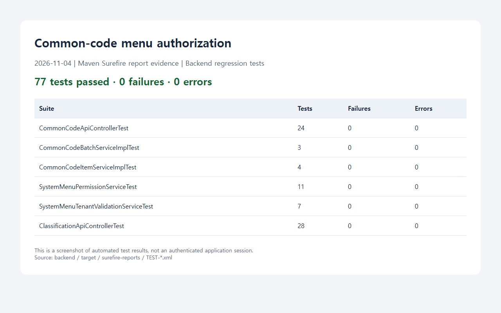

# 공통코드 메뉴별 기능 권한 적용 결과

## 근거와 변경

- [작업지시서](../../../directions/20261104/20261104_003_common-code-menu-permission_작업지시서.md)
- [계획서](../../../plan/20261104/20261104_003_common-code-menu-permission_계획서.md)
- [상세 사양서](../../../spec/20261104/20261104_003_common-code-menu-permission_상세사양서.md)
- 대상: `CommonCodeGroupApiController`, `CommonCodeApiControllerTest`.

### 재현 조건과 원인

일반 사용자가 권한그룹의 공통코드 메뉴에 쓰기 권한을 가진 상태로 일괄 저장 또는 단건 등록/수정을 호출하면 403이 발생했다. 화면은 CREATE 또는 UPDATE로 저장을 허용하지만 서버의 `requireAdmin`은 `EgovAccessControlHelper.isTenantAdmin`으로 관리자 역할만 인정하고 있었다.

### 해결

- 관리자 역할 검사를 제거하고 `SystemMenuService.getMyMenuTree`의 기존 로그인 사용자 권한그룹 합산 결과를 사용한다.
- `/co` 모듈의 `common-code` 또는 기존 `cmncodes` 메뉴 기능 권한만 확인한다.
- 등록/수정/일괄 저장은 CREATE 또는 UPDATE, 단건 삭제는 DELETE를 확인한다.
- 일괄 저장에 그룹 또는 상세 삭제 행이 포함되면 DELETE도 확인한다. 거부 시 업무 서비스를 호출하지 않는다.
- 인증 및 양수 tenantId 검증은 유지한다. 관리자도 해당 메뉴 권한이 없으면 거부한다.
- 공용 조회 API, UI/F1Grid, 데이터 유효성 검사, 테넌트 분리, 다른 메뉴 정책은 변경하지 않았다.

## 검증

테스트 추가 후 구현 전 실행에서 일반 사용자의 저장은 기대한 200 대신 403, 읽기 전용 관리자의 저장은 기대한 403 대신 200으로 실패하여 원인을 재현했다.

최초 수정 후 71건이 통과했으나 실제 DB 페이지 키를 반영하지 못했다. 아래 추가 보완 후 다음 명령으로 6개 테스트 클래스, 총 77건이 실패/오류/건너뛰기 없이 통과했다.

```powershell
cd backend
mvn -q "-Dtest=CommonCodeApiControllerTest,CommonCodeBatchServiceImplTest,CommonCodeItemServiceImplTest,SystemMenuPermissionServiceTest,SystemMenuTenantValidationServiceTest,ClassificationApiControllerTest" test
```

| 테스트 클래스 | 건수 |
| --- | ---: |
| CommonCodeApiControllerTest | 24 |
| CommonCodeBatchServiceImplTest | 3 |
| CommonCodeItemServiceImplTest | 4 |
| SystemMenuPermissionServiceTest | 11 |
| SystemMenuTenantValidationServiceTest | 7 |
| ClassificationApiControllerTest | 28 |

회귀 범위는 CREATE 단독/UPDATE 단독 일반 사용자, 관리자 우회 금지, 다른 메뉴/모듈 권한 거부, 그룹/상세 일괄 삭제, 단건 삭제, null 변경 세트, 인증/테넌트 누락·오류, 인증된 테넌트 전달, 기존 중복/상위 코드 검증 응답이다.

변경한 운영 컨트롤러는 Maven 의존성과 컴파일된 프로젝트 클래스패스를 사용하여 `javac --release 8 -encoding UTF-8`로 별도 컴파일했고 종료 코드 0을 확인했다. 이 검증은 변경 파일의 Java 8 문법·표준 API 범위이며 전체 애플리케이션의 Java 8 실서버 실행 검증은 아니다.

### 스크린샷 및 미확인 범위



스크린샷은 실제 Surefire XML의 테스트 집계 결과를 렌더링한 증거이며 로그인된 업무 화면 캡처가 아니다. 프론트엔드 소스/레이아웃 변경이 없어 프론트엔드 테스트·빌드는 실행하지 않았다. 실행 중 서버의 재시작·배포, 실제 사용자 로그인 및 운영 DB 저장은 수행하지 않았다.

## DB MCP와 스키마

- 기본 `s-erp-postgresql-readonly`의 `list_tables`를 직접 호출했다.
- 이어 `describe_table("tb_role_menu_permission")`에서 `role_id`, `menu_id`, `permission_id`가 bigint NOT NULL임을 확인했다.
- 계정·테넌트·인증 데이터 행은 조회하거나 기록하지 않았다.
- 기존 `SystemMenuServiceImpl.getMyMenuTree`의 권한그룹 합산 및 메뉴별 READ/CREATE/UPDATE/DELETE/EXCEL 매핑을 재사용했다.
- DB 스키마, 매퍼, 데이터 변경이 없으므로 신규 SQL/롤백/누적 스키마 변경은 없다.

## 사용자 재현 후 실제 DB 재확인 및 보완

### 확인 근거

- 사용자 피드백: 일반사용자 그룹에 쓰기 권한을 부여했지만 여전히 거부됨.
- 기본 MCP 도구 검색에서는 도구가 반환되지 않았으나, 이전에 제공된 정식 도구를 직접 호출하자 `list_tables`가 성공했다. 검색 결과 누락은 실제 연결 불가를 의미하지 않았으며, DB 미확인 상태로 결론 내리지 않았다.
- 이어 `tb_role`, `tb_menu`, `tb_module`, `tb_permission`, `tb_role_menu_permission`의 구조를 `describe_table`로 확인했다.
- 제한 집계 조회는 `COUNT ... FILTER`와 `EXISTS`를 사용했고 개별 계정/테넌트 행이나 ID를 조회·기록하지 않았다.

| 집계 조건 | 결과 |
| --- | ---: |
| 공통코드 메뉴 | 1 |
| 활성 공통코드 메뉴/모듈 | 1 |
| `/co` 모듈 아래 메뉴 | 1 |
| 기존 `cmncodes` 페이지 키 | 0 |
| 현재 `common-code` 페이지 키 | 1 |
| 동일 테넌트의 활성 일반사용자 그룹 CREATE 또는 UPDATE 연결 메뉴 | 1 |

### 실제 원인과 수정

DB의 일반사용자 쓰기 권한 연결은 존재했다. 최초 수정은 과거 사양의 `cmncodes`만 검사했기 때문에 현재 DB의 `common-code` 메뉴 권한을 찾지 못했다. 프론트엔드 `DashboardContent.tsx`는 두 키를 같은 화면으로 처리하지만 서버 검사는 그 계약과 달랐다.

테스트를 실제 DB 키 `common-code`로 보완하여 24건 중 6건이 403으로 실패하는 것을 확인한 뒤, 서버의 페이지 키 검사에 `common-code`를 추가했다. 기존 `cmncodes` 지원과 모듈/기능 권한 제한은 유지했다.

### 추가 검증 및 한계

- CREATE/UPDATE × `common-code`/`cmncodes` 네 조합의 일반 사용자 저장과 단건 등록/수정을 검증했다.
- 두 키 모두 조회 전용 사용자의 관리자 우회와 다른 모듈의 동일 키 권한 오용을 차단했다.
- 삭제/중복/상위 코드/인증/테넌트 회귀도 현재 `common-code` 키를 기본으로 다시 실행했다.
- 관련 회귀 테스트 77건 및 변경 컨트롤러의 `javac --release 8` 검증을 통과했다.
- 실행 중 백엔드는 저장된 클래스 경로를 사용하고 있었고, 수정 후 공통코드 조회의 비인증 요청에 HTTP 401을 반환하여 응답 상태를 확인했다. 이 응답만으로 인증된 사용자의 저장 성공이나 최신 클래스의 런타임 로딩을 증명하지는 않는다.
- 사용자 인증정보를 취득하지 않았으며 로그인된 사용자로 실제 데이터 저장은 실행하지 않았다. DB 권한 연결, 실제 DB 키의 오류 재현 및 수정 검증을 구분하여 기록한다.
- 테스트 집계 스크린샷을 77건 결과로 갱신했다. DB 데이터/스키마는 변경하지 않았다.

## 완료 점검

- [x] 작업지시서 → 계획서 → 상세 사양서 → 구현 순서 준수
- [x] 공통코드 변경 API와 관련 회귀 테스트로 범위 제한
- [x] 백엔드 관련 회귀 테스트 및 변경 파일 Java 8 API 호환 검증
- [x] 결과 문서와 테스트 증거 스크린샷 보관
- [x] DB MCP 메타데이터 확인 및 DB 변경 불필요 확인
- [x] 기존 사용자 작업과 무관한 소스 수정 없음
