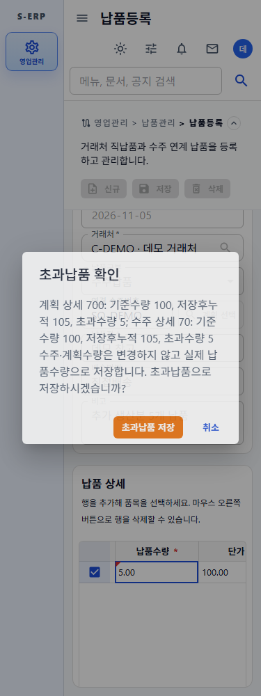

# 초과납품 정책 구현 결과

## 구현 범위

테넌트별 `over_delivery_policy`를 추가했다. 납품계획 운영 방식인 `delivery_plan_mode=AUTO/MANUAL`과 독립적으로 적용하며, 기존 테넌트의 기본값은 `BLOCK`이다.

| 정책 | 수주·계획 기준 초과 시 동작 |
| --- | --- |
| BLOCK | 저장 거부. 확인 플래그가 있어도 우회할 수 없음 |
| WARN | 기준수량·저장 후 누적수량·초과수량을 경고하고 사용자가 확인하면 저장 |

수주·계획 기준수량은 초과 실적에 맞춰 자동 증가시키지 않는다. 예를 들어 기준 100, 실납품 105라면 기준은 100을 유지하고 미납 0, 초과납품 5로 표시한다. 직납품은 기존처럼 수주·계획 수량에 영향을 주지 않는다.

## 저장 및 화면 동작

- 서버는 수주 헤더 잠금 후 계획별 누적량과 같은 수주상세의 분할 계획 요청량을 합산해 검증한다. 수정 시 해당 납품의 기존 수량을 제외하며, 수정·삭제 역보정은 동일 트랜잭션으로 처리한다.
- WARN 미확인 요청에는 HTTP 409와 `[OVER_DELIVERY_CONFIRM_REQUIRED]` 접두어를 반환한다. 이 시점에는 업무 데이터와 번호를 변경하지 않는다.
- 화면은 경고를 받은 입력 스냅샷을 보존하고 `취소 / 초과납품 저장`을 제공한다. 취소하면 입력을 유지하며, 확인 시 그 스냅샷에만 확인 플래그를 붙여 재시도한다. 대화상자와 재시도 중 입력 변경·중복 저장을 막는다.
- 서버는 재시도에서도 최신 정책·연결·누적량을 검증한다. 경고 이후 BLOCK으로 변경되면 확인 저장도 거부한다. 다른 409 오류는 초과납품 경고로 해석하지 않는다.
- WARN에서는 잔량이 0 이하인 계획도 선택할 수 있다. 초기 수량은 0이며 사용자가 실제 양수를 입력해야 저장된다. 선택 목록과 계획현황은 미납수량·초과납품을 분리한다.
- WARN에서 이미 초과 실적이 있어도 수주·계획의 원래 기준수량을 강제로 늘리지 않고 수정할 수 있다. 기존 참조 삭제·품목 변경 방지와 수동 계획 합계 상한은 유지한다.
- 테넌트 정책 설정 화면, 별도 승인권한, 초과율 상한, 초과사유 입력은 추가하지 않았다.

## DB 확인 및 변경 스크립트

**실제 DB에는 적용하지 않았다.** 사용 전 기존 납품·계획 DDL과 이번 003 변경본을 순서대로 적용하고, 초과납품을 허용할 테넌트에만 WARN을 설정해야 한다.

기본 읽기 전용 DB MCP의 `list_tables`, `describe_table(tb_tenant)`, `describe_table(tb_sales_order_dt)`를 직접 호출했다. 조회 당시 테넌트 정책 컬럼과 납품·계획 테이블은 미반영이며 수주상세에는 `shipped_qty`가 존재했다. 업무 데이터 행은 조회하지 않았다. 신규 테이블 제약과 연계 계약은 저장소 날짜별 DDL·Mapper·도메인 코드를 대체 근거로 확인했다. 따라서 실제 DB에 신규 테이블·API가 반영됐다고 보증하지 않는다.

변경본은 `docs/database`와 `backend/DATABASE`에 동일하게 보관했다.

- [변경 SQL](../../../database/20261105/20261105_003_add_over_delivery_policy.sql): 테넌트 정책 컬럼, 계획 실납품 상한 해제, 수주출하량 비음수·NaN 거부 제약.
- [롤백 SQL](../../../database/20261105/20261105_003_rollback_over_delivery_policy.sql): 초과 실적 또는 WARN 테넌트가 남아 있으면 중단한다. 수량을 임의 변경하거나 데이터를 삭제하지 않는다.
- [스키마 변경 이력](../../../database/20261105/20261105_003_change_over_delivery_policy_schema.md), [누적 스키마](../../../database/db-schema.md).

## 검증 결과

| 검증 | 결과 |
| --- | --- |
| 백엔드 `mvn -q test` 전체 | 통과 |
| 프론트엔드 납품·계획 API/page 4파일 | 29개 테스트 통과 |
| 프론트엔드 `npm run build` | 통과 |
| 변경 프론트엔드 파일 oxlint | 종료 코드 0. 기존 effect 관련 경고 1건 |
| 수주·계획·납품 운영 Java 29파일 | `javac --release 8` API 호환 컴파일 통과 |
| 003 스키마 계약 테스트 및 사본 해시 | 통과, 두 경로 동일 |
| 격리 PGlite PostgreSQL 엔진에서 합성 스키마에 003 실행 | 기본 BLOCK, 잘못된 정책·음수·NaN 거부, 초과 실적 저장, 초과/WARN 롤백 중단과 데이터 보존, 조건 충족 후 롤백 통과 |
| 실제 브라우저 375/768/1280px | 소진 계획 선택·추가 수량, 경고 취소와 입력 보존, 정책 변경 시 확인 저장 거부, 일반 저장의 재확인, 확인 저장 성공 및 페이지 오류 없음 확인 |
| 보고용 흐름도 | BLOCK/WARN 문구 반영 후 PNG 재렌더링 및 이미지 확인 |

브라우저 검증은 합성 API 응답으로 수행했다. 실제 DB 마이그레이션·실서버 연동 검증을 대신하지 않는다. 이전 작업의 전체 프론트엔드 테스트 실패는 이번에 전체 재실행·원인분석하지 않았으며, 위 29개 관련 테스트 통과와 구분한다.

## 화면 및 보고 자료

| 화면 폭 | 초과납품 경고 | 확인 저장 후 |
| --- | --- | --- |
| 375px | [경고](screenshots/warning-375.png) | [저장](screenshots/saved-375.png) |
| 768px | [경고](screenshots/warning-768.png) | [저장](screenshots/saved-768.png) |
| 1280px | [경고](screenshots/warning-1280.png) | [저장](screenshots/saved-1280.png) |

[보고용 흐름도 PNG](../sales-delivery-planning/sales-delivery-flow.png) · [SVG](../sales-delivery-planning/sales-delivery-flow.svg)

흐름도는 1440×2020 크기로 확장해 기준 초과 여부, BLOCK 저장 차단, WARN 경고 취소·확인 저장, 확인 시 최신 정책 재검증을 별도 분기로 표시했다. 직납품의 독립 경로와 기준 100 / 실납품 105 예시도 함께 표현했다.

## 관련 문서

- [작업지시서](../../../directions/20261105/20261105_003_초과납품_정책_작업지시서.md)
- [계획서](../../../plan/20261105/20261105_003_초과납품_정책_계획서.md)
- [상세사양서](../../../spec/20261105/20261105_003_초과납품_정책_상세사양서.md)
- [기존 납품계획 연계 결과](../sales-delivery-planning/20261105_002_납품계획_연계_납품흐름_결과서.md)
