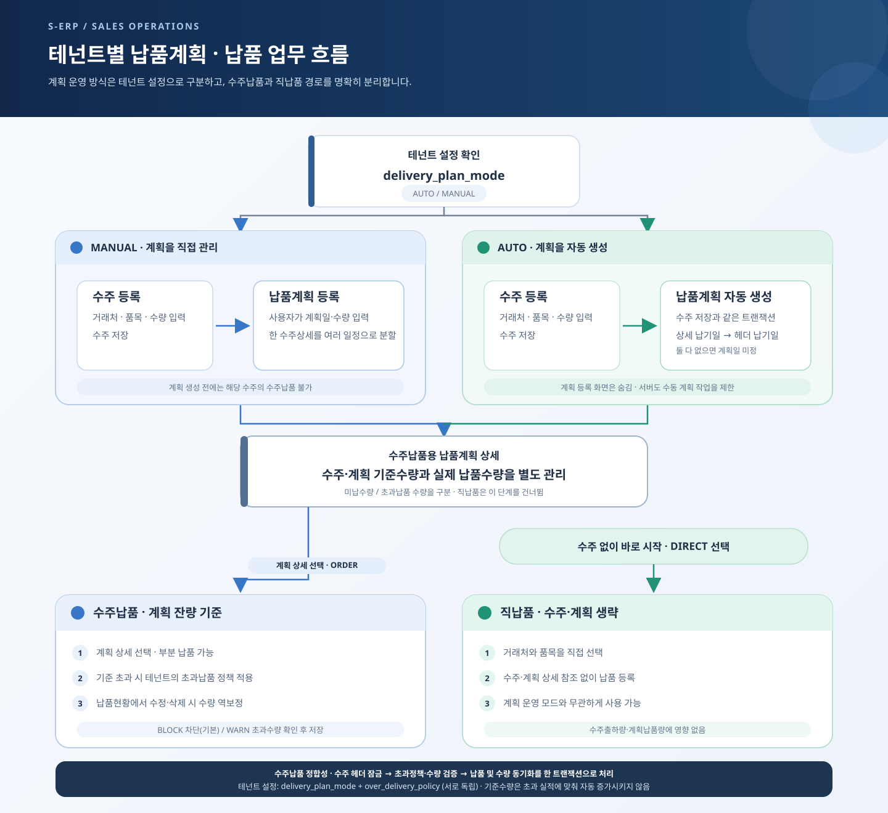

# 납품계획 연계 납품흐름 결과서

## 구현 내용

- 테넌트의 `delivery_plan_mode` 기준으로 `AUTO` 수주 저장 시 납품계획을 같은 트랜잭션에서 생성하고, `MANUAL` 테넌트는 계획 등록·현황 화면과 API를 사용하도록 구성했다. `AUTO` 모드에서는 MANUAL 계획 등록, 상세 조회, 현황 조회를 서버에서도 거부한다.
- 납품계획 등록 화면에서 수주 품목별 계획일·수량을 입력하고 같은 수주상세를 여러 예정일 행으로 나누거나 분할행을 삭제할 수 있다. 저장 후 `신규`로 다음 계획을 작성할 수 있다.
- 납품계획 현황 화면에 필수 계획일 기간 검색, 상세 조회 및 계획일·수량 수정 흐름을 추가했다. 납품등록의 수주 연계 선택 대상은 계획 상세가 되며, 직납품 흐름은 유지한다.
- 수주 수정은 기존 상세를 삭제 후 재생성하지 않고 순번별 상세 ID를 보존해 동기화한다. 수량이 출하·수동계획 수량보다 낮아지거나 계획/납품에서 참조 중인 행을 삭제·품목 변경하는 경우 거부한다. AUTO 계획은 수주 상세의 변경사항에 맞춰 동기화한다.
- 납품 수정·삭제는 연결된 수주를 먼저 잠근 뒤 납품 헤더를 잠가 수주·계획·납품 변경의 잠금 순서를 일관되게 유지한다.
- 계획 테이블, 테넌트 모드, 기존 납품 참조 및 데이터 backfill을 위한 날짜별 DDL·메뉴 seed·rollback·이력 문서와 누적 schema 문서를 추가했다.

## 검증 결과

| 검증 | 결과 |
|---|---|
| 백엔드 전체 테스트 | `mvn -q test` 통과 |
| 프론트엔드 관련 회귀 테스트 | 납품/계획 4개 테스트 파일, 23개 테스트 통과 |
| 프론트엔드 빌드 | `npm run build` 통과 |
| 변경 영역 lint | `npm run lint -- src/pages/sales/delivery src/pages/sales/delivery-plan src/pages/dashboard` 통과(exit 0). 기존 코드의 React effect/Fast Refresh 등 경고가 표시됨 |
| 브라우저 | 합성 API 응답으로 계획 등록·분할·분할행 삭제·현황 수정 및 375/768/1280px 가로 넘침을 확인 |
| DDL 사본 | `docs/database/20261105`와 `backend/DATABASE/20261105`의 대응 파일 SHA-256 일치 |
| DB 계약 | 읽기 전용 MCP에서 `tb_sales_order_dt` 컬럼을 확인. 상세 테이블에 `updated_by`/`updated_at` 컬럼이 없어 수정 SQL에서 해당 컬럼을 사용하지 않도록 반영 |
| 실제 DB 반영 | 수행하지 않음. 계획 테이블·tenant 컬럼을 포함한 DDL은 검토 및 운영 적용 대상으로만 저장됨 |

전체 프론트엔드 `npm run test`는 178개 파일 중 39개 파일 실패, 267개 테스트 실패 및 19개 uncaught error로 종료됐다. 실패 출력에는 `CommonCodeManagementPanel` 테스트의 `treeRef.current?.setSelectedRowIds is not a function` 오류가 포함되어 있다. 전체 실패 원인은 별도로 분석하지 않았으며, 변경 범위의 4개 회귀 테스트는 별도로 모두 통과했다.

상세사양서에 표시된 계획현황의 `계획상태`는 상태값과 산정 기준이 정의되지 않아 임의로 추가하지 않았다. 현재 화면은 계획수량·납품수량·잔량으로 진행 상황을 확인한다.

## 브라우저 스크린샷

모든 브라우저 검증은 S-ERP 개발 서버와 합성 API 응답을 사용했으며 운영 DB/API 데이터는 사용하지 않았다.

## 보고용 업무 흐름도

20261105_003 초과납품 정책 반영: 기존 일괄 차단에서 테넌트별 BLOCK/WARN으로 변경했다. [초과납품 정책 결과](../over-delivery-policy/20261105_003_초과납품_정책_결과서.md)를 함께 참고한다.

[SVG 원본 열기](sales-delivery-flow.svg) · [PNG 미리보기](sales-delivery-flow.png)

### 화면별 캡처

| 뷰포트 | 등록 화면 | 분할 입력 | 현황 | 상세·수정 |
|---|---|---|---|---|
| 375px | [등록](screenshots/create-375.png) | [분할](screenshots/create-split-375.png) | [현황](screenshots/status-375.png) | [상세](screenshots/status-detail-375.png) |
| 768px | [등록](screenshots/create-768.png) | [분할](screenshots/create-split-768.png) | [현황](screenshots/status-768.png) | [상세](screenshots/status-detail-768.png) |
| 1280px | [등록](screenshots/create-1280.png) | [분할](screenshots/create-split-1280.png) | [현황](screenshots/status-1280.png) | [상세](screenshots/status-detail-1280.png) |

## 기준 문서 및 DB 변경 파일

- [작업지시서](../../../directions/20261105/20261105_002_납품계획_연계_납품흐름_개편_작업지시서.md)
- [계획서](../../../plan/20261105/20261105_002_납품계획_연계_납품흐름_개편_계획서.md)
- [상세사양서](../../../spec/20261105/20261105_002_납품계획_연계_납품흐름_개편_상세사양서.md)
- [계획 테이블·backfill DDL](../../../database/20261105/20261105_002_add_sales_delivery_planning.sql)
- [계획 메뉴 seed](../../../database/20261105/20261105_002_seed_sales_delivery_plan_menu.sql)
- [스키마 변경 이력](../../../database/20261105/20261105_002_change_sales_delivery_planning_schema.md)
