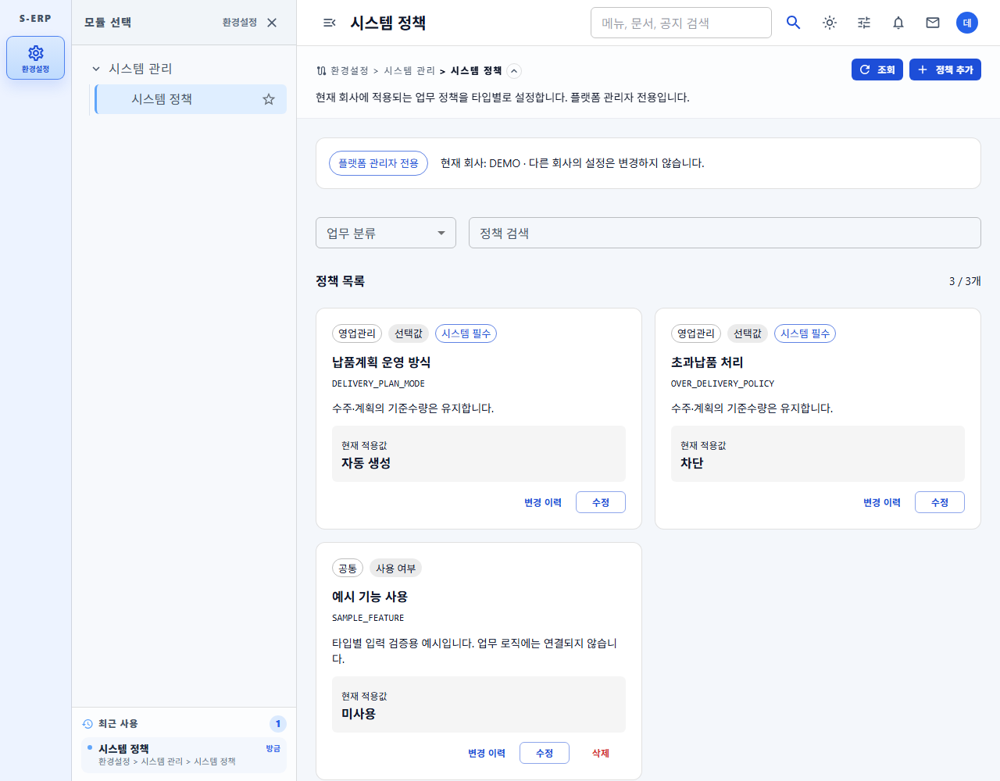

# 시스템 정책 관리 결과서

## 구현 범위

환경설정 > 시스템관리 > 시스템 정책에서 현재 로그인한 회사의 정책을 관리한다. 기존 중앙 DB → 테넌트 DB 복제·배포 구조를 사용하며 테넌트 선택, 계정 생성, 프로비저닝 기능은 추가하지 않는다.

플랫폼 관리자 역할과 메뉴 권한을 확인하고, 정책 검색·분류·등록·수정·삭제·변경 이력을 제공한다. 정책은 이름·고유 코드·업무 분류·설명·타입과 적용값을 가진다.

| 타입 | 편집 방식 |
| --- | --- |
| 사용 여부 | 사용/미사용 스위치. false도 명시값으로 보존 |
| 숫자 | 최솟값·최댓값·단위. 0도 명시값으로 보존 |
| 선택값 | 값/표시명 행 추가·삭제와 실제 적용값 선택 |
| 문자열 | 여러 줄 텍스트 |
| 날짜 | 날짜 선택 |
| 사용자 목록 | 현재 회사의 활성 사용자 검색·다중 선택. 빈 목록 허용 |

필수 시스템 정책은 정의와 삭제를 잠그고 값만 변경한다. 사용자 정의 정책은 생성 후 코드·타입을 고정한다. 저장 실패 시 입력을 보존하고, 미저장 상태로 닫을 때 확인한다. 저장·삭제 중 중복 요청을 막는다.

새 정책을 추가하는 것만으로 업무 로직이 자동 생성되지는 않는다. 해당 업무에서 정책을 읽도록 연동해야 한다는 안내를 화면에 표시한다. 임의 SQL·스크립트 실행은 지원하지 않는다.

## 기존 납품 정책

`DELIVERY_PLAN_MODE`, `OVER_DELIVERY_POLICY`는 기존 테넌트 컬럼 값을 보존한다. 기존 업무 서비스의 읽기 계약은 바꾸지 않고 화면 저장을 연결한다. 기존 계획이 있는 운영 모드 전환은 거부하며, 초과납품 차단 전환 시 기존 초과 실적을 삭제하거나 기준수량을 증액하지 않는다.

## DB 확인 범위

이번 작업에서 기본 읽기 전용 DB MCP의 `list_tables`, `describe_table(tb_tenant)`, `describe_table(tb_user)`, `describe_table(tb_role_menu_permission)`를 직접 호출했다. 정책 테이블은 없으며, 기존 납품·계획 테이블과 테넌트의 두 납품 정책 컬럼이 존재함을 확인했다. 업무 데이터 행이나 계정 정보는 조회하지 않았다.

에이전트는 실제 DB에 신규 DDL을 적용하지 않았다. 작업 시작 시 정책 테이블은 없었으나, 후속 MCP 메타데이터 확인에서는 정책·이력 테이블 존재가 확인되었다. 외부 반영 경위와 운영 적용 상태는 확인하지 않았으며, 에이전트가 배포한 것으로 간주하지 않는다. 중앙·기존 테넌트 배포는 운영 절차에 따라 진행해야 하며, 기본값 변경을 기존 테넌트에 자동 덮어쓰는 기능은 범위 밖이다.

구현 단계에서는 MCP `describe_table`로 메뉴·모듈·역할·권한·메뉴권한·계획헤더·즐겨찾기 구조를 추가 확인했다. 테넌트 관리자에게 기존 관리 메뉴 권한이 있더라도 정책 메뉴는 개인 메뉴 트리에서 제외하며, 모든 정책 API도 플랫폼 관리자 역할을 별도로 확인한다. 메뉴관리에서 메뉴 항목 자체를 조회하는 기존 동작은 변경하지 않았다.

## 저장 API 및 배포 파일

- 현재 테넌트 정책 CRUD·사용자 검색·최신 50건 이력을 제공한다. 정책의 JSON 타입 검증, 낙관적 버전 잠금, 변경 전후 스냅샷과 변경자·시각 기록은 서버에서 수행한다.
- 기존 두 납품 정책은 `tb_tenant` 값을 실제 적용값으로 사용하며 정책 저장 시 같은 트랜잭션으로 갱신한다. 납품 서비스·Mapper의 기존 읽기 계약은 바꾸지 않았다.
- [테이블·기본 정책 SQL](../../../database/20261105/20261105_004_create_system_policy_schema.sql), [메뉴·권한 SQL](../../../database/20261105/20261105_004_seed_system_policy_menu.sql), [스키마 이력](../../../database/20261105/20261105_004_change_system_policy_schema.md).
- [메뉴 롤백](../../../database/20261105/20261105_004_rollback_system_policy_menu.sql), [정책 스키마 롤백](../../../database/20261105/20261105_004_rollback_system_policy_schema.sql). 사용자 정의 정책·변경이력이 있으면 스키마 롤백을 차단하여 운영 데이터를 임의 삭제하지 않는다.
- 다섯 파일을 `docs/database`와 `backend/DATABASE`에 동일하게 보관했다. 중앙 DB를 복제하면 정책과 값도 함께 전달되며, 기존 DB에 신규 배포하거나 빈 DB에서 별도로 초기화하는 경우에는 해당 SQL 적용이 필요하다.

## 백엔드 검증

- 전체 `mvn -o -q test` 통과.
- 정책 Controller 7개, Service 16개, SQL 계약 5개, 메뉴 권한 회귀 13개 통과.
- 격리 PGlite PostgreSQL 엔진에서 스키마·기본값·메뉴권한·재실행·롤백 보호 등 59개 확인 통과. 운영 DB에는 적용하지 않았다.
- 신규 정책 및 메뉴·수주·납품계획 운영 Java 총 15파일을 `javac --release 8` argfile로 컴파일하여 Java 8 API 호환성을 확인했다.
- 프론트엔드 범위 검토에서 중요한 문제 없음.

최종 검토 보완으로 필수 정책의 이름·분류·설명 변경을 서버에서도 거부하고 기존 정의를 유지했다. 납품계획 생성은 테넌트 정책 행의 공유 잠금을 수주 잠금/계획 생성 전에 획득하고, 운영 방식 변경의 배타 잠금과 조정한다. 계획 생성이 먼저 완료되면 운영 방식 변경을 거부하며, 정책 변경이 먼저 완료되면 새 정책으로 생성 여부를 판단한다. 회귀 테스트를 먼저 추가하고 실패를 확인한 뒤 수정했으며 전체 Maven과 Java 8 검증을 재수행했다.

## 프론트엔드 검증

- 정책 화면 Vitest 10개 통과: 역할·메뉴 권한, 검색, 필수 정책 수정/삭제 제한, false·0·빈 배열 보존, 선택지와 숫자 범위 검증, 저장 실패 입력 보존, 닫기 확인, 삭제 확인·변경 이력.
- TypeScript + Vite build 통과. 신규 정책 파일 oxlint 경고·오류 없음.
- 375/768/1280px 실제 브라우저에서 6개 타입 등록, 납품 정책 변경, 이력 조회, 사용자 정의 정책 삭제를 합성 API로 확인했다. 페이지 오류와 페이지 전체 가로 넘침 없음.
- 브라우저 API는 합성 응답이며 실제 DB 저장·실서버 연동을 검증한 것으로 간주하지 않는다.
- 추가 실행한 `dashboard-data.test.tsx`, `menu-permissions.test.ts`에서 6개 실패가 있었다. 변경 전 HEAD의 `moduleDescriptors=[]`와 존재하지 않는 정적 `userMenuResponse`를 전제로 한 기존 테스트다. 이번 변경은 정책 콘텐츠 키만 추가했으며 해당 초기화 계약을 변경하지 않았다. 무관한 테스트·메뉴 초기화 코드는 수정하지 않았다.

## 스크린샷

모든 화면의 회사·사용자는 합성 예시이며 실제 테넌트 데이터가 아니다.

| 화면 폭 | 정책 목록 | 필수 정책 값 변경 | 숫자·범위·단위 | 사용자 다중 선택 |
| --- | --- | --- | --- | --- |
| 375px | [목록](screenshots/policies-375.png) | [편집](screenshots/policy-edit-375.png) | [숫자](screenshots/policy-number-375.png) | [사용자](screenshots/policy-users-375.png) |
| 768px | [목록](screenshots/policies-768.png) | [편집](screenshots/policy-edit-768.png) | [숫자](screenshots/policy-number-768.png) | [사용자](screenshots/policy-users-768.png) |
| 1280px | [목록](screenshots/policies-1280.png) | [편집](screenshots/policy-edit-1280.png) | [숫자](screenshots/policy-number-1280.png) | [사용자](screenshots/policy-users-1280.png) |

## 관련 문서

- [작업지시서](../../../directions/20261105/20261105_004_시스템정책_관리_작업지시서.md)
- [계획서](../../../plan/20261105/20261105_004_시스템정책_관리_계획서.md)
- [상세사양서](../../../spec/20261105/20261105_004_시스템정책_관리_상세사양서.md)
