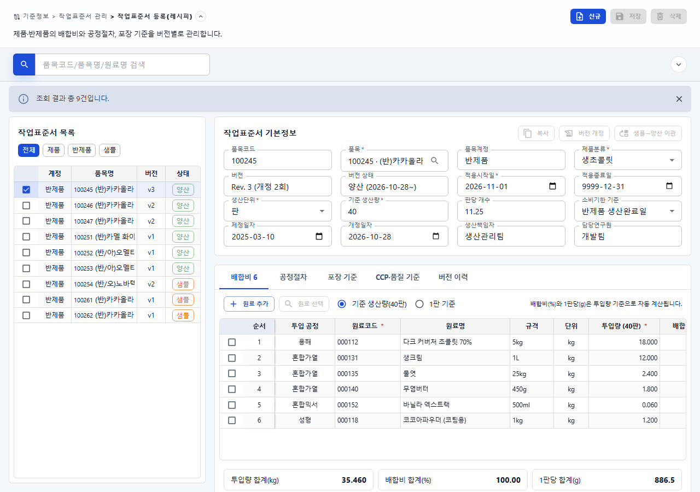
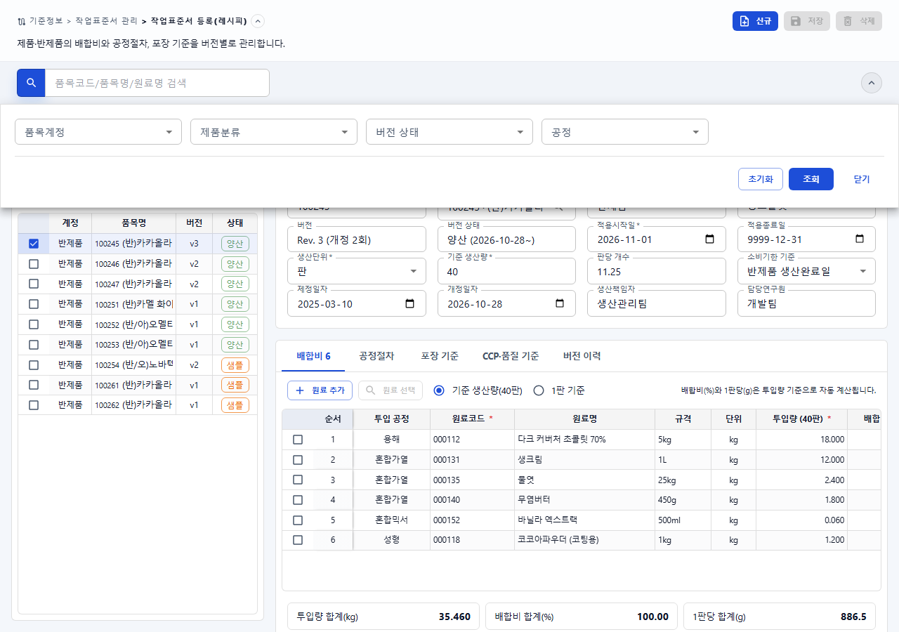
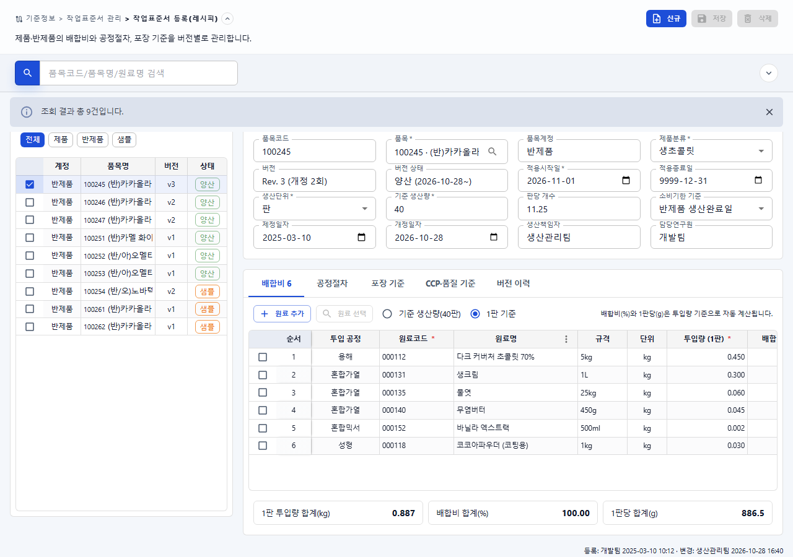
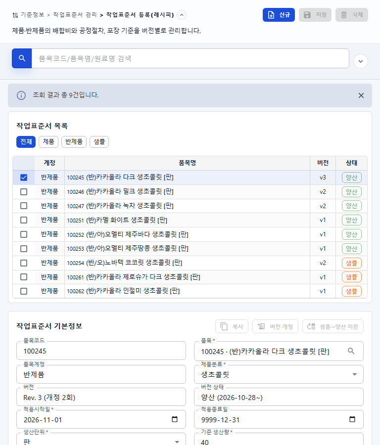
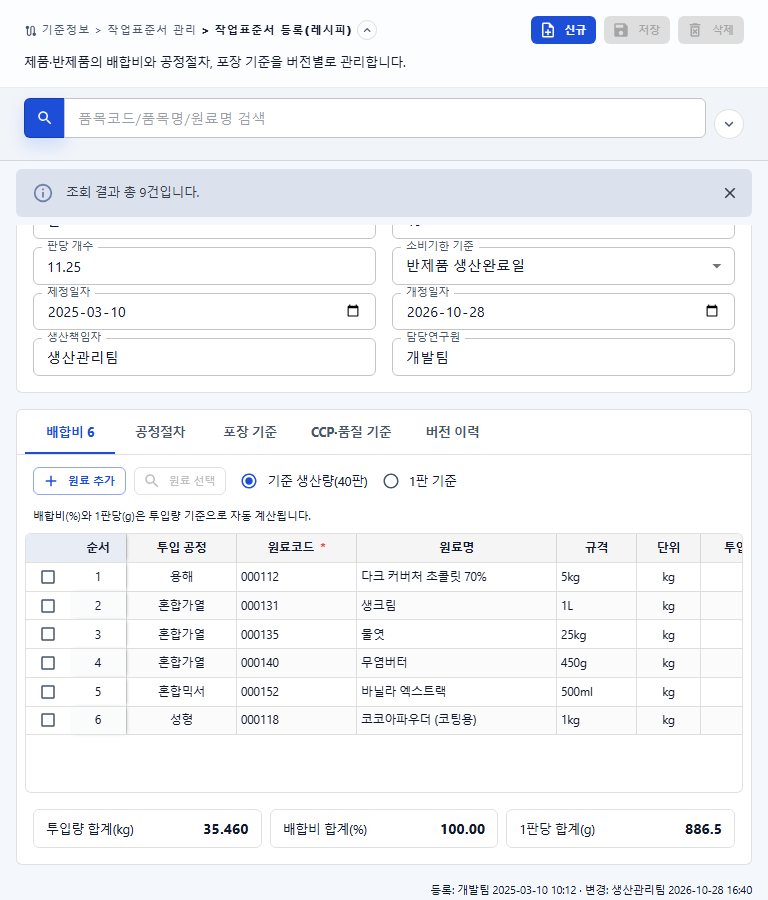
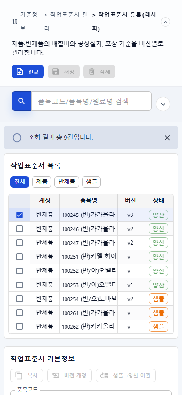
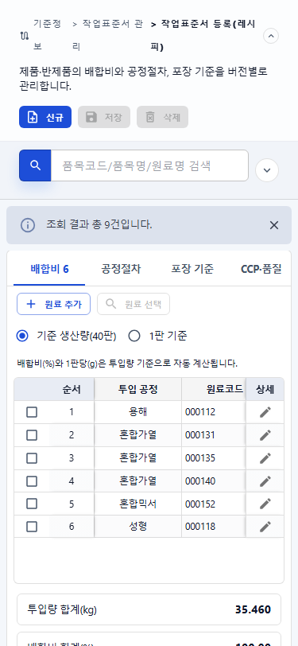
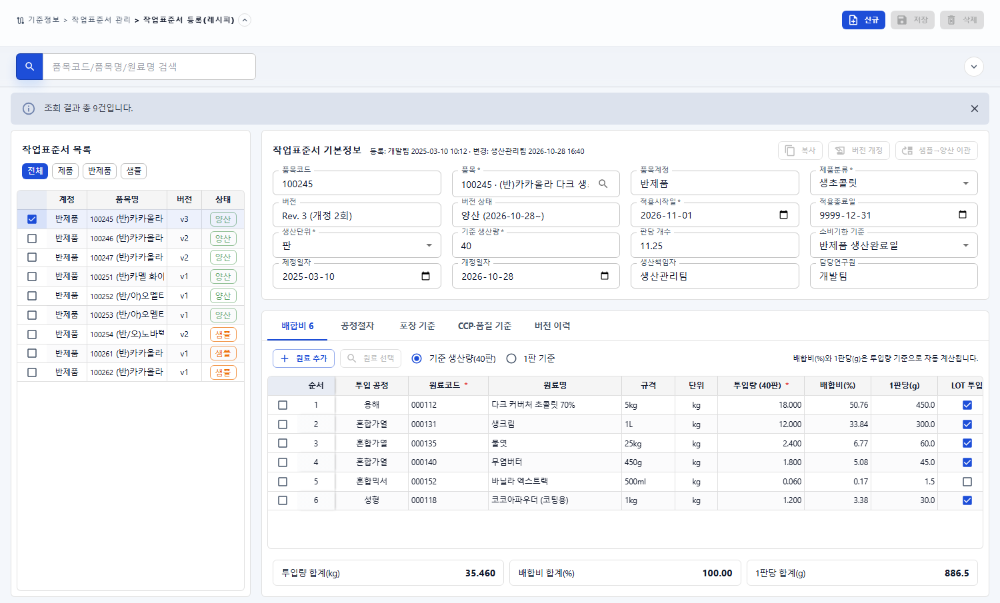
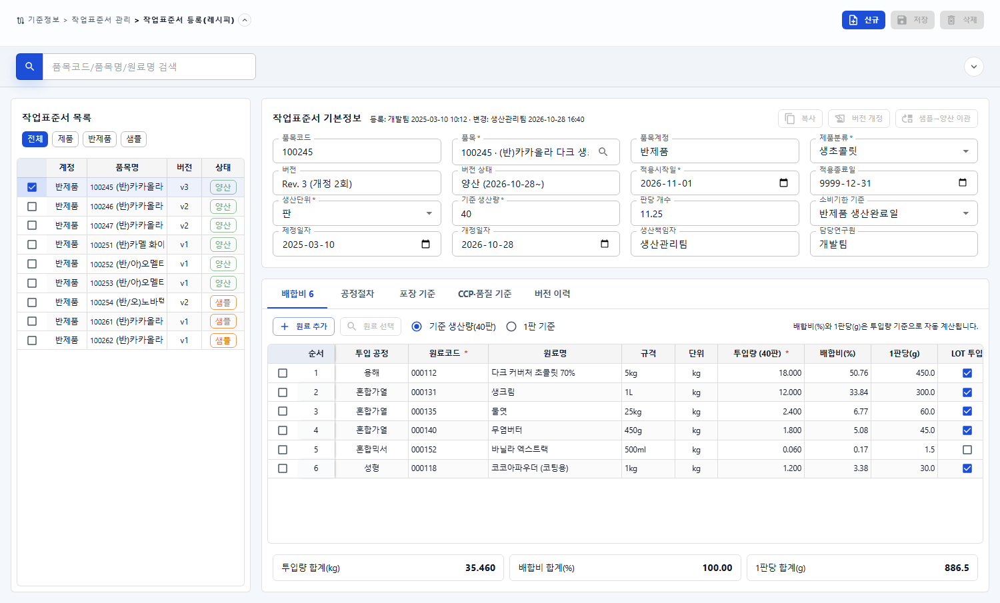

# 작업표준서 등록(레시피) 화면 결과

- 작업지시서: [20261111_003 작업지시서](../../../directions/20261111/20261111_003_작업표준서_등록_레시피_화면_작업지시서.md)
- 계획서: [20261111_003 계획서](../../../plan/20261111/20261111_003_작업표준서_등록_레시피_화면_계획서.md)
- 상세사양서: [20261111_003 상세사양서](../../../spec/20261111/20261111_003_작업표준서_등록_레시피_화면_상세사양서.md)

## 1. 작업 범위

- 메뉴 `기준정보 > 작업표준서 관리 > 작업표준서 등록(레시피)` 추가용 seed/rollback SQL 작성 (DB 미적용)
  - `docs/database/20261111/20261111_003_*`, `backend/DATABASE/20261111/20261111_003_*` 동일 보관, `db-schema.md` 변경 이력 추가
- 화면 `frontend/src/pages/co/work-standard/recipe/` 신규 구현 (pageKey `work-standard-recipe`)
  - 통합검색(품목코드/품목명/원료명) + 상세검색(품목계정·제품분류·버전 상태·공정)
  - 좌측 작업표준서 목록(F1Grid, 전체/제품/반제품/샘플 칩), 우측 기본정보(수주 기본정보와 동일한 Paper + 4열 그리드, 16개 필드)
  - 하단 탭: 배합비 n · 공정절차 · 포장 기준 · CCP·품질 기준 · 버전 이력 (배합비만 구현, 나머지는 "준비 중")
  - 배합비 F1Grid: 원료 추가/원료 선택(품목 picker), 투입량 기준(기준 생산량/1판 기준) 전환, 배합비(%)·1판당(g) 자동 계산, 합계
- `DashboardContent.tsx` 화면 분기, `dashboardData.tsx` 화면 제목/설명 추가
- F1Grid 공통 컴포넌트는 수정하지 않음 (컬럼 `getValue`/`editable`/`onValueChange`/`onOpenCodePicker`만 사용)

## 2. 샘플 대비 차이 및 제약

- 백엔드 미구현: 목록/상세는 `data/workStandard.data.ts` 예시 데이터 9건을 서비스 계층(`searchWorkStandards`)에서 반환. API 연결 시 서비스만 교체.
- 저장·삭제, 복사·버전 개정·샘플→양산 이관 버튼은 비활성 상태로 배치.
- 원료/품목 선택은 기존 품목관리 API(`fetchMaterials`)를 사용하는 공통 MaterialPicker 재사용.
- 엑셀 내보내기는 제외.

## 3. DB MCP 확인 근거

- `s-erp-postgresql-readonly`로 `tb_menu` 컬럼, CO 모듈 메뉴(CO_COMMON sort 1, CO_WORKFLOW sort 2, CO_MATERIAL 등), `tb_permission` 코드(READ/CREATE/UPDATE/DELETE 사용) 확인.
- `CO_WORK_STD*` 또는 `/co/work-standard*` 메뉴가 기존에 없음을 확인. seed는 신규 루트(sort 2)를 추가하고 CO_WORKFLOW를 3으로 이동.
- 작업표준서 업무 테이블은 아직 없으며 이번 작업에서 생성하지 않음.

## 4. 검증

| 항목 | 명령/방법 | 결과 |
| --- | --- | --- |
| 단위·화면 테스트 | `npm run test -- tests/work-standard-recipe-page.test.tsx` | 5건 통과 |
| 빌드 | `npm run build` | 통과 |
| 브라우저 | Vite(127.0.0.1:4173)에서 임시 하네스로 화면만 렌더링(메뉴 seed 미적용·로그인 불필요), 확인 후 하네스 파일 삭제 | 1280/768/375px 가로 넘침 0px, 콘솔 오류 없음 |

- 테스트 범위: 키워드(원료명 포함)·상세검색·구분 칩 필터, 첫 행 자동 선택 및 행 선택 시 기본정보/배합비 갱신, 배합비(50.76%)·1판당(450g)·합계(35.460kg/100.00%/886.5g) 계산, 신규 초기화, 저장·삭제 비활성.

## 5. 스크린샷

| 화면 | 파일 |
| --- | --- |
| 데스크톱 기본 |  |
| 상세검색 열림 |  |
| 1판 기준 전환 |  |
| 태블릿 |   |
| 모바일 |   |
| 레이아웃 보정 후 |  |
| 결과 메시지 닫힘 |  |

### 5.1 레이아웃 보정 (사용자 피드백 반영)

| 문제 | 원인 | 조치 |
| --- | --- | --- |
| 결과 메시지와 본문 폭 불일치 | 본문 영역에만 세로 스크롤바가 생겨 본문 폭이 스크롤바만큼 줄어듦 | 메시지를 본문과 같은 스크롤 컨테이너 안으로 이동 |
| 메시지 닫으면 상단 여백 없이 잘림 | 결과 메시지 표시 여부와 무관하게 본문 상단 여백을 0으로 고정 | 본문 `pt: 2` 고정, 메시지가 있을 때만 `PageMessageArea` 인접 형제 규칙으로 0 처리 |
| 좌우 패널 높이 불일치 | 우측 하단 등록/변경 이력 문구가 우측 높이를 늘림 | 이력 문구를 기본정보 제목 옆으로 이동 |

- 검증: 1500px에서 메시지·본문 좌우 경계 16/1484px 일치, 좌우 패널 top/bottom 동일, 메시지 닫은 뒤 상단 여백 16px 확인, 768/375px 가로 넘침 0px, 테스트 5/5·`tsc -b` 통과.

## 6. 후속 작업

- 작업표준서 테이블/API 설계 및 서비스 계층 교체, 저장·삭제·버전 업무 버튼 활성화
- 공정절차·포장 기준·CCP·품질 기준·버전 이력 탭 구현
- 메뉴 seed SQL 운영 DB 적용

## 7. 커밋 제안

```text
feat: 작업표준서 등록(레시피) 화면 레이아웃 추가

- 기준정보 > 작업표준서 관리 메뉴 seed/rollback SQL 추가
- 통합검색·상세검색, 작업표준서 목록, 기본정보 화면 구성
- 배합비 탭 F1Grid 및 배합비/1판당 자동 계산 구현 (백엔드 연결 전 예시 데이터)
```
