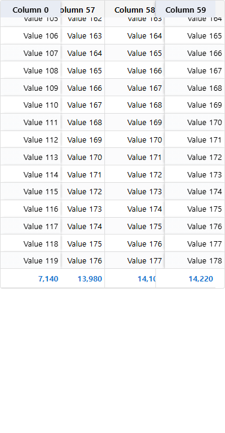
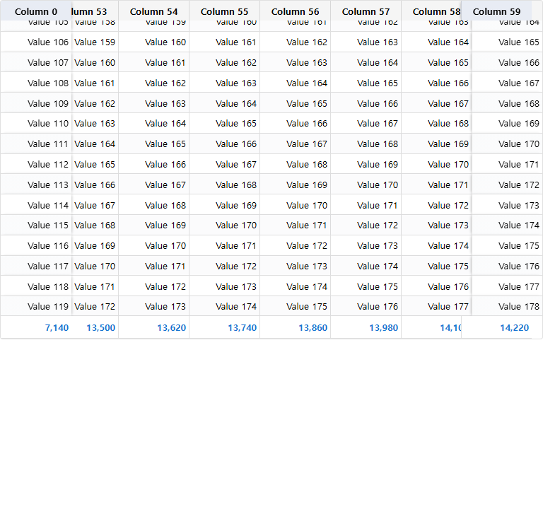
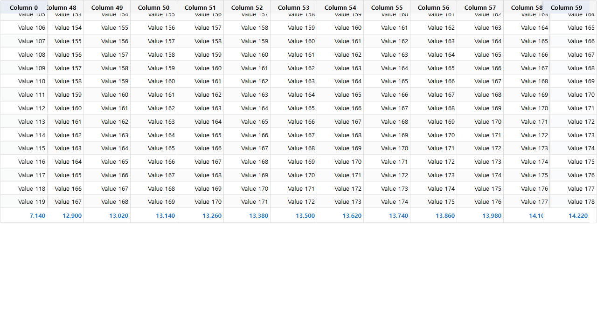

# F1-Grid 다중 컬럼 가로 스크롤 개선 결과

- [작업지시서](../../../directions/20261117/20261117_012_f1grid-horizontal-scroll_작업지시서.md)
- [계획서](../../../plan/20261117/20261117_012_f1grid-horizontal-scroll_계획서.md)
- [상세사양서](../../../spec/20261117/20261117_012_f1grid-horizontal-scroll_상세사양서.md)

## 재현과 원인

120행 × 60열(100px), 좌우 고정과 하단 합계를 가진 합성 데이터에서 조사했다. 본문이 1,200px를 헤더/합계에 동기화한 뒤 1,240px로 더 이동하면, 대기 중인 헤더/합계 scroll 이벤트가 본문을 1,200px로 되돌렸다.

컬럼 가상화는 실제 viewport가 이미 렌더된 열 안에 있어도 overscan 집합이 바뀔 때마다 셀을 교체했다. 200행 미만의 넓은 표는 모든 행을 DOM에 유지하므로 새 컬럼 하나에도 화면 밖 행의 셀까지 생성했다.

## 변경

- 헤더/합계에 마지막으로 쓴 실제 위치를 기록해 프로그램 동기화의 후속 이벤트와 직접 입력을 구분했다. 직접 헤더/합계 이동은 본문과 다른 영역에 즉시 전파한다.
- 기존 가상 열 집합이 viewport와 고정/보호 열을 충족하면 재사용한다. 범위 이탈 시 기존 overscan을 포함해 최신 위치로 교체한다.
- 컬럼 너비·viewport·고정/보호 설정 변경 시 이전 창을 무효화한다. React 상태를 갱신하지 않은 이동도 별도 위치 ref에 기록해 리사이즈 시 과거 위치로 계산하지 않는다.
- 자동 행 가상화에 1,000셀 기준을 추가했다. 병합 컬럼이 있는 표는 새 기준에서 제외하고 기존 200행 기준을 유지한다. 명시적 `virtualizeRows={false}`도 유지한다.
- 기존 네이티브 스크롤, sticky 고정, 편집/선택/복사, 집계 및 API 계약을 유지했다. 별도 애니메이션이나 debounce는 추가하지 않았다.

## 측정

Chromium 개발 서버, 1280 × 720px, 120행 × 60열, 90프레임 동안 12px씩 총 1,068px 이동한 관측값이다. 초기 마운트는 제외했다. 시간과 프레임 간격은 환경 영향을 받으며 고정 FPS나 모든 업무 화면의 동일 성능을 보장하지 않는다.

| 항목 | 수정 전 | 수정 후 |
| --- | ---: | ---: |
| React commit | 18회 | 3회 |
| 누적 React 렌더 시간 | 약 1,803ms | 약 181ms |
| 이동 후 본문 셀 DOM | 2,400개 | 380개 |
| 본문 childList mutation 기록 | 2,160건 | 266건 |
| 지연 이벤트 이후 본문 위치(기대 1,240px) | 1,200px | 1,240px |

열 버퍼 재사용만 적용했을 때도 commit은 3회였지만 단일 렌더 지연이 남았다. 추가 행 가상화로 화면 밖 셀 생성 비용을 줄였다. 병합 표와 명시적 가상화 해제 표에는 이 추가 최적화를 강제하지 않는다.

## 검증

- 수정 전 새 회귀 테스트에서 버퍼 내부 이동의 추가 commit, 헤더/합계 후속 이벤트의 rollback, 직접 입력 전파 지연을 확인했다.
- 추가 행 가상화 테스트의 `120행 전체 렌더 → 30행 미만 기대` 실패를 확인한 뒤 수정했다. 병합 표 보존과 최신 가로 위치에서 리사이즈하는 테스트도 각각 실패를 확인한 뒤 수정했다.
- 최종 Vitest: **8파일, 305개 통과**.

```powershell
cd frontend
node node_modules\vitest\vitest.mjs run tests\f1-grid.test.tsx tests\f1-grid-virtualization.test.ts tests\f1-grid-render-performance.test.tsx tests\f1-grid-summary.test.tsx tests\f1-grid-pinned-column-range.test.tsx tests\f1-grid-row-merge-regression.test.tsx tests\f1-grid-form-modal.test.tsx tests\f1-grid-row-selection.test.tsx --reporter=dot
node --test tests\f1-grid-smooth-scroll.browser.mjs
```

- 실제 브라우저: **375/768/1280px 모두 통과**. 연속 전진/역방향 이동, 실제 wheel 입력, viewport 열 누락 없음, 헤더/본문/합계 정렬 오차 1px 이내, 좌우 고정, 양 끝 이동, 마지막 119번 행 접근 및 페이지 외부 가로 overflow 없음을 확인했다.
- 가상화로 DOM에서 빠진 행을 포함한 `Column 5` 합계 7,740을 확인했다.
- 변경 파일 lint: 종료 코드 0. 기존 effect/state 및 hook dependency 경고 11건은 남아 있으며 이번 변경에 의한 새 경고는 없다.
- `npm run build`: **종료 코드 2, 기존 별도 변경의 TypeScript 계약 오류로 차단**. `CommonCodeManagementPanelProps.searchQuery`, 공통코드 `headerName`/`moduleCd` 누락, 기존 `F1GridColumn.options` 제거에 따른 사용처 오류 등이 있다. 본 작업에서 해당 소스/타입을 수정하지 않았다.
- `node node_modules\vite\bin\vite.js build --logLevel error`: 종료 코드 0. 프로덕션 번들 생성은 통과했지만 전체 TypeScript 빌드 통과로 간주하지 않는다.
- 폼 테스트의 기존 MUI select out-of-range 경고는 남아 있다.
- 이미 실행 중이던 4173 Vite 서버를 확인해 재사용했다. 기존 서버는 종료하지 않았다. 임시 진단 브라우저 탭과 자체 실행한 Playwright 브라우저는 종료했다.

## 스크린샷







## 범위와 종료 확인

- 기능 문서: `frontend/src/pages/f1-grid-docs/F1-GRID.md` 갱신.
- 운영 코드: F1Grid와 GridVirtualization만 변경. 다른 작업의 기존 변경을 되돌리거나 수정하지 않았다.
- 백엔드/API/DB 변경 없음. DB MCP/SQL 스크립트 대상이 아니다.
- 코드·회귀 테스트·반응형 스크린샷·결과 문서를 함께 남겼다. 전체 빌드의 별도 기존 오류는 위 제약으로 명시했다.
- 본 세션에서는 커밋·푸시·병합을 실행하지 않았다.

## 복사용 커밋 메시지

```text
fix: F1-Grid 가로 스크롤 끊김 개선

- 헤더·합계 동기화 이벤트의 본문 위치 되돌림 방지
- 가상 열 버퍼 재사용과 다중 컬럼 표의 행 렌더 비용 제한
- 스크롤·병합·리사이즈 회귀 및 반응형 검증 문서 추가
```
