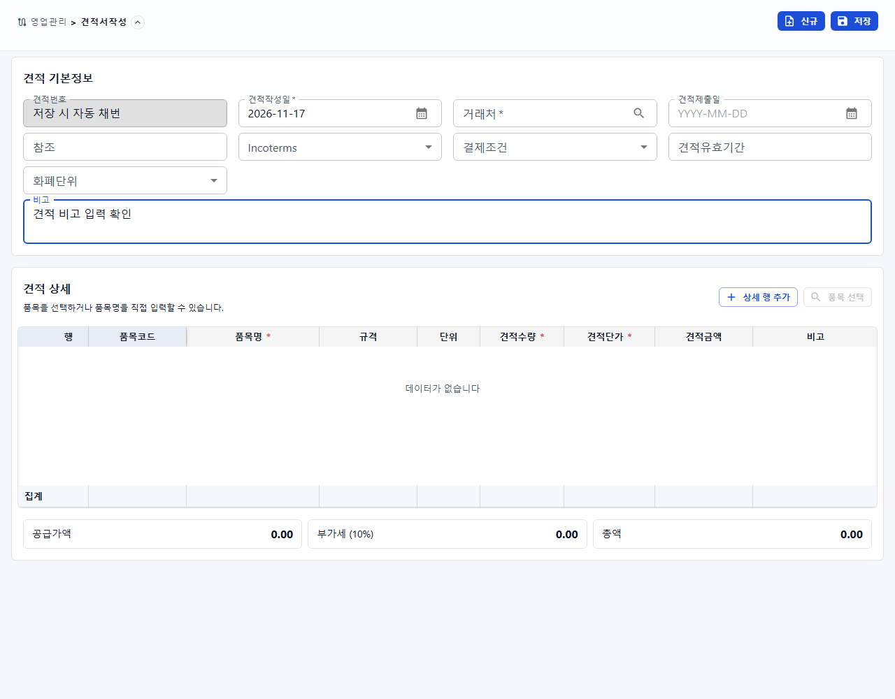
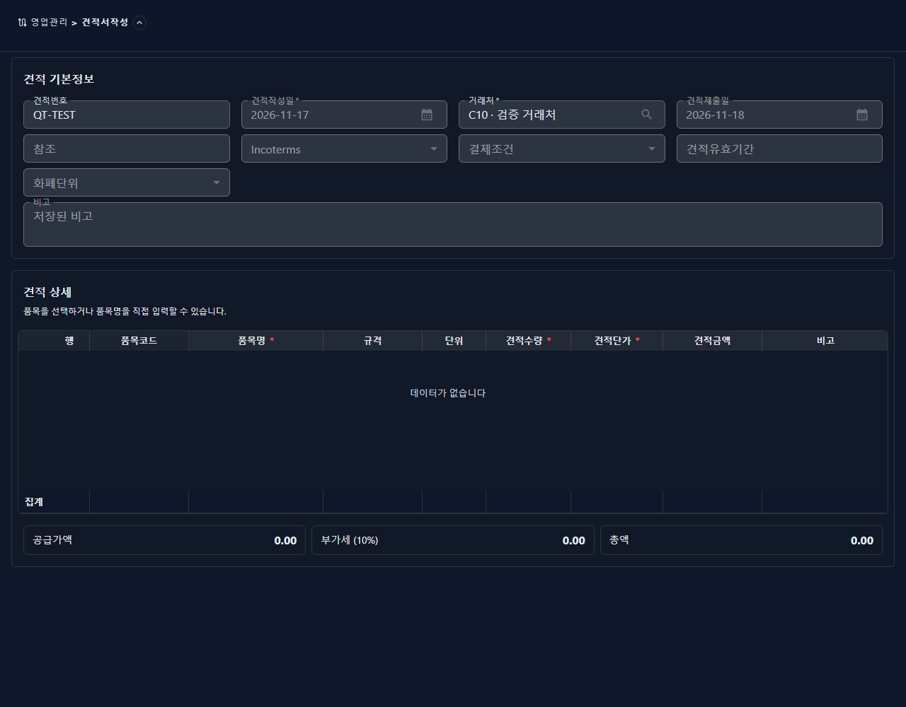

# 편집 가능 비고 읽기전용 배경 수정 결과

## 범위와 원인

- 견적작성의 비고는 권한에 따라 정상적으로 편집 가능했지만 읽기전용 배경색이 표시되었다.
- MUI는 multiline 높이 측정용으로 `aria-hidden="true" readonly`인 textarea를 추가한다. 공통 테마의 `:has(textarea[readonly])`가 이 숨김 요소까지 탐지한 것이 원인이다.
- 공통 테마의 textarea 탐지에서 해당 숨김 요소만 제외했다. 견적 권한, 입력값, 저장 로직, 실제 readOnly/disabled 배경 및 마스터 선택 예외는 변경하지 않았다.
- 공통 multiline 스타일 수정이며 F1-Grid 자체의 기능·옵션·이벤트는 변경하지 않았다. 기존 F1-Grid 폼의 읽기전용 회귀 테스트도 통과했다.
- 백엔드·DB·API 계약 변경은 없으므로 SQL 및 DB MCP 확인 대상은 없다.

## 검증

- 수정 전 `readonly-form-fields.test.tsx`: light/dark 신규 회귀 테스트 2개 실패로 재현, 기존 18개 통과.
- 수정 후 아래 5개 파일 총 32개 테스트 통과.

```powershell
cd frontend
npm run test -- tests/readonly-form-fields.test.tsx tests/theme-radius.test.ts tests/theme-settings.test.tsx tests/quotation-create-page.test.tsx tests/quotation-status-page.test.tsx
```

- 신규 회귀 테스트에서 편집 가능 multiline 입력 및 배경, 실제 readOnly/disabled multiline 배경을 light/dark 각각 확인했다.
- `node tests\quotation-remark-color.browser.mjs`: 실제 견적 컴포넌트와 공통 테마를 사용하고 합성 API 응답으로 검증했다. light/dark × 작성/상세보기 × 375/768/1280px 총 12개 조합 통과.
- 작성 시 비고 직접 입력과 참조 입력과의 배경 일치, 상세보기 시 비활성 및 읽기전용 배경 유지, 숨김 측정 textarea 존재, 페이지 가로 overflow 없음, 브라우저 오류 없음을 확인했다.
- `npm run build` 통과.
- `npm run lint -- src\theme\theme.ts tests\readonly-form-fields.test.tsx tests\quotation-remark-color.browser.mjs` 통과.
- `git diff --check` 통과. 공유 중인 기존 개발 서버를 재사용했으며 시작·종료하지 않았다.

## 화면

전체 12개 화면은 [screenshots](screenshots)에 보관한다.

| 구분 | 375px | 768px | 1280px |
| --- | --- | --- | --- |
| Light 작성 | [보기](screenshots/remark-light-create-375.png) | [보기](screenshots/remark-light-create-768.png) | [보기](screenshots/remark-light-create-1280.png) |
| Light 상세 | [보기](screenshots/remark-light-view-375.png) | [보기](screenshots/remark-light-view-768.png) | [보기](screenshots/remark-light-view-1280.png) |
| Dark 작성 | [보기](screenshots/remark-dark-create-375.png) | [보기](screenshots/remark-dark-create-768.png) | [보기](screenshots/remark-dark-create-1280.png) |
| Dark 상세 | [보기](screenshots/remark-dark-view-375.png) | [보기](screenshots/remark-dark-view-768.png) | [보기](screenshots/remark-dark-view-1280.png) |




## 커밋 참고

커밋·푸시는 보류 상태이며 이번 수정 과정에서도 실행하지 않았다. 관련 없는 다른 작업은 수정하지 않았다.

```text
fix: 편집 가능한 비고의 읽기전용 배경 오적용 수정

- multiline 높이 측정용 숨김 textarea를 읽기전용 탐지에서 제외
- light/dark 입력 상태 회귀 테스트와 견적 화면 검증 추가
```
