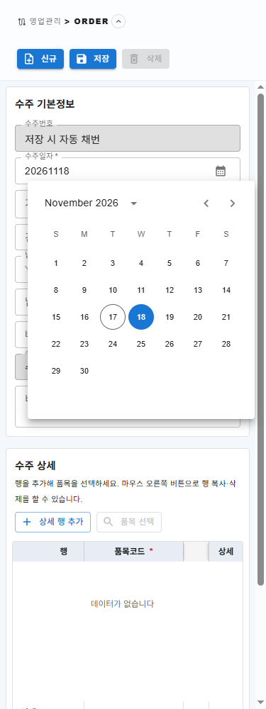
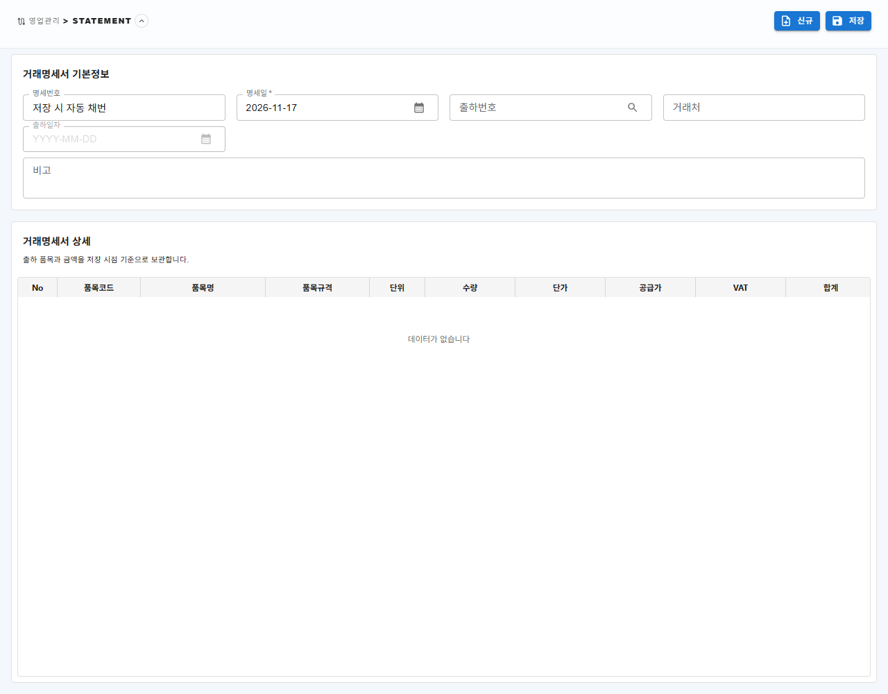

# 영업관리 폼 공통 날짜 입력 결과

## 범위와 결과

- [작업지시서](../../../directions/20261117/20261117_003_sales-form-datefield_작업지시서.md), [계획서](../../../plan/20261117/20261117_003_sales-form-datefield_계획서.md), [상세사양서](../../../spec/20261117/20261117_003_sales-form-datefield_상세사양서.md).
- 수주일자·납기일자, 출하일자, 명세일을 공통 `DateEditor` outlined 입력으로 전환했다. 원천 출하일자도 비활성 공통 입력기로 표시한다.
- 별도 진행 중인 견적 폼 전환을 보존하고 두 날짜 입력에 공통 `disabled`를 연결했다. 견적 레이아웃·품목 입력 변경은 이 작업의 결과로 산정하지 않는다.
- 등록 폼을 재사용하는 현황 상세·수정에도 적용된다. 이미 공통 날짜 입력을 사용하는 검색과 출하계획의 날짜 셀은 기존 동작을 유지한다.
- blur 및 저장 직전에 축약 날짜를 ISO로 정규화하고 무효 날짜는 원문을 유지한 채 저장을 차단한다. 필수/선택, 기본값, 기존 저장 payload와 권한 정책을 유지했다.
- 공통 `DateEditor`의 선택적 `disabled`는 입력·버튼을 함께 비활성화하고 열린 달력도 닫는다. 기본 셀 편집 동작은 변경하지 않았다.

## 회귀 조건과 보완

- 기존 폼은 브라우저 네이티브 date 입력을 사용해 공통 달력·축약 입력 동작이 일관되지 않았다.
- 네이티브 입력을 텍스트 기반 공통 편집기로 바꾸면 잘못된 문자열도 입력할 수 있으므로 blur와 저장 각각에서 실제 날짜 검증이 필요하다.
- 수주일 오류만 조기 반환하면 거래처·상세 필수 오류가 함께 표시되지 않는 문제를 회귀 테스트로 확인하여, 기존 전체 필수 검증을 유지하도록 보완했다.
- 수주일 입력의 정규식 접근성 조회는 새 달력 버튼 이름에도 일치하므로 테스트에서 `input` selector를 명시했다.
- 검증 항목: 축약 입력 blur 확정, blur 없는 저장 ISO payload, 무효/누락 날짜 차단, 원문 보존, 선택 납기일 정책, 조회 전용 버튼, 열린 달력의 비활성 전환.

## 실행 검증

모든 명령은 `frontend`에서 실행했다.

| 검증 | 결과 |
| --- | --- |
| 구현 전 폼·공통 편집기 회귀 테스트 | 예상한 날짜 입력·달력·비활성화 실패 14개 확인 |
| `date-editor`, 수주등록, 출하, 거래명세서, 견적작성·현황, 상세검색 테스트 | 94개 중 91개 통과 후 시간 제한/비동기 대기 실패 3개를 격리 재실행하여 모두 통과 |
| 수주현황·출하계획 테스트 격리 실행 | 48개 통과 |
| `f1-grid.test.tsx` 날짜 편집 선택 실행 | 7개 통과 |
| `npm run build` | 통과 |
| 변경 파일 oxlint | 오류 없음. 기존 mixed export 및 effect 내 setState 패턴 경고 유지 |
| `git diff --check` | 통과 |

최종 실행 예시:

```powershell
node .\node_modules\vitest\vitest.mjs run tests/date-editor.test.tsx tests/sales-order-create-page.test.tsx tests/sales-delivery-page.test.tsx tests/sales-statement-page.test.tsx tests/quotation-create-page.test.tsx tests/quotation-status-page.test.tsx tests/page-search-area-detail.test.tsx --maxWorkers=2 --testTimeout=20000 --reporter=dot
node .\node_modules\vitest\vitest.mjs run tests/sales-order-create-page.test.tsx tests/quotation-status-page.test.tsx -t 'keeps entered data and prevents duplicate|shows save failure and retains|requires a date range' --maxWorkers=1 --reporter=default
node .\node_modules\vitest\vitest.mjs run tests/sales-order-status-page.test.tsx tests/sales-delivery-plan-page.test.tsx --maxWorkers=1 --testTimeout=20000 --reporter=default
node .\node_modules\vitest\vitest.mjs run tests/f1-grid.test.tsx -t 'supported date|date cell|edits dates|date text|date and time editors|date/time editors' --maxWorkers=1 --reporter=default
npm run build
```

넓은 병렬 실행에서는 기존 5/10초 테스트 제한 및 비동기 조회 대기 실패가 발생했다. 코드 검증 오류는 수정했고, 나머지 실패는 단독/저병렬 실행에서 통과했다. 전체 저장소 테스트를 실행했다는 의미는 아니다.

## 실제 브라우저

- 기존 `http://127.0.0.1:4173` 개발 서버를 재사용했다. 서버는 이 작업에서 시작하지 않았으므로 종료하지 않았다.
- Orca의 별도 검증 탭에서 실제 페이지 컴포넌트를 렌더링하고, 업무 API 응답은 합성 값으로 격리했다. 저장·DB 변경은 수행하지 않았다.
- 375/768/1280px에서 네 업무 폼의 날짜 텍스트 입력, 달력 버튼, 입력·아이콘 비겹침 및 페이지 가로 넘침 없음을 확인했다.
- 네 폼의 달력 열기 및 화면 내 배치를 확인하고, 모바일 수주일 달력 선택 결과와 명세일 `20261118` 입력 후 blur의 `2026-11-18` 확정을 확인했다.
- 검증 탭은 종료했다. 테스트용 소스/테넌트 데이터는 결과에 포함하지 않았다.

| 업무 | 375px | 768px | 1280px |
| --- | --- | --- | --- |
| 견적 | [화면](screenshots/quotation-375.png) | [화면](screenshots/quotation-768.png) | [화면](screenshots/quotation-1280.png) |
| 수주 | [화면](screenshots/order-375.png) | [화면](screenshots/order-768.png) | [화면](screenshots/order-1280.png) |
| 출하 | [화면](screenshots/delivery-375.png) | [화면](screenshots/delivery-768.png) | [화면](screenshots/delivery-1280.png) |
| 거래명세서 | [화면](screenshots/statement-375.png) | [화면](screenshots/statement-768.png) | [화면](screenshots/statement-1280.png) |





## 변경 제외 및 최종 점검

- 백엔드·API·DB 스키마 변경 없음. DB MCP/SQL/롤백 절차는 대상이 아니다.
- 다른 작업의 견적·출하계획·구매자재·테마·설정 변경은 되돌리거나 이 작업에 포함하지 않았다.
- 작업지시서 → 계획서 → 상세사양서 → 테스트·구현 → 결과/스크린샷 순서를 확인했다.
- 공통 F1-GRID 문서에 업무 폼 재사용과 비활성화 계약을 추가했다.
- 실제 커밋·푸시·브랜치 변경은 수행하지 않았다.

## 복사 가능한 커밋 문구

제목: `fix(sales): 폼 날짜 입력을 공통 DateEditor로 통일`

내용:

```text
- 수주·출하·명세서 폼에 공통 달력과 축약 날짜 입력 적용
- 저장 직전 날짜 정규화·검증 및 읽기 전용 달력 차단
- 견적 날짜 비활성화 연동, 회귀 테스트·문서·스크린샷 추가
```
