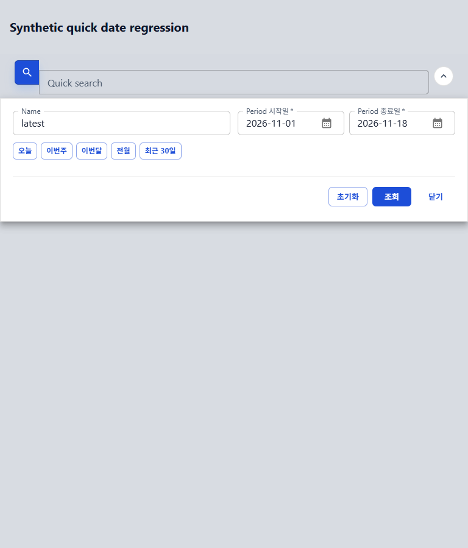
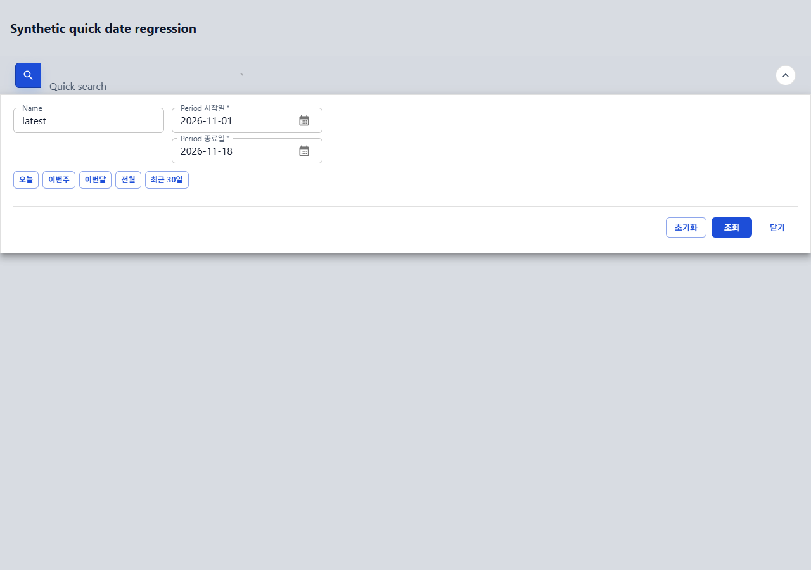

# 공통 빠른 날짜 경합 수정 결과

## 결과와 원인

- PageSearchArea 내부에 날짜 필드별 요청 토큰과 최신 draft ref를 추가했다. await 이전 closure가 전체 draft를 다시 쓰던 경합을 제거했다.
- 다른 조건은 최신 값과 병합하고, 같은 날짜의 직접 수정·후속 요청은 이전 응답보다 우선한다.
- 초기화·두 닫기 경로·외부 복원·unmount 뒤 응답과 구 요청 오류는 무시한다. 같은 값의 controlled echo와 서로 다른 날짜 필드는 서로 방해하지 않는다.
- 공개 props/callback, API/DB 계약, 서버 날짜 계산, 조회 정책, 기존 Portal backdrop과 레이아웃은 변경하지 않았다. 백엔드·SQL 변경은 없다.

## 회귀 검증

- 운영 수정 전 deferred 회귀 **10개가 모두 실패**했다. 단순히 최신 서버 값을 반환하는 fixture가 아니라 실제로 응답을 보류하고 그 사이 입력·요청·수명주기를 바꾼다.
- 수정 후 상세검색 43개, 일반 검색 2개, 기본값 6개, 기본값 hook 3개: **54/54 통과**, 제외 없음.
- typecheck/lint exit 0. lint 경고는 별도 최종 검사에서 집계한다.
- 검증 worktree의 PageSearchArea는 기존 bf6cf0bb Portal 변경을 포함한 소스로 명시 갱신했다. 이전 22bd60b8 전체 실행까지 이 변경이 검증됐다고 표현하지 않는다.

## 실제 브라우저

- 실제 PageSearchArea와 합성 조건·지연 날짜 응답을 격리 profile에서 렌더했다. 다른 필드 입력 `latest` 보존, 수동 시작일 `2026-11-01` 보존을 375/768/1280px에서 확인했다.
- 표준 `searchField`를 제공한 호스트의 문서 scrollWidth는 각각 375/768/1280px로 페이지 가로 넘침이 없었다. 세 스크린샷을 열어 값과 버튼 표시를 확인했다.
- Orca가 사용자의 진행 중인 IME 입력 보호로 native click을 거부해, 소유 격리 탭에서 DOM click/input 이벤트로 React 처리 경로를 실행했다. 실제 native 키보드·마우스 입력 검증이라고 표현하지 않는다.
- 최초의 빠른 검색 슬롯 없는 합성 호스트에서는 375px에 391px 가로 넘침이 있었다. 기존 별도 호스트 모드의 레이아웃 문제로 분리하며 이번 경합 수정에서 고치거나 모든 호스트 모드가 반응형이라고 주장하지 않는다.
- 임시 HTML, 소유 탭/profile을 제거했다. 공유 서버는 HTTP 200을 유지했다. 인증·실 데이터는 사용하지 않았다.

| 폭 | 증거 |
| --- | --- |
| 375 |  |
| 768 |  |
| 1280 |  |

## 복사용 커밋 문구

```text
fix: 빠른 날짜 지연 응답의 검색조건 덮어쓰기 방지

- 최신 draft와 날짜 필드별 요청 토큰으로 입력 보존
- 초기화·닫기·복원 이후 구 응답과 오류 무시
- deferred 회귀와 합성 반응형 브라우저 증거 추가
```

커밋은 생성하지 않았다.
