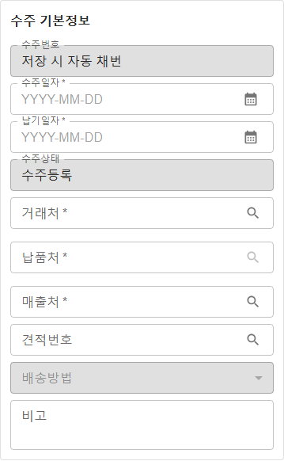
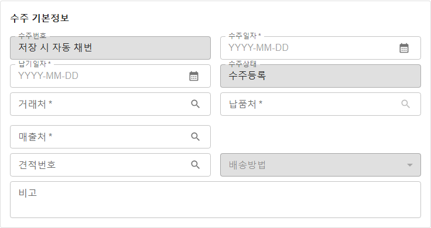
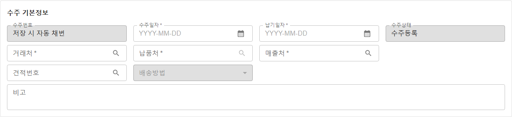

# 수주등록 필드 배치 결과

- [작업지시서](../../../directions/20261123/20261123_006_수주등록_필드배치_작업지시서.md)
- [계획서](../../../plan/20261123/20261123_006_수주등록_필드배치_계획서.md)
- [상세사양서](../../../spec/20261123/20261123_006_수주등록_필드배치_상세사양서.md)

## 변경

수주번호·수주일자·납기일자·수주상태, 거래처·납품처·매출처, 견적번호·배송방법, 비고 순서로 재배치했다. 세 picker를 수주번호와 동일한 그리드 폭으로 맞췄다. 기존 납기일자 명칭 및 입력·저장 기능은 유지했다.

## 검증

- 필드 순서 회귀 테스트가 변경 전 실패하고 변경 후 통과했다.
- 수주등록 및 스크롤 Vitest 39건 통과. 등록과 현황 상세에서 공유하는 컴포넌트의 수정·읽기 전용 및 저장 테스트 포함.
- 프론트엔드 빌드 성공. 기존 번들 크기 경고가 출력됐다.
- 변경 TSX lint 오류 없음. 기존 `set-state-in-effect` 경고 1건이 출력됐다.
- 격리된 테스트 데이터로 Chromium 등록 화면에서 375/768/1280px의 겹침, 페이지 가로 넘침, picker와 수주번호의 너비를 확인했다. 1280px에서 지정된 행 배치도 확인했다. 현황 상세 다이얼로그의 실제 브라우저 비교는 수행하지 않았다.

## 커밋 문구

제목: `수주등록 기본정보 필드 배치 변경`

내용: `수주 기본정보 행 순서와 거래처 관련 필드 너비를 정렬한다.`
